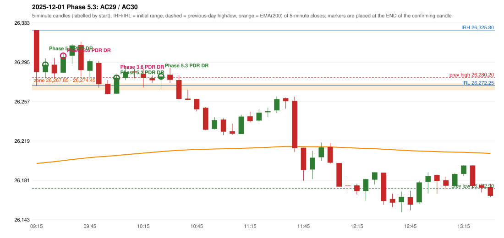

# 2025-12-01 - Phase 5.3 original versus author-corrected signals

> Signal-level comparison only: no controller, no fills, no P&L. Provisional conventions are labelled.

## AC29 (PDF page 5) - topic `PDR_FIRST_ELIGIBLE`

> Early entry should take place in 1st green candle

* Phase 3.6 automated signal: PDR PDR 09:35; entry candle OHLC 26284.75/26303.95/26284.55/26300.15
* Phase 3.6 signals to 13:00: 09:35 PDR/PDR; 10:05 PDR/PDR; 10:30 PDR/PDR
* Phase 5.3 author-corrected signals to 13:00: 09:25 PDR/PDR; 10:05 PDR/PDR; 10:30 PDR/PDR
* Reconciliation: **RECONCILED** - Phase 5.3 first eligible confirmation candle 09:20 = the author's first green candle 09:20

| measurement | value |
|---|---|
| phase53_signals_to_13_00 | 09:25 PDR/PDR; 10:05 PDR/PDR; 10:30 PDR/PDR |
| phase53_pdr_first_eligible_candle | 09:20 |
| phase53_pdr_signal | 09:25 |
| author_first_green_candle | 09:20 |
| retest_candle | 09:15 |
| retest_candle_would_qualify | False |

## AC30 (PDF page 5) - topic `NOT_ADDRESSED_BY_THE_CALL`

> 2nd entry should be ignored.

* Phase 3.6 automated signal: PDR PDR 10:05; entry candle OHLC 26264.45/26282.15/26264.45/26279.75
* Phase 3.6 signals to 13:00: 09:35 PDR/PDR; 10:05 PDR/PDR; 10:30 PDR/PDR
* Phase 5.3 author-corrected signals to 13:00: 09:25 PDR/PDR; 10:05 PDR/PDR; 10:30 PDR/PDR
* Reconciliation: **NOT_IN_SCOPE_UNCHANGED** - not addressed by the Phase 5.3 corrections; behaviour unchanged

| measurement | value |
|---|---|
| phase53_signals_to_13_00 | 09:25 PDR/PDR; 10:05 PDR/PDR; 10:30 PDR/PDR |

### Changes in the author-corrected configuration on this date (against Phase 3.6)

| strategy | method | change | Phase 3.6 | Phase 5.3 | cause |
|---|---|---|---|---|---|
| PDR | PDR | TIME_SHIFTED_EARLIER | 09:35 | 09:25 | all four Phase 5.3 rules together |

