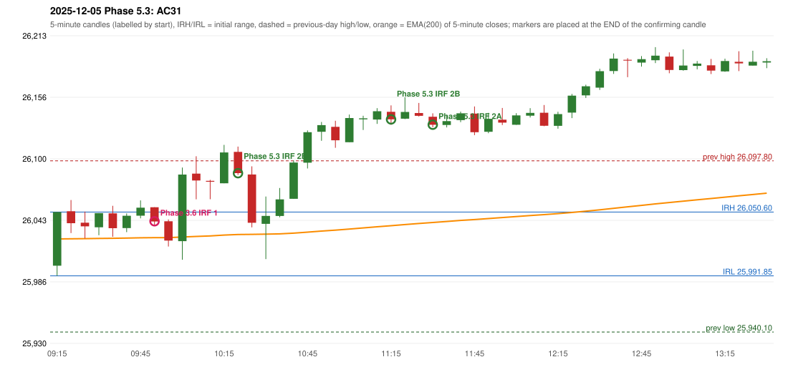

# 2025-12-05 - Phase 5.3 original versus author-corrected signals

> Signal-level comparison only: no controller, no fills, no P&L. Provisional conventions are labelled.

## AC31 (PDF page 5) - topic `ORB_MISSING`

> ORB should activate instead of IRF.

* Phase 3.6 automated signal: IRF Method 1 09:55; entry candle OHLC 26055.05/26055.05/26038.4/26041.9
* Phase 3.6 signals to 13:00: 09:55 IRF/Method 1; 10:25 IRF/Method 2B; 10:30 IRF/Method 1; 11:20 IRF/Method 2B; 11:50 IRF/Method 2A; 12:15 IRF/Method 2B
* Phase 5.3 author-corrected signals to 13:00: 10:25 IRF/Method 2B; 11:20 IRF/Method 2B; 11:35 IRF/Method 2A; 12:15 IRF/Method 2B
* Reconciliation: **UNRESOLVED_MISSING_DEFINITION** - the level the author drew: Method 2's inner support/resistance is not defined in the rulebook (the engine has no level to break when the first candle does not break the previous-day high/low)

| measurement | value |
|---|---|
| phase53_signals_to_13_00 | 10:25 IRF/Method 2B; 11:20 IRF/Method 2B; 11:35 IRF/Method 2A; 12:15 IRF/Method 2B |
| orb_cause | LEVEL_CONSTRUCTION |

### Changes in the author-corrected configuration on this date (against Phase 3.6)

| strategy | method | change | Phase 3.6 | Phase 5.3 | cause |
|---|---|---|---|---|---|
| IRF | Method 1 | REMOVED | 09:55 |  | all four Phase 5.3 rules together |
| IRF | Method 1 | REMOVED | 10:30 |  | all four Phase 5.3 rules together |
| IRF | Method 2A | TIME_SHIFTED_EARLIER | 11:50 | 11:35 | all four Phase 5.3 rules together |
| IRF | Method 2A | TIME_SHIFTED_LATER | 13:50 | 13:55 | all four Phase 5.3 rules together |
| IRF | Method 2A | ADDED |  | 15:30 | all four Phase 5.3 rules together |

### IRF candidates rejected by the 28-point EMA clearance this date

| method | candle | EMA | relation | range distance |
|---|---|---|---|---|
| Method 1 | 09:55 26055.05/26055.05/26038.4/26041.9 | 26027.05 | EMA_BELOW_CANDLE | 11.35 |
| Method 1 | 10:30 26085.25/26092.75/26036.5/26040.75 | 26030.06 | EMA_BELOW_CANDLE | 6.44 |

