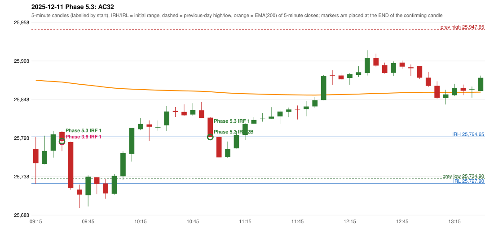

# 2025-12-11 - Phase 5.3 original versus author-corrected signals

> Signal-level comparison only: no controller, no fills, no P&L. Provisional conventions are labelled.

## AC32 (PDF page 5) - topic `IRF_DAY_LOW`

> Should be ignored as candle body is less than 50%. | 2nd candle should also be ignores as it is at day's low.

* Phase 3.6 automated signal: IRF Method 1 09:35; entry candle OHLC 25801.35/25802.75/25774.3/25788.5
* Phase 3.6 signals to 13:00: 09:35 IRF/Method 1; 11:00 IRF/Method 1; 11:00 IRF/Method 2A; 11:00 IRF/Method 2B; 11:50 IRF/Method 2B; 12:40 IRF/Method 2B; 13:00 IRF/Method 2A
* Phase 5.3 author-corrected signals to 13:00: 09:35 IRF/Method 1; 11:00 IRF/Method 1; 11:00 IRF/Method 2B
* Reconciliation: **PENDING_OWNER_DEFINITION** - the day's-low predicate is unresolved; the previous behaviour is preserved (diagnostics in irf_day_low_diagnostics.csv)

| measurement | value |
|---|---|
| phase53_signals_to_13_00 | 09:35 IRF/Method 1; 11:00 IRF/Method 1; 11:00 IRF/Method 2B |

### Changes in the author-corrected configuration on this date (against Phase 3.6)

| strategy | method | change | Phase 3.6 | Phase 5.3 | cause |
|---|---|---|---|---|---|
| IRF | Method 2A | REMOVED | 11:00 |  | all four Phase 5.3 rules together |
| IRF | Method 2A | REMOVED | 13:00 |  | all four Phase 5.3 rules together |
| IRF | Method 2B | REMOVED | 11:50 |  | all four Phase 5.3 rules together |
| IRF | Method 2B | REMOVED | 12:40 |  | all four Phase 5.3 rules together |
| IRF | Method 2B | REMOVED | 14:05 |  | all four Phase 5.3 rules together |
| IRF | Method 2B | REMOVED | 14:45 |  | all four Phase 5.3 rules together |

### IRF candidates rejected by the 28-point EMA clearance this date

| method | candle | EMA | relation | range distance |
|---|---|---|---|---|
| Method 2B | 11:50 25833.6/25839.4/25819.45/25833.25 | 25854.44 | EMA_ABOVE_CANDLE | 15.04 |

