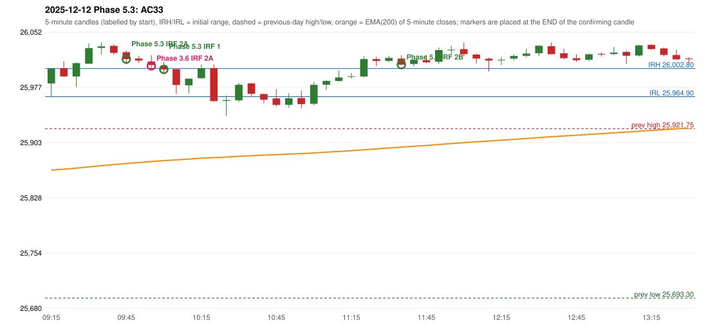

# 2025-12-12 - Phase 5.3 original versus author-corrected signals

> Signal-level comparison only: no controller, no fills, no P&L. Provisional conventions are labelled.

## AC33 (PDF page 5) - topic `ORB_MISSING`

> Should be ORB, But IRF is activated.

* Phase 3.6 automated signal: IRF Method 2A 10:00; entry candle OHLC 26012.15/26020.9/26001.6/26007.55
* Phase 3.6 signals to 13:00: 10:00 IRF/Method 2A; 10:05 IRF/Method 1; 11:40 IRF/Method 2B; 11:50 IRF/Method 2B
* Phase 5.3 author-corrected signals to 13:00: 09:50 IRF/Method 2A; 10:05 IRF/Method 1; 11:40 IRF/Method 2B; 11:50 IRF/Method 2B; 12:10 IRF/Method 2A; 12:45 IRF/Method 2A
* Reconciliation: **UNRESOLVED_MISSING_DEFINITION** - the ORB strong-candle definition (body %, opposite-wick %) or an approval of a looser profile - the rulebook gives no numbers

| measurement | value |
|---|---|
| phase53_signals_to_13_00 | 09:50 IRF/Method 2A; 10:05 IRF/Method 1; 11:40 IRF/Method 2B; 11:50 IRF/Method 2B; 12:10 IRF/Method 2A; 12:45 IRF/Method 2A |
| orb_cause | STRONG_CANDLE_THRESHOLD |

### Changes in the author-corrected configuration on this date (against Phase 3.6)

| strategy | method | change | Phase 3.6 | Phase 5.3 | cause |
|---|---|---|---|---|---|
| IRF | Method 2A | TIME_SHIFTED_EARLIER | 10:00 | 09:50 | all four Phase 5.3 rules together |
| IRF | Method 2A | TIME_SHIFTED_EARLIER | 14:30 | 12:10 | all four Phase 5.3 rules together |
| IRF | Method 2A | ADDED |  | 12:45 | all four Phase 5.3 rules together |
| IRF | Method 2A | ADDED |  | 14:25 | all four Phase 5.3 rules together |
| IRF | Method 2A | ADDED |  | 15:30 | all four Phase 5.3 rules together |
| IRF | Method 2B | TIME_SHIFTED_EARLIER | 14:30 | 13:20 | all four Phase 5.3 rules together |
| IRF | Method 2B | ADDED |  | 15:30 | all four Phase 5.3 rules together |

