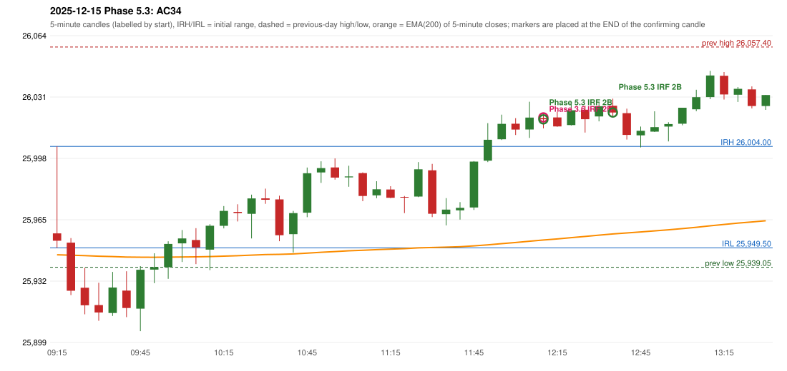

# 2025-12-15 - Phase 5.3 original versus author-corrected signals

> Signal-level comparison only: no controller, no fills, no P&L. Provisional conventions are labelled.

## AC34 (PDF page 6) - topic `IRF_FIRST_RED_CANDLE`

> First red candle should be considered.

* Phase 3.6 automated signal: IRF Method 2B 12:15; entry candle OHLC 26019.25/26021.85/26013.7/26018.55
* Phase 3.6 signals to 13:00: 12:15 IRF/Method 2B; 12:40 IRF/Method 2B
* Phase 5.3 author-corrected signals to 13:00: 12:15 IRF/Method 2B; 12:40 IRF/Method 2B
* Reconciliation: **NOT_RECONCILED_METHOD_OUT_OF_SCOPE** - Method 2B has no red-candle-created support (Method 2B's reference is a resistance); the rule is not applied there without source support (scope verification required)

| measurement | value |
|---|---|
| phase53_signals_to_13_00 | 12:15 IRF/Method 2B; 12:40 IRF/Method 2B |
| phase53_irf_result_first_red_low | UNCHANGED (same time and method) |
| phase53_irf_result_red_search_after_breakout | UNCHANGED (same time and method) |
| first_red_candle | 12:00 |
| first_red_candle_low | 26010.15 |

### Changes in the author-corrected configuration on this date (against Phase 3.6)

| strategy | method | change | Phase 3.6 | Phase 5.3 | cause |
|---|---|---|---|---|---|
| IRF | Method 2A | TIME_SHIFTED_EARLIER | 15:30 | 13:30 | all four Phase 5.3 rules together |
| IRF | Method 2A | ADDED |  | 15:05 | all four Phase 5.3 rules together |
| IRF | Method 2B | REMOVED | 15:30 |  | all four Phase 5.3 rules together |

