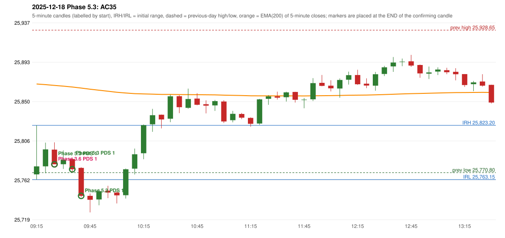

# 2025-12-18 - Phase 5.3 original versus author-corrected signals

> Signal-level comparison only: no controller, no fills, no P&L. Provisional conventions are labelled.

## AC35 (PDF page 6) - topic `NOT_ADDRESSED_BY_THE_CALL`

> Should take resistance in the zone, breakout of zone Ep trap is not conside[red]

* Phase 3.6 automated signal: PDS Method 1 09:30; entry candle OHLC 25796.3/25804.35/25780.05/25780.05
* Phase 3.6 signals to 13:00: 09:30 PDS/Method 1; 11:05 IRF/Method 2A; 11:05 IRF/Method 2B
* Phase 5.3 author-corrected signals to 13:00: 09:30 PDS/Method 1; 09:40 PDS/Method 1; 09:45 PDS/Method 1
* Reconciliation: **NOT_IN_SCOPE_UNCHANGED** - not addressed by the Phase 5.3 corrections; behaviour unchanged

| measurement | value |
|---|---|
| phase53_signals_to_13_00 | 09:30 PDS/Method 1; 09:40 PDS/Method 1; 09:45 PDS/Method 1 |

### Changes in the author-corrected configuration on this date (against Phase 3.6)

| strategy | method | change | Phase 3.6 | Phase 5.3 | cause |
|---|---|---|---|---|---|
| IRF | Method 1 | REMOVED | 14:10 |  | all four Phase 5.3 rules together |
| IRF | Method 1 | REMOVED | 15:10 |  | all four Phase 5.3 rules together |
| IRF | Method 2A | TIME_SHIFTED_LATER | 11:05 | 14:15 | all four Phase 5.3 rules together |
| IRF | Method 2A | REMOVED | 13:20 |  | all four Phase 5.3 rules together |
| IRF | Method 2B | TIME_SHIFTED_LATER | 11:05 | 14:15 | all four Phase 5.3 rules together |
| PDS | Method 1 | ADDED |  | 09:40 | all four Phase 5.3 rules together |
| PDS | Method 1 | ADDED |  | 09:45 | all four Phase 5.3 rules together |
| PDS | Method 1 | ADDED |  | 14:25 | all four Phase 5.3 rules together |
| PDS | Method 1 | ADDED |  | 14:40 | all four Phase 5.3 rules together |

### IRF candidates rejected by the 28-point EMA clearance this date

| method | candle | EMA | relation | range distance |
|---|---|---|---|---|
| Method 2B | 11:05 25849.6/25851.1/25825.8/25827.5 | 25856.68 | EMA_ABOVE_CANDLE | 5.58 |
| Method 2B | 11:15 25835.8/25837.0/25830.1/25831.7 | 25856.23 | EMA_ABOVE_CANDLE | 19.23 |
| Method 2B | 11:20 25831.45/25832.05/25821.7/25824.9 | 25855.92 | EMA_ABOVE_CANDLE | 23.87 |
| Method 2B | 14:05 25843.55/25843.6/25824.65/25830.45 | 25858.86 | EMA_ABOVE_CANDLE | 15.26 |
| Method 2A | 14:10 25830.6/25830.95/25815.5/25815.55 | 25858.43 | EMA_ABOVE_CANDLE | 27.48 |
| Method 2B | 14:10 25830.6/25830.95/25815.5/25815.55 | 25858.43 | EMA_ABOVE_CANDLE | 27.48 |
| Method 1 | 14:10 25830.6/25830.95/25815.5/25815.55 | 25858.43 | EMA_ABOVE_CANDLE | 27.48 |
| Method 1 | 15:10 25824.6/25829.75/25807.25/25815.7 | 25851.73 | EMA_ABOVE_CANDLE | 21.98 |

