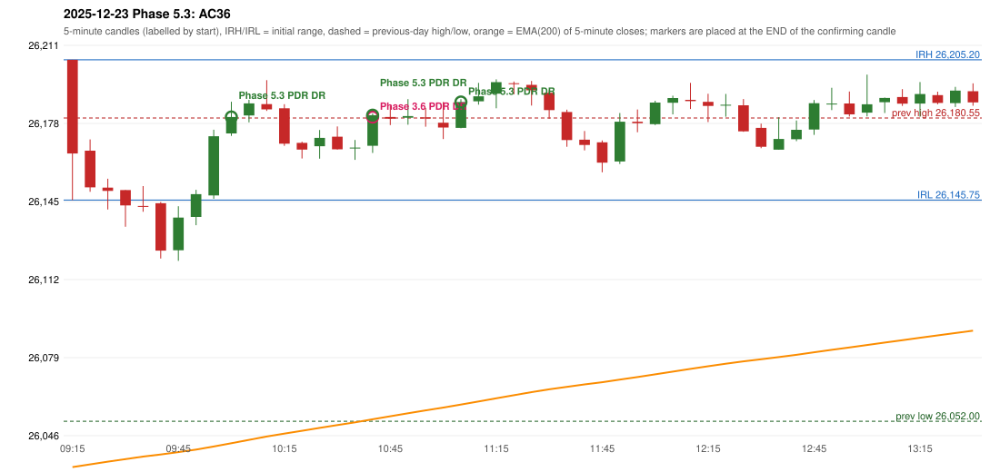

# 2025-12-23 - Phase 5.3 original versus author-corrected signals

> Signal-level comparison only: no controller, no fills, no P&L. Provisional conventions are labelled.

## AC36 (PDF page 6) - topic `NOT_ADDRESSED_BY_THE_CALL`

> RF should be activated instead of PDR. | PDR is also wrong.

* Phase 3.6 automated signal: PDR PDR 10:45; entry candle OHLC 26168.8/26182.45/26165.75/26181.75
* Phase 3.6 signals to 13:00: 10:45 PDR/PDR; 11:10 PDR/PDR; 11:55 PDR/PDR; 12:05 PDR/PDR; 12:50 PDR/PDR
* Phase 5.3 author-corrected signals to 13:00: 10:05 PDR/PDR; 10:45 PDR/PDR; 11:10 PDR/PDR; 11:55 PDR/PDR; 12:05 PDR/PDR; 12:50 PDR/PDR
* Reconciliation: **NOT_IN_SCOPE_UNCHANGED** - not addressed by the Phase 5.3 corrections; behaviour unchanged

| measurement | value |
|---|---|
| phase53_signals_to_13_00 | 10:05 PDR/PDR; 10:45 PDR/PDR; 11:10 PDR/PDR; 11:55 PDR/PDR; 12:05 PDR/PDR; 12:50 PDR/PDR |

### Changes in the author-corrected configuration on this date (against Phase 3.6)

| strategy | method | change | Phase 3.6 | Phase 5.3 | cause |
|---|---|---|---|---|---|
| PDR | PDR | TIME_SHIFTED_EARLIER | 10:45 | 10:05 | all four Phase 5.3 rules together |
| PDR | PDR | TIME_SHIFTED_EARLIER | 11:10 | 10:45 | all four Phase 5.3 rules together |
| PDR | PDR | TIME_SHIFTED_EARLIER | 11:55 | 11:10 | all four Phase 5.3 rules together |
| PDR | PDR | TIME_SHIFTED_EARLIER | 12:05 | 11:55 | all four Phase 5.3 rules together |
| PDR | PDR | TIME_SHIFTED_EARLIER | 12:50 | 12:05 | all four Phase 5.3 rules together |
| PDR | PDR | TIME_SHIFTED_EARLIER | 15:15 | 12:50 | all four Phase 5.3 rules together |
| PDR | PDR | ADDED |  | 14:50 | all four Phase 5.3 rules together |
| PDR | PDR | ADDED |  | 15:00 | all four Phase 5.3 rules together |
| PDR | PDR | ADDED |  | 15:15 | all four Phase 5.3 rules together |

