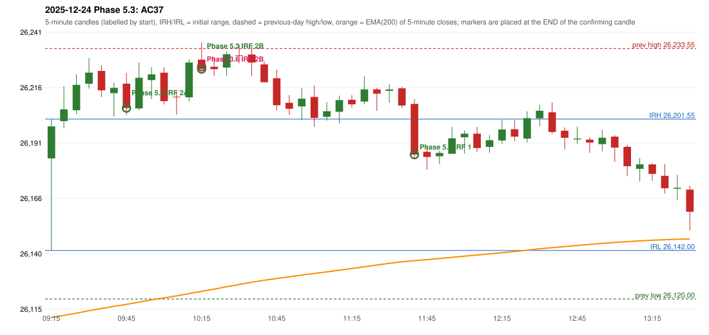

# 2025-12-24 - Phase 5.3 original versus author-corrected signals

> Signal-level comparison only: no controller, no fills, no P&L. Provisional conventions are labelled.

## AC37 (PDF page 6) - topic `ORB_MISSING`

> ORB should be activated instead of IRF

* Phase 3.6 automated signal: IRF Method 2B 10:20; entry candle OHLC 26228.5/26236.3/26224.25/26224.25
* Phase 3.6 signals to 13:00: 10:20 IRF/Method 2B; 11:45 IRF/Method 1; 12:40 IRF/Method 1
* Phase 5.3 author-corrected signals to 13:00: 09:50 IRF/Method 2A; 10:20 IRF/Method 2B; 11:45 IRF/Method 1; 12:40 IRF/Method 1
* Reconciliation: **UNRESOLVED_MISSING_DEFINITION** - the level the author drew: Method 2's inner support/resistance is not defined in the rulebook (the engine has no level to break when the first candle does not break the previous-day high/low)

| measurement | value |
|---|---|
| phase53_signals_to_13_00 | 09:50 IRF/Method 2A; 10:20 IRF/Method 2B; 11:45 IRF/Method 1; 12:40 IRF/Method 1 |
| orb_cause | LEVEL_CONSTRUCTION |

### Changes in the author-corrected configuration on this date (against Phase 3.6)

| strategy | method | change | Phase 3.6 | Phase 5.3 | cause |
|---|---|---|---|---|---|
| IRF | Method 2A | ADDED |  | 09:50 | all four Phase 5.3 rules together |

