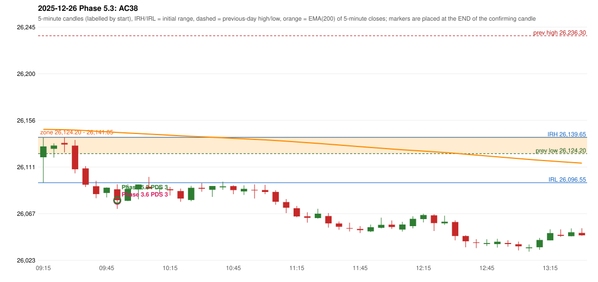

# 2025-12-26 - Phase 5.3 original versus author-corrected signals

> Signal-level comparison only: no controller, no fills, no P&L. Provisional conventions are labelled.

## AC38 (PDF page 6) - topic `PDS_FIRST_ELIGIBLE`

> First candle entry.

* Phase 3.6 automated signal: PDS Method 3 09:55; entry candle OHLC 26090.3/26095.1/26071.7/26080.0
* Phase 3.6 signals to 13:00: 09:55 PDS/Method 3
* Phase 5.3 author-corrected signals to 13:00: 09:55 PDS/Method 3
* Reconciliation: **NOT_RECONCILED_CONFLICT_WITH_SOURCE_RULE** - the author's 'first candle entry' is a weak first red candle; the PDS guide says do not take a weak red candle (Method 3); flagged for owner approval rather than overridden

| measurement | value |
|---|---|
| phase53_signals_to_13_00 | 09:55 PDS/Method 3 |
| phase53_pds_first_red_candle | 09:25 |
| phase53_pds_first_red_geometry | body 10.4% / wicks 38.1% / 51.6% |
| phase53_pds_verdict | WEAK(Method 3 path - source quality rule) |

### Changes in the author-corrected configuration on this date (against Phase 3.6)

(no signal changes on this date)

