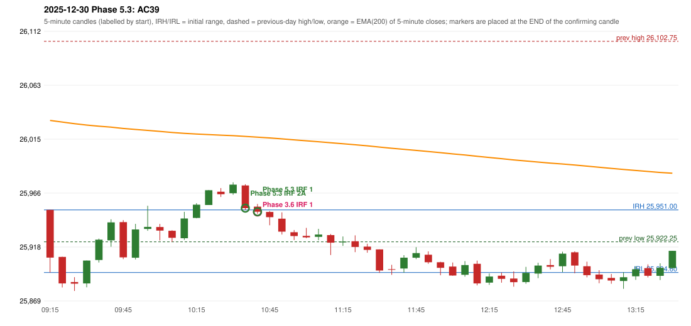

# 2025-12-30 - Phase 5.3 original versus author-corrected signals

> Signal-level comparison only: no controller, no fills, no P&L. Provisional conventions are labelled.

## AC39 (PDF page 6) - topic `ORB_MISSING`

> ORB should be activated instead of IRF.

* Phase 3.6 automated signal: IRF Method 1 10:45; entry candle OHLC 25953.9/25956.35/25947.5/25949.3
* Phase 3.6 signals to 13:00: 10:45 IRF/Method 1; 11:15 IRF/Method 2A
* Phase 5.3 author-corrected signals to 13:00: 10:40 IRF/Method 2A; 10:45 IRF/Method 1
* Reconciliation: **UNRESOLVED_MISSING_DEFINITION** - the ORB strong-candle definition (body %, opposite-wick %) or an approval of a looser profile - the rulebook gives no numbers

| measurement | value |
|---|---|
| phase53_signals_to_13_00 | 10:40 IRF/Method 2A; 10:45 IRF/Method 1 |
| orb_cause | STRONG_CANDLE_THRESHOLD |

### Changes in the author-corrected configuration on this date (against Phase 3.6)

| strategy | method | change | Phase 3.6 | Phase 5.3 | cause |
|---|---|---|---|---|---|
| IRF | Method 1 | REMOVED | 13:55 |  | all four Phase 5.3 rules together |
| IRF | Method 2A | TIME_SHIFTED_EARLIER | 11:15 | 10:40 | all four Phase 5.3 rules together |

### IRF candidates rejected by the 28-point EMA clearance this date

| method | candle | EMA | relation | range distance |
|---|---|---|---|---|
| Method 1 | 13:55 25953.35/25956.55/25934.9/25937.75 | 25982.13 | EMA_ABOVE_CANDLE | 25.58 |

