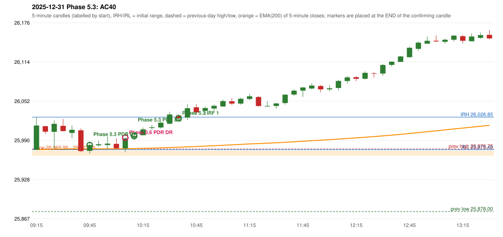

# 2025-12-31 - Phase 5.3 original versus author-corrected signals

> Signal-level comparison only: no controller, no fills, no P&L. Provisional conventions are labelled.

## AC40 (PDF page 6) - topic `PDR_FIRST_ELIGIBLE`

> ORB should activate first, Which hits SL Ep then PDR. | PDR 1st candle entry.

* Phase 3.6 automated signal: PDR PDR 10:10; entry candle OHLC 25977.5/25995.1/25971.75/25993.3
* Phase 3.6 signals to 13:00: 10:10 PDR/PDR; 10:40 IRF/Method 1; 11:25 IRF/Method 2B
* Phase 5.3 author-corrected signals to 13:00: 09:50 PDR/PDR; 10:15 PDR/PDR; 10:40 IRF/Method 1; 11:25 IRF/Method 2A; 11:25 IRF/Method 2B
* Reconciliation: **RECONCILED** - Phase 5.3 first eligible confirmation candle 09:45 = the author's first green candle 09:45

| measurement | value |
|---|---|
| phase53_signals_to_13_00 | 09:50 PDR/PDR; 10:15 PDR/PDR; 10:40 IRF/Method 1; 11:25 IRF/Method 2A; 11:25 IRF/Method 2B |
| phase53_pdr_first_eligible_candle | 09:45 |
| phase53_pdr_signal | 09:50 |
| author_first_green_candle | 09:45 |
| retest_candle | 09:40 |
| retest_candle_would_qualify | False |

### Changes in the author-corrected configuration on this date (against Phase 3.6)

| strategy | method | change | Phase 3.6 | Phase 5.3 | cause |
|---|---|---|---|---|---|
| IRF | Method 2A | TIME_SHIFTED_EARLIER | 13:40 | 11:25 | all four Phase 5.3 rules together |
| IRF | Method 2A | REMOVED | 14:25 |  | all four Phase 5.3 rules together |
| IRF | Method 2A | REMOVED | 15:05 |  | all four Phase 5.3 rules together |
| PDR | PDR | TIME_SHIFTED_EARLIER | 10:10 | 09:50 | all four Phase 5.3 rules together |
| PDR | PDR | ADDED |  | 10:15 | all four Phase 5.3 rules together |

