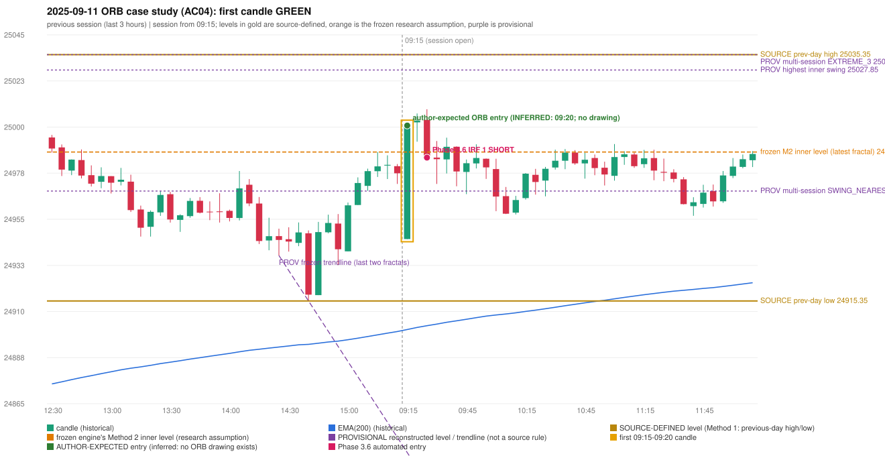

# 2025-09-11 - ORB case study (AC04, handwritten page 1)

> Audit evidence only: no controller, no fills, no P&L. Provisional levels are research constructions, not source rules.

**Author:** This should be an ORB trade. | It is shown as IRF, ORB should activate Ep 30 pts SL.

* Expected direction: NOT STATED. ASSUMPTION (not author evidence): LONG, inferred from the first-candle colour (GREEN)
* Expected method: NOT IDENTIFIABLE (no level, drawing or method written); closest by predicates: Method 1 (fails level_broken), Method 2 (fails trendline)
* Expected entry candle: 09:15-09:20 candle, entry at the 09:20 open of the next minute bar (rulebook decision time; no ORB drawing exists)
* Engine ORB status: Method 2 LONG: INVALIDATED (TRENDLINE_NOT_SUPPORTIVE)
* Phase 3.6 trade taken instead: IRF Method 1 09:30 SHORT @ 24985.2
* Manual journal row: ORB 09:15

## Original one-minute data (first five bars)

| time | open | high | low | close |
|---|---|---|---|---|
| 09:15 | 24945.5 | 24973.1 | 24945.5 | 24959.2 |
| 09:16 | 24957.3 | 24963.7 | 24955.2 | 24963.65 |
| 09:17 | 24962.3 | 24967.15 | 24954.1 | 24963.6 |
| 09:18 | 24972.15 | 24994.6 | 24968.7 | 24992.7 |
| 09:19 | 24991.65 | 25002.1 | 24989.8 | 25000.8 |

## First candle 24945.5/25002.1/24945.5/25000.8 (GREEN; body 97.7%, upper wick 2.3%, lower wick 0.0%); previous day high/low/close 25035.35/24915.35/24973.1; gap -27.6; EMA(200) 24901.44

## Engine eligibility checks (colour-matching direction, engine order)

| method | predicate | pass | observed | margin |
|---|---|---|---|---|
| Method 1 | level_broken | False | previous-day high 25035.35; candle high/low 25002.1, close 25000.8 | -34.55 |
| Method 1 | trend | True | EMA_PREV_SESSION_CLOSE on the trend side | 77.104 |
| Method 1 | candle_quality | True | body 97.7% opposite wick 2.3% close location 97.7% | 17.703 |
| Method 2 | inner_level_broken | True | latest inner swing 24987.9; close 25000.8 | 12.9 |
| Method 2 | trend | True | EMA_PREV_SESSION_CLOSE on the trend side | 77.104 |
| Method 2 | trendline | False | TRENDLINE_NOT_SUPPORTIVE; line at the open 24841.52 | 159.283 |
| Method 2 | candle_quality | True | body 97.7% opposite wick 2.3% close location 97.7% | 17.703 |
| Method 2 | near_ema_close | True | EMA not near |  |
| Gap/200DMA | gap_in_direction | False | gap -27.60 (DOWN) | -27.6 |
| Gap/200DMA | gap_crosses_200_average | False | previous close 24973.1 vs previous EMA 24900.45; open 24945.5 vs EMA 24901.44 | -72.654 |
| Gap/200DMA | first_candle_closes_beyond_average | True | close 25000.8 vs EMA 24901.44 | 99.356 |
| Gap/200DMA | candle_shape | True | body 97.7% opposite wick 2.3% close location 97.7%; rejection wick flag False | 17.703 |

## Candidate levels (what the first candle did against each construction)

| family | status | level | broken | open already beyond | close - level |
|---|---|---|---|---|---|
| M1_PREVIOUS_DAY_EXTREME | EXPLICIT_DOCUMENT_RULE (Method 1) | 25035.35 | False | False | -34.55 |
| M2_LATEST_FRACTAL_K2 | CURRENT_ENGINE_ASSUMPTION | 24987.9 | True | False | 12.9 |
| M2_HIGHEST_FRACTAL_K2 | RESEARCH_PROPOSAL | 25027.85 | False | False | -27.05 |
| M2_NEAREST_FRACTAL_FROM_OPEN_K2 | RESEARCH_PROPOSAL | 24968.9 | True | False | 31.9 |
| M2_HIGHEST_BROKEN_FRACTAL_K2 | RESEARCH_PROPOSAL | 25000.4 | True | False | 0.4 |
| MS_EXTREME_2_SESSIONS | RESEARCH_PROPOSAL (not in the written rules; the page-13 ref | 25035.35 | False | False | -34.55 |
| MS_EXTREME_3_SESSIONS | RESEARCH_PROPOSAL (not in the written rules; the page-13 ref | 25035.35 | False | False | -34.55 |
| MS_EXTREME_5_SESSIONS | RESEARCH_PROPOSAL (not in the written rules; the page-13 ref | 25035.35 | False | False | -34.55 |
| MS_SWING_NEAREST_FROM_OPEN_3_SESSIONS | RESEARCH_PROPOSAL | 24968.9 | True | False | 31.9 |

## Trend and trendline

* previous close 24977.55 vs its EMA 24900.45 (margin 77.1); first-candle close 25000.8 vs EMA 24901.44 (margin 99.36); EMA change over the last previous hour 7.53
* active trend: True (EMA_PREV_SESSION_CLOSE on the trend side); structure variant: False (STRUCTURE swing highs 24978.65->24987.9, swing lows 24937.5->24915.35 (not higher-high/higher-low)); literal first-close test: True (EMA5M_BASIC)
* frozen trendline: TRENDLINE_NOT_SUPPORTIVE (line at the open 24841.52); any-pair-of-last-three: TRENDLINE_NOT_SUPPORTIVE

## Candle strength

* body 97.7%, opposite wick 2.3%, close location 97.7%; STRICT True, MODERATE True, LOOSE True; owner pin test False (wick/body 0.0, close 2.3% from the favourable extreme; needs <= 30%)

## Missing condition and required definition

* YES: the closest method (Method 1, Method 2) is rejected by a condition the engine decides with a research assumption / numeric approximation / owner variant (ENGINE_ASSUMPTION); the source is silent or qualitative there
* Method 1: the first candle did not break and close beyond the previous-day high/low (Method 1 is source-explicit): the author must have used another level | Method 2: the Method 2 trendline has no construction in the rulebook; the engine's last-two-fractals line was not supportive | Gap/200DMA: no opening gap in this direction: the Gap / 200-average setup does not apply

## Variants (signal-only; disabled by default)

* orb-frozen: no ORB signal
* orb-var-inner-highest-fractal: no ORB signal
* orb-var-inner-nearest-from-open: no ORB signal
* orb-var-inner-highest-broken: no ORB signal
* orb-var-trendline-any-pair: no ORB signal
* orb-var-trendline-none: Method 2 LONG 09:20
* orb-var-strength-strict: no ORB signal
* orb-var-strength-loose: no ORB signal
* orb-var-trend-structure: no ORB signal
* orb-var-trend-ema-basic: no ORB signal
* orb-var-gap-candle-crossing: no ORB signal
* orb-var-colour: no ORB signal

