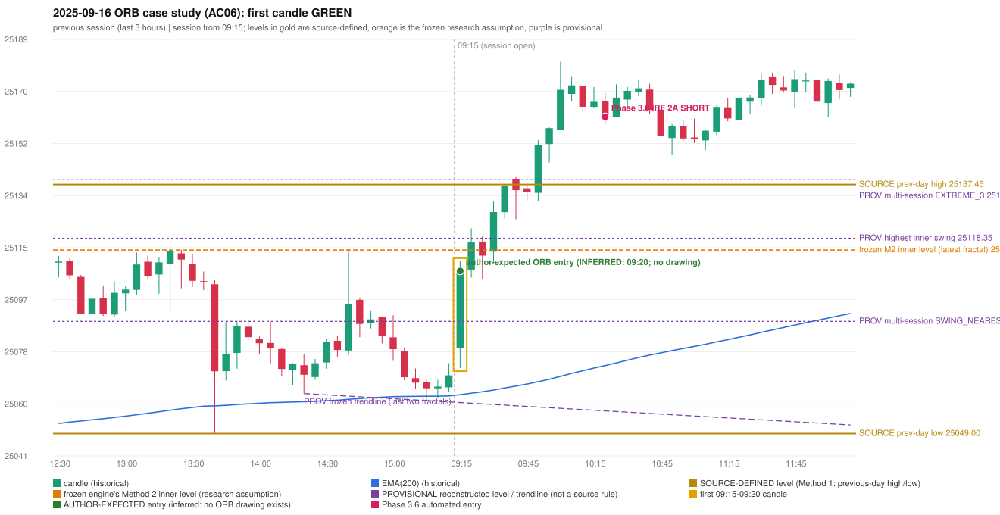

# 2025-09-16 - ORB case study (AC06, handwritten page 2)

> Audit evidence only: no controller, no fills, no P&L. Provisional levels are research constructions, not source rules.

**Author:** IRF is taken, which is wrong. | ORB should take place in this condition[s]

* Expected direction: NOT STATED. ASSUMPTION (not author evidence): LONG, inferred from the first-candle colour (GREEN)
* Expected method: NOT IDENTIFIABLE (no level, drawing or method written); closest by predicates: Method 1 (fails level_broken), Gap/200DMA (fails gap_crosses_200_average)
* Expected entry candle: 09:15-09:20 candle, entry at the 09:20 open of the next minute bar (rulebook decision time; no ORB drawing exists)
* Engine ORB status: NO RECORD (no level broken / no gap crossing in either direction)
* Phase 3.6 trade taken instead: IRF Method 2A 10:25 SHORT @ 25161.5
* Manual journal row: ORB 09:15

## Original one-minute data (first five bars)

| time | open | high | low | close |
|---|---|---|---|---|
| 09:15 | 25079.5 | 25110.25 | 25079.5 | 25094.8 |
| 09:16 | 25096.75 | 25102.95 | 25088.25 | 25089.6 |
| 09:17 | 25089.9 | 25089.9 | 25072.25 | 25079.25 |
| 09:18 | 25081.1 | 25106.95 | 25079.15 | 25103.65 |
| 09:19 | 25106.15 | 25109.6 | 25101.65 | 25106.75 |

## First candle 25079.5/25110.25/25072.25/25106.75 (GREEN; body 71.7%, upper wick 9.2%, lower wick 19.1%); previous day high/low/close 25137.45/25049.0/25069.2; gap 10.3; EMA(200) 25062.82

## Engine eligibility checks (colour-matching direction, engine order)

| method | predicate | pass | observed | margin |
|---|---|---|---|---|
| Method 1 | level_broken | False | previous-day high 25137.45; candle high/low 25110.25, close 25106.75 | -30.7 |
| Method 1 | trend | True | EMA_PREV_SESSION_CLOSE on the trend side | 7.326 |
| Method 1 | candle_quality | True | body 71.7% opposite wick 9.2% close location 90.8% | 10.789 |
| Method 2 | inner_level_broken | False | latest inner swing 25114.2; close 25106.75 | -7.45 |
| Method 2 | trend | True | EMA_PREV_SESSION_CLOSE on the trend side | 7.326 |
| Method 2 | trendline | False | TRENDLINE_NOT_SUPPORTIVE; line at the open 25060.02 | 46.732 |
| Method 2 | candle_quality | True | body 71.7% opposite wick 9.2% close location 90.8% | 10.789 |
| Method 2 | near_ema_close | True | EMA not near |  |
| Gap/200DMA | gap_in_direction | True | gap +10.30 (UP) | 10.3 |
| Gap/200DMA | gap_crosses_200_average | False | previous close 25069.2 vs previous EMA 25062.37; open 25079.5 vs EMA 25062.82 | -6.826 |
| Gap/200DMA | first_candle_closes_beyond_average | True | close 25106.75 vs EMA 25062.82 | 43.934 |
| Gap/200DMA | candle_shape | True | body 71.7% opposite wick 9.2% close location 90.8%; rejection wick flag False | 10.789 |

## Candidate levels (what the first candle did against each construction)

| family | status | level | broken | open already beyond | close - level |
|---|---|---|---|---|---|
| M1_PREVIOUS_DAY_EXTREME | EXPLICIT_DOCUMENT_RULE (Method 1) | 25137.45 | False | False | -30.7 |
| M2_LATEST_FRACTAL_K2 | CURRENT_ENGINE_ASSUMPTION | 25114.2 | False | False | -7.45 |
| M2_HIGHEST_FRACTAL_K2 | RESEARCH_PROPOSAL | 25118.35 | False | False | -11.6 |
| M2_NEAREST_FRACTAL_FROM_OPEN_K2 | RESEARCH_PROPOSAL | 25088.85 | True | False | 17.9 |
| M2_HIGHEST_BROKEN_FRACTAL_K2 | RESEARCH_PROPOSAL | 25102.75 | True | False | 4.0 |
| MS_EXTREME_2_SESSIONS | RESEARCH_PROPOSAL (not in the written rules; the page-13 ref | 25139.3 | False | False | -32.55 |
| MS_EXTREME_3_SESSIONS | RESEARCH_PROPOSAL (not in the written rules; the page-13 ref | 25139.3 | False | False | -32.55 |
| MS_EXTREME_5_SESSIONS | RESEARCH_PROPOSAL (not in the written rules; the page-13 ref | 25139.3 | False | False | -32.55 |
| MS_SWING_NEAREST_FROM_OPEN_3_SESSIONS | RESEARCH_PROPOSAL | 25088.85 | True | False | 17.9 |

## Trend and trendline

* previous close 25069.7 vs its EMA 25062.37 (margin 7.33); first-candle close 25106.75 vs EMA 25062.82 (margin 43.93); EMA change over the last previous hour 1.92
* active trend: True (EMA_PREV_SESSION_CLOSE on the trend side); structure variant: False (STRUCTURE swing highs 25116.9->25114.2, swing lows 25063.2->25060.7 (not higher-high/higher-low)); literal first-close test: True (EMA5M_BASIC)
* frozen trendline: TRENDLINE_NOT_SUPPORTIVE (line at the open 25060.02); any-pair-of-last-three: TRENDLINE_SUPPORTIVE

## Candle strength

* body 71.71%, opposite wick 9.21%, close location 90.79%; STRICT True, MODERATE True, LOOSE True; owner pin test False (wick/body 0.27, close 9.21% from the favourable extreme; needs <= 30%)

## Missing condition and required definition

* YES: the closest method (Method 1, Gap/200DMA) is rejected by a condition the engine decides with a research assumption / numeric approximation / owner variant (READING_OF_SOURCE); the source is silent or qualitative there
* Method 1: the first candle did not break and close beyond the previous-day high/low (Method 1 is source-explicit): the author must have used another level | Method 2: Method 2's inner level has no construction in the rulebook; the engine's latest-fractal choice was not broken | Gap/200DMA: the gap did not carry the OPEN through the 200 average (frozen reading: previous close on the wrong side AND open on the right side)

## Variants (signal-only; disabled by default)

* orb-frozen: no ORB signal
* orb-var-inner-highest-fractal: no ORB signal
* orb-var-inner-nearest-from-open: no ORB signal
* orb-var-inner-highest-broken: no ORB signal
* orb-var-trendline-any-pair: no ORB signal
* orb-var-trendline-none: no ORB signal
* orb-var-strength-strict: no ORB signal
* orb-var-strength-loose: no ORB signal
* orb-var-trend-structure: no ORB signal
* orb-var-trend-ema-basic: no ORB signal
* orb-var-gap-candle-crossing: no ORB signal
* orb-var-colour: no ORB signal

