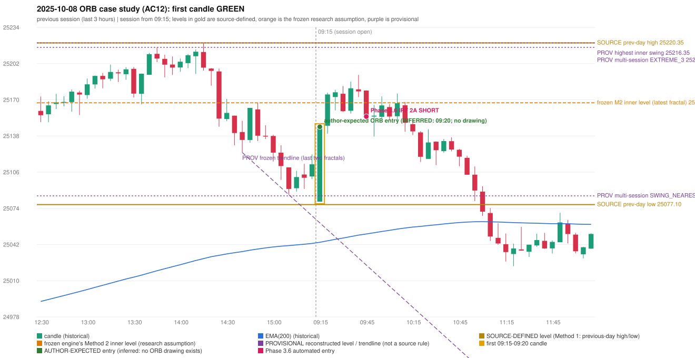

# 2025-10-08 - ORB case study (AC12, handwritten page 3)

> Audit evidence only: no controller, no fills, no P&L. Provisional levels are research constructions, not source rules.

**Author:** This should be an ORB trade, but is shown as IRF. | ORB should activate, Instead IRF is activated.

* Expected direction: NOT STATED. ASSUMPTION (not author evidence): LONG, inferred from the first-candle colour (GREEN)
* Expected method: NOT IDENTIFIABLE (no level, drawing or method written); closest by predicates: Method 1 (fails level_broken)
* Expected entry candle: 09:15-09:20 candle, entry at the 09:20 open of the next minute bar (rulebook decision time; no ORB drawing exists)
* Engine ORB status: NO RECORD (no level broken / no gap crossing in either direction)
* Phase 3.6 trade taken instead: IRF Method 2A 09:50 SHORT @ 25155.1
* Manual journal row: ORB 09:15

## Original one-minute data (first five bars)

| time | open | high | low | close |
|---|---|---|---|---|
| 09:15 | 25079.75 | 25130.8 | 25079.75 | 25104.45 |
| 09:16 | 25105.05 | 25123.95 | 25092.7 | 25120.65 |
| 09:17 | 25120.15 | 25127.0 | 25117.2 | 25126.95 |
| 09:18 | 25126.4 | 25145.85 | 25120.35 | 25143.55 |
| 09:19 | 25144.55 | 25146.95 | 25137.4 | 25146.05 |

## First candle 25079.75/25146.95/25079.75/25146.05 (GREEN; body 98.7%, upper wick 1.3%, lower wick 0.0%); previous day high/low/close 25220.35/25077.1/25108.3; gap -28.55; EMA(200) 25043.72

## Engine eligibility checks (colour-matching direction, engine order)

| method | predicate | pass | observed | margin |
|---|---|---|---|---|
| Method 1 | level_broken | False | previous-day high 25220.35; candle high/low 25146.95, close 25146.05 | -74.3 |
| Method 1 | trend | True | EMA_PREV_SESSION_CLOSE on the trend side | 70.107 |
| Method 1 | candle_quality | True | body 98.7% opposite wick 1.3% close location 98.7% | 18.661 |
| Method 2 | inner_level_broken | False | latest inner swing 25167.25; close 25146.05 | -21.2 |
| Method 2 | trend | True | EMA_PREV_SESSION_CLOSE on the trend side | 70.107 |
| Method 2 | trendline | False | TRENDLINE_NOT_SUPPORTIVE; line at the open 25060.97 | 85.083 |
| Method 2 | candle_quality | True | body 98.7% opposite wick 1.3% close location 98.7% | 18.661 |
| Method 2 | near_ema_close | True | EMA not near |  |
| Gap/200DMA | gap_in_direction | False | gap -28.55 (DOWN) | -28.55 |
| Gap/200DMA | gap_crosses_200_average | False | previous close 25108.3 vs previous EMA 25042.69; open 25079.75 vs EMA 25043.72 | -65.607 |
| Gap/200DMA | first_candle_closes_beyond_average | True | close 25146.05 vs EMA 25043.72 | 102.329 |
| Gap/200DMA | candle_shape | True | body 98.7% opposite wick 1.3% close location 98.7%; rejection wick flag False | 18.661 |

## Candidate levels (what the first candle did against each construction)

| family | status | level | broken | open already beyond | close - level |
|---|---|---|---|---|---|
| M1_PREVIOUS_DAY_EXTREME | EXPLICIT_DOCUMENT_RULE (Method 1) | 25220.35 | False | False | -74.3 |
| M2_LATEST_FRACTAL_K2 | CURRENT_ENGINE_ASSUMPTION | 25167.25 | False | False | -21.2 |
| M2_HIGHEST_FRACTAL_K2 | RESEARCH_PROPOSAL | 25216.35 | False | False | -70.3 |
| M2_NEAREST_FRACTAL_FROM_OPEN_K2 | RESEARCH_PROPOSAL | 25167.25 | False | False | -21.2 |
| M2_HIGHEST_BROKEN_FRACTAL_K2 | RESEARCH_PROPOSAL | None | False | None | None |
| MS_EXTREME_2_SESSIONS | RESEARCH_PROPOSAL (not in the written rules; the page-13 ref | 25220.35 | False | False | -74.3 |
| MS_EXTREME_3_SESSIONS | RESEARCH_PROPOSAL (not in the written rules; the page-13 ref | 25220.35 | False | False | -74.3 |
| MS_EXTREME_5_SESSIONS | RESEARCH_PROPOSAL (not in the written rules; the page-13 ref | 25220.35 | False | False | -74.3 |
| MS_SWING_NEAREST_FROM_OPEN_3_SESSIONS | RESEARCH_PROPOSAL | 25084.85 | True | False | 61.2 |

## Trend and trendline

* previous close 25112.8 vs its EMA 25042.69 (margin 70.11); first-candle close 25146.05 vs EMA 25043.72 (margin 102.33); EMA change over the last previous hour 10.54
* active trend: True (EMA_PREV_SESSION_CLOSE on the trend side); structure variant: False (STRUCTURE swing highs 25220.35->25167.25, swing lows 25123.3->25085.9 (not higher-high/higher-low)); literal first-close test: True (EMA5M_BASIC)
* frozen trendline: TRENDLINE_NOT_SUPPORTIVE (line at the open 25060.97); any-pair-of-last-three: TRENDLINE_NOT_SUPPORTIVE

## Candle strength

* body 98.66%, opposite wick 1.34%, close location 98.66%; STRICT True, MODERATE True, LOOSE True; owner pin test False (wick/body 0.0, close 1.34% from the favourable extreme; needs <= 30%)

## Missing condition and required definition

* NO conflict with an explicit source rule: the closest method fails an explicit source condition (level / gap not reached); the author's level is unknown
* Method 1: the first candle did not break and close beyond the previous-day high/low (Method 1 is source-explicit): the author must have used another level | Method 2: Method 2's inner level has no construction in the rulebook; the engine's latest-fractal choice was not broken | Gap/200DMA: no opening gap in this direction: the Gap / 200-average setup does not apply

## Variants (signal-only; disabled by default)

* orb-frozen: no ORB signal
* orb-var-inner-highest-fractal: no ORB signal
* orb-var-inner-nearest-from-open: no ORB signal
* orb-var-inner-highest-broken: no ORB signal
* orb-var-trendline-any-pair: no ORB signal
* orb-var-trendline-none: no ORB signal
* orb-var-strength-strict: no ORB signal
* orb-var-strength-loose: no ORB signal
* orb-var-trend-structure: no ORB signal
* orb-var-trend-ema-basic: no ORB signal
* orb-var-gap-candle-crossing: no ORB signal
* orb-var-colour: no ORB signal

