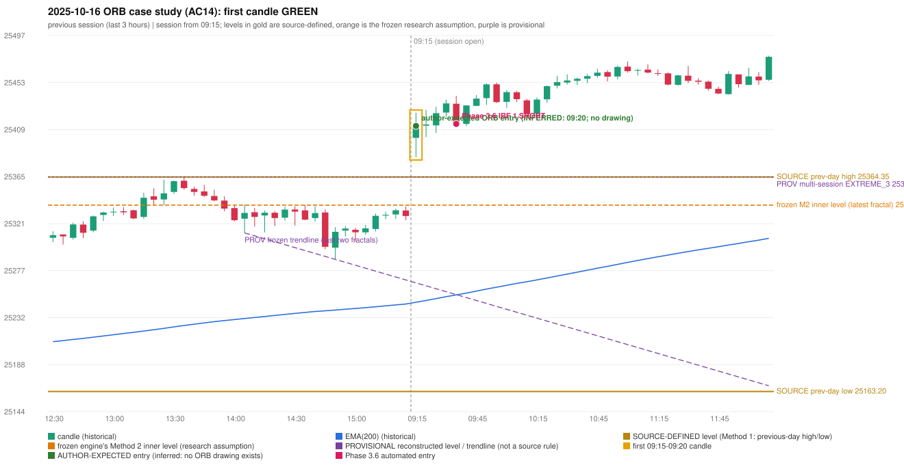

# 2025-10-16 - ORB case study (AC14, handwritten page 3)

> Audit evidence only: no controller, no fills, no P&L. Provisional levels are research constructions, not source rules.

**Author:** ORB should have activated, instead IRF is activated.

* Expected direction: NOT STATED. ASSUMPTION (not author evidence): LONG, inferred from the first-candle colour (GREEN)
* Expected method: NOT IDENTIFIABLE (no level, drawing or method written); closest by predicates: Method 1 (fails candle_quality)
* Expected entry candle: 09:15-09:20 candle, entry at the 09:20 open of the next minute bar (rulebook decision time; no ORB drawing exists)
* Engine ORB status: Method 1 LONG: INVALIDATED (CANDLE_QUALITY(not a strong body / wick too large)); Method 2 LONG: INVALIDATED (TRENDLINE_NOT_SUPPORTIVE)
* Phase 3.6 trade taken instead: IRF Method 1 09:40 SHORT @ 25414.1
* Manual journal row: ORB 09:15

## Original one-minute data (first five bars)

| time | open | high | low | close |
|---|---|---|---|---|
| 09:15 | 25401.0 | 25408.95 | 25382.85 | 25405.5 |
| 09:16 | 25404.85 | 25410.0 | 25397.65 | 25408.9 |
| 09:17 | 25408.35 | 25424.65 | 25407.4 | 25415.7 |
| 09:18 | 25415.1 | 25415.1 | 25401.35 | 25408.0 |
| 09:19 | 25407.95 | 25412.45 | 25399.95 | 25412.15 |

## First candle 25401.0/25424.65/25382.85/25412.15 (GREEN; body 26.7%, upper wick 29.9%, lower wick 43.4%); previous day high/low/close 25364.35/25163.2/25323.55; gap 77.45; EMA(200) 25246.91

## Engine eligibility checks (colour-matching direction, engine order)

| method | predicate | pass | observed | margin |
|---|---|---|---|---|
| Method 1 | level_broken | True | previous-day high 25364.35; candle high/low 25424.65, close 25412.15 | 47.8 |
| Method 1 | trend | True | EMA_PREV_SESSION_CLOSE on the trend side | 82.501 |
| Method 1 | candle_quality | False | body 26.7% opposite wick 29.9% close location 70.1% | -33.325 |
| Method 2 | inner_level_broken | True | latest inner swing 25337.95; close 25412.15 | 74.2 |
| Method 2 | trend | True | EMA_PREV_SESSION_CLOSE on the trend side | 82.501 |
| Method 2 | trendline | False | TRENDLINE_NOT_SUPPORTIVE; line at the open 25265.06 | 147.094 |
| Method 2 | candle_quality | False | body 26.7% opposite wick 29.9% close location 70.1% | -33.325 |
| Method 2 | near_ema_close | True | EMA not near |  |
| Gap/200DMA | gap_in_direction | True | gap +77.45 (UP) | 77.45 |
| Gap/200DMA | gap_crosses_200_average | False | previous close 25323.55 vs previous EMA 25245.25; open 25401.0 vs EMA 25246.91 | -78.301 |
| Gap/200DMA | first_candle_closes_beyond_average | True | close 25412.15 vs EMA 25246.91 | 165.24 |
| Gap/200DMA | candle_shape | False | body 26.7% opposite wick 29.9% close location 70.1%; rejection wick flag False | -33.325 |

## Candidate levels (what the first candle did against each construction)

| family | status | level | broken | open already beyond | close - level |
|---|---|---|---|---|---|
| M1_PREVIOUS_DAY_EXTREME | EXPLICIT_DOCUMENT_RULE (Method 1) | 25364.35 | True | True | 47.8 |
| M2_LATEST_FRACTAL_K2 | CURRENT_ENGINE_ASSUMPTION | 25337.95 | True | True | 74.2 |
| M2_HIGHEST_FRACTAL_K2 | RESEARCH_PROPOSAL | 25337.95 | True | True | 74.2 |
| M2_NEAREST_FRACTAL_FROM_OPEN_K2 | RESEARCH_PROPOSAL | None | False | None | None |
| M2_HIGHEST_BROKEN_FRACTAL_K2 | RESEARCH_PROPOSAL | 25337.95 | True | True | 74.2 |
| MS_EXTREME_2_SESSIONS | RESEARCH_PROPOSAL (not in the written rules; the page-13 ref | 25364.35 | True | True | 47.8 |
| MS_EXTREME_3_SESSIONS | RESEARCH_PROPOSAL (not in the written rules; the page-13 ref | 25364.35 | True | True | 47.8 |
| MS_EXTREME_5_SESSIONS | RESEARCH_PROPOSAL (not in the written rules; the page-13 ref | 25364.35 | True | True | 47.8 |
| MS_SWING_NEAREST_FROM_OPEN_3_SESSIONS | RESEARCH_PROPOSAL | None | False | None | None |

## Trend and trendline

* previous close 25327.75 vs its EMA 25245.25 (margin 82.5); first-candle close 25412.15 vs EMA 25246.91 (margin 165.24); EMA change over the last previous hour 9.76
* active trend: True (EMA_PREV_SESSION_CLOSE on the trend side); structure variant: False (STRUCTURE swing highs 25364.35->25337.95, swing lows 25311.9->25287.1 (not higher-high/higher-low)); literal first-close test: True (EMA5M_BASIC)
* frozen trendline: TRENDLINE_NOT_SUPPORTIVE (line at the open 25265.06); any-pair-of-last-three: TRENDLINE_NOT_SUPPORTIVE

## Candle strength

* body 26.67%, opposite wick 29.9%, close location 70.1%; STRICT False, MODERATE False, LOOSE False; owner pin test False (wick/body 1.63, close 29.9% from the favourable extreme; needs <= 30%)

## Missing condition and required definition

* YES: the closest method (Method 1) is rejected by a condition the engine decides with a research assumption / numeric approximation / owner variant (NUMERIC_APPROXIMATION); the source is silent or qualitative there
* Method 1: 'strong body, limited wick' is qualitative in the rulebook; the numeric profile (MODERATE) rejected the candle | Method 2: the Method 2 trendline has no construction in the rulebook; the engine's last-two-fractals line was not supportive | Gap/200DMA: the gap did not carry the OPEN through the 200 average (frozen reading: previous close on the wrong side AND open on the right side)

## Variants (signal-only; disabled by default)

* orb-frozen: no ORB signal
* orb-var-inner-highest-fractal: no ORB signal
* orb-var-inner-nearest-from-open: no ORB signal
* orb-var-inner-highest-broken: no ORB signal
* orb-var-trendline-any-pair: no ORB signal
* orb-var-trendline-none: no ORB signal
* orb-var-strength-strict: no ORB signal
* orb-var-strength-loose: no ORB signal
* orb-var-trend-structure: no ORB signal
* orb-var-trend-ema-basic: no ORB signal
* orb-var-gap-candle-crossing: no ORB signal
* orb-var-colour: no ORB signal

