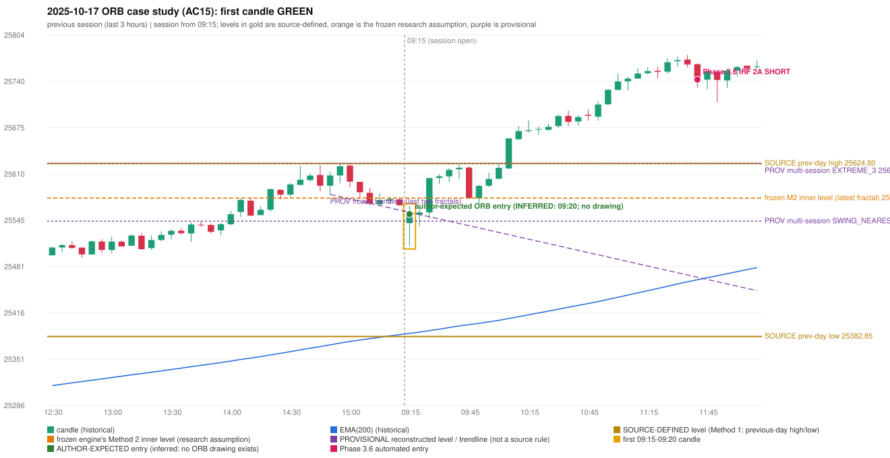

# 2025-10-17 - ORB case study (AC15, handwritten page 3)

> Audit evidence only: no controller, no fills, no P&L. Provisional levels are research constructions, not source rules.

**Author:** ORB should have activated, instead IRF is activated.

* Expected direction: NOT STATED. ASSUMPTION (not author evidence): LONG, inferred from the first-candle colour (GREEN)
* Expected method: NOT IDENTIFIABLE (no level, drawing or method written); closest by predicates: Method 1 (fails level_broken)
* Expected entry candle: 09:15-09:20 candle, entry at the 09:20 open of the next minute bar (rulebook decision time; no ORB drawing exists)
* Engine ORB status: Method 2 SHORT: INVALIDATED (TREND:EMA_PREV_SESSION_CLOSE wrong side)
* Phase 3.6 trade taken instead: IRF Method 2A 11:45 SHORT @ 25742.05
* Manual journal row: no journal row

## Original one-minute data (first five bars)

| time | open | high | low | close |
|---|---|---|---|---|
| 09:15 | 25541.3 | 25564.7 | 25508.95 | 25552.2 |
| 09:16 | 25552.7 | 25564.55 | 25541.3 | 25561.25 |
| 09:17 | 25559.55 | 25559.55 | 25542.5 | 25550.1 |
| 09:18 | 25547.55 | 25556.55 | 25541.3 | 25551.75 |
| 09:19 | 25553.05 | 25557.7 | 25546.7 | 25554.05 |

## First candle 25541.3/25564.7/25508.95/25554.05 (GREEN; body 22.9%, upper wick 19.1%, lower wick 58.0%); previous day high/low/close 25624.8/25382.85/25585.3; gap -44.0; EMA(200) 25387.17

## Engine eligibility checks (colour-matching direction, engine order)

| method | predicate | pass | observed | margin |
|---|---|---|---|---|
| Method 1 | level_broken | False | previous-day high 25624.8; candle high/low 25564.7, close 25554.05 | -70.75 |
| Method 1 | trend | True | EMA_PREV_SESSION_CLOSE on the trend side | 180.808 |
| Method 1 | candle_quality | True | body 22.9% opposite wick 19.1% close location 80.9% | -37.13 |
| Method 2 | inner_level_broken | False | latest inner swing 25576.4; close 25554.05 | -22.35 |
| Method 2 | trend | True | EMA_PREV_SESSION_CLOSE on the trend side | 180.808 |
| Method 2 | trendline | False | TRENDLINE_NOT_SUPPORTIVE; line at the open 25556.51 | -2.46 |
| Method 2 | candle_quality | True | body 22.9% opposite wick 19.1% close location 80.9% | -37.13 |
| Method 2 | near_ema_close | True | EMA not near |  |
| Gap/200DMA | gap_in_direction | False | gap -44.00 (DOWN) | -44.0 |
| Gap/200DMA | gap_crosses_200_average | False | previous close 25585.3 vs previous EMA 25385.49; open 25541.3 vs EMA 25387.17 | -199.808 |
| Gap/200DMA | first_candle_closes_beyond_average | True | close 25554.05 vs EMA 25387.17 | 166.881 |
| Gap/200DMA | candle_shape | True | body 22.9% opposite wick 19.1% close location 80.9%; rejection wick flag False | -37.13 |

## Candidate levels (what the first candle did against each construction)

| family | status | level | broken | open already beyond | close - level |
|---|---|---|---|---|---|
| M1_PREVIOUS_DAY_EXTREME | EXPLICIT_DOCUMENT_RULE (Method 1) | 25624.8 | False | False | -70.75 |
| M2_LATEST_FRACTAL_K2 | CURRENT_ENGINE_ASSUMPTION | 25576.4 | False | False | -22.35 |
| M2_HIGHEST_FRACTAL_K2 | RESEARCH_PROPOSAL | 25576.4 | False | False | -22.35 |
| M2_NEAREST_FRACTAL_FROM_OPEN_K2 | RESEARCH_PROPOSAL | 25544.1 | True | False | 9.95 |
| M2_HIGHEST_BROKEN_FRACTAL_K2 | RESEARCH_PROPOSAL | 25544.1 | True | False | 9.95 |
| MS_EXTREME_2_SESSIONS | RESEARCH_PROPOSAL (not in the written rules; the page-13 ref | 25624.8 | False | False | -70.75 |
| MS_EXTREME_3_SESSIONS | RESEARCH_PROPOSAL (not in the written rules; the page-13 ref | 25624.8 | False | False | -70.75 |
| MS_EXTREME_5_SESSIONS | RESEARCH_PROPOSAL (not in the written rules; the page-13 ref | 25624.8 | False | False | -70.75 |
| MS_SWING_NEAREST_FROM_OPEN_3_SESSIONS | RESEARCH_PROPOSAL | 25544.1 | True | False | 9.95 |

## Trend and trendline

* previous close 25566.3 vs its EMA 25385.49 (margin 180.81); first-candle close 25554.05 vs EMA 25387.17 (margin 166.88); EMA change over the last previous hour 26.18
* active trend: True (EMA_PREV_SESSION_CLOSE on the trend side); structure variant: False (STRUCTURE swing highs 25576.4->25624.8, swing lows 25581.55->25565.9 (not higher-high/higher-low)); literal first-close test: True (EMA5M_BASIC)
* frozen trendline: TRENDLINE_NOT_SUPPORTIVE (line at the open 25556.51); any-pair-of-last-three: TRENDLINE_NOT_SUPPORTIVE

## Candle strength

* body 22.87%, opposite wick 19.1%, close location 80.9%; STRICT False, MODERATE False, LOOSE False; owner pin test True (wick/body 2.54, close 19.1% from the favourable extreme; needs <= 30%)

## Missing condition and required definition

* NO conflict with an explicit source rule: the closest method fails an explicit source condition (level / gap not reached); the author's level is unknown
* Method 1: the first candle did not break and close beyond the previous-day high/low (Method 1 is source-explicit): the author must have used another level | Method 2: Method 2's inner level has no construction in the rulebook; the engine's latest-fractal choice was not broken | Gap/200DMA: no opening gap in this direction: the Gap / 200-average setup does not apply

## Variants (signal-only; disabled by default)

* orb-frozen: no ORB signal
* orb-var-inner-highest-fractal: no ORB signal
* orb-var-inner-nearest-from-open: no ORB signal
* orb-var-inner-highest-broken: no ORB signal
* orb-var-trendline-any-pair: no ORB signal
* orb-var-trendline-none: no ORB signal
* orb-var-strength-strict: no ORB signal
* orb-var-strength-loose: no ORB signal
* orb-var-trend-structure: no ORB signal
* orb-var-trend-ema-basic: no ORB signal
* orb-var-gap-candle-crossing: no ORB signal
* orb-var-colour: no ORB signal

