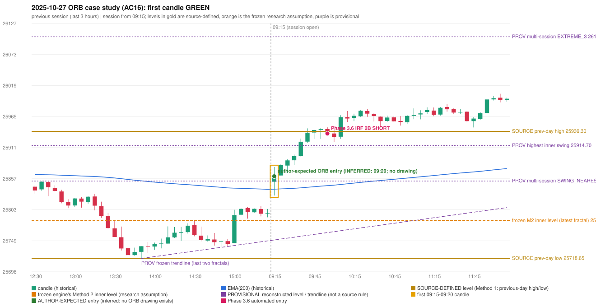

# 2025-10-27 - ORB case study (AC16, handwritten page 3)

> Audit evidence only: no controller, no fills, no P&L. Provisional levels are research constructions, not source rules.

**Author:** ORB should have activated, instead IRF is activated. | IRF activation is also wrong.

* Expected direction: NOT STATED. ASSUMPTION (not author evidence): LONG, inferred from the first-candle colour (GREEN)
* Expected method: NOT IDENTIFIABLE (no level, drawing or method written); closest by predicates: Gap/200DMA (fails candle_shape)
* Expected entry candle: 09:15-09:20 candle, entry at the 09:20 open of the next minute bar (rulebook decision time; no ORB drawing exists)
* Engine ORB status: Method 2 LONG: INVALIDATED (TREND:EMA_PREV_SESSION_CLOSE wrong side); Gap/200DMA LONG: INVALIDATED (CANDLE_QUALITY_OR_REJECTION_WICK)
* Phase 3.6 trade taken instead: IRF Method 2B 10:00 SHORT @ 25935.75
* Manual journal row: ORB 09:15

## Original one-minute data (first five bars)

| time | open | high | low | close |
|---|---|---|---|---|
| 09:15 | 25851.95 | 25872.9 | 25828.1 | 25871.7 |
| 09:16 | 25869.85 | 25877.6 | 25862.1 | 25873.8 |
| 09:17 | 25875.5 | 25876.35 | 25860.9 | 25862.7 |
| 09:18 | 25863.8 | 25866.45 | 25850.7 | 25855.0 |
| 09:19 | 25856.1 | 25869.45 | 25853.9 | 25861.4 |

## First candle 25851.95/25877.6/25828.1/25861.4 (GREEN; body 19.1%, upper wick 32.7%, lower wick 48.2%); previous day high/low/close 25939.3/25718.65/25795.15; gap 56.8; EMA(200) 25839.1

## Engine eligibility checks (colour-matching direction, engine order)

| method | predicate | pass | observed | margin |
|---|---|---|---|---|
| Method 1 | level_broken | False | previous-day high 25939.3; candle high/low 25877.6, close 25861.4 | -77.9 |
| Method 1 | trend | False | EMA_PREV_SESSION_CLOSE wrong side | -41.421 |
| Method 1 | candle_quality | False | body 19.1% opposite wick 32.7% close location 67.3% | -40.909 |
| Method 2 | inner_level_broken | True | latest inner swing 25784.3; close 25861.4 | 77.1 |
| Method 2 | trend | False | EMA_PREV_SESSION_CLOSE wrong side | -41.421 |
| Method 2 | trendline | True | TRENDLINE_SUPPORTIVE; line at the open 25750.82 | 110.583 |
| Method 2 | candle_quality | False | body 19.1% opposite wick 32.7% close location 67.3% | -40.909 |
| Method 2 | near_ema_close | True | EMA not near |  |
| Gap/200DMA | gap_in_direction | True | gap +56.80 (UP) | 56.8 |
| Gap/200DMA | gap_crosses_200_average | True | previous close 25795.15 vs previous EMA 25838.87; open 25851.95 vs EMA 25839.10 | 12.855 |
| Gap/200DMA | first_candle_closes_beyond_average | True | close 25861.4 vs EMA 25839.10 | 22.305 |
| Gap/200DMA | candle_shape | False | body 19.1% opposite wick 32.7% close location 67.3%; rejection wick flag False | -40.909 |

## Candidate levels (what the first candle did against each construction)

| family | status | level | broken | open already beyond | close - level |
|---|---|---|---|---|---|
| M1_PREVIOUS_DAY_EXTREME | EXPLICIT_DOCUMENT_RULE (Method 1) | 25939.3 | False | False | -77.9 |
| M2_LATEST_FRACTAL_K2 | CURRENT_ENGINE_ASSUMPTION | 25784.3 | True | True | 77.1 |
| M2_HIGHEST_FRACTAL_K2 | RESEARCH_PROPOSAL | 25914.7 | False | False | -53.3 |
| M2_NEAREST_FRACTAL_FROM_OPEN_K2 | RESEARCH_PROPOSAL | 25853.15 | True | False | 8.25 |
| M2_HIGHEST_BROKEN_FRACTAL_K2 | RESEARCH_PROPOSAL | 25853.15 | True | False | 8.25 |
| MS_EXTREME_2_SESSIONS | RESEARCH_PROPOSAL (not in the written rules; the page-13 ref | 26103.8 | False | False | -242.4 |
| MS_EXTREME_3_SESSIONS | RESEARCH_PROPOSAL (not in the written rules; the page-13 ref | 26103.8 | False | False | -242.4 |
| MS_EXTREME_5_SESSIONS | RESEARCH_PROPOSAL (not in the written rules; the page-13 ref | 26103.8 | False | False | -242.4 |
| MS_SWING_NEAREST_FROM_OPEN_3_SESSIONS | RESEARCH_PROPOSAL | 25853.15 | True | False | 8.25 |

## Trend and trendline

* previous close 25797.45 vs its EMA 25838.87 (margin -41.42); first-candle close 25861.4 vs EMA 25839.1 (margin 22.3); EMA change over the last previous hour -8.06
* active trend: False (EMA_PREV_SESSION_CLOSE wrong side); structure variant: False (STRUCTURE: previous close on the wrong side of EMA(200)); literal first-close test: True (EMA5M_BASIC)
* frozen trendline: TRENDLINE_SUPPORTIVE (line at the open 25750.82); any-pair-of-last-three: TRENDLINE_SUPPORTIVE

## Candle strength

* body 19.09%, opposite wick 32.73%, close location 67.27%; STRICT False, MODERATE False, LOOSE False; owner pin test False (wick/body 2.52, close 32.73% from the favourable extreme; needs <= 30%)

## Missing condition and required definition

* YES: the closest method (Gap/200DMA) is rejected by a condition the engine decides with a research assumption / numeric approximation / owner variant (NUMERIC_APPROXIMATION); the source is silent or qualitative there
* Method 1: the first candle did not break and close beyond the previous-day high/low (Method 1 is source-explicit): the author must have used another level | Method 2: the active trend reading (previous close against its EMA) differs from the rulebook's literal 'price above the 200 EMA' at 09:20 | Gap/200DMA: 'strong body or suitable pin bar' is qualitative; the numeric profile / pin test rejected the candle

## Variants (signal-only; disabled by default)

* orb-frozen: no ORB signal
* orb-var-inner-highest-fractal: no ORB signal
* orb-var-inner-nearest-from-open: no ORB signal
* orb-var-inner-highest-broken: no ORB signal
* orb-var-trendline-any-pair: no ORB signal
* orb-var-trendline-none: no ORB signal
* orb-var-strength-strict: no ORB signal
* orb-var-strength-loose: no ORB signal
* orb-var-trend-structure: no ORB signal
* orb-var-trend-ema-basic: no ORB signal
* orb-var-gap-candle-crossing: no ORB signal
* orb-var-colour: no ORB signal

