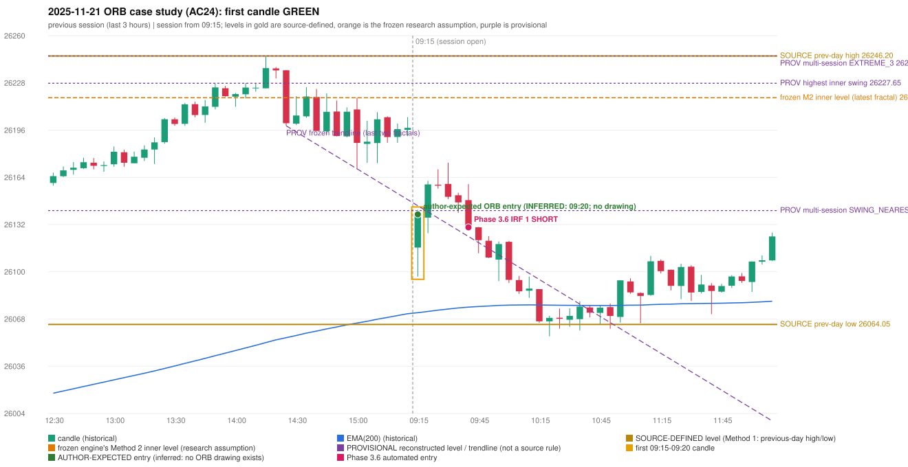

# 2025-11-21 - ORB case study (AC24, handwritten page 4)

> Audit evidence only: no controller, no fills, no P&L. Provisional levels are research constructions, not source rules.

**Author:** ORB should have activated, but IRF is activated

* Expected direction: NOT STATED. ASSUMPTION (not author evidence): LONG, inferred from the first-candle colour (GREEN)
* Expected method: NOT IDENTIFIABLE (every method fails two or more predicates)
* Expected entry candle: 09:15-09:20 candle, entry at the 09:20 open of the next minute bar (rulebook decision time; no ORB drawing exists)
* Engine ORB status: Method 2 SHORT: INVALIDATED (TREND:EMA_PREV_SESSION_CLOSE wrong side)
* Phase 3.6 trade taken instead: IRF Method 1 09:45 SHORT @ 26129.9
* Manual journal row: IRF 09:40

## Original one-minute data (first five bars)

| time | open | high | low | close |
|---|---|---|---|---|
| 09:15 | 26116.2 | 26130.05 | 26096.5 | 26111.1 |
| 09:16 | 26107.35 | 26115.6 | 26100.45 | 26106.9 |
| 09:17 | 26104.75 | 26123.75 | 26101.55 | 26117.05 |
| 09:18 | 26116.75 | 26124.05 | 26112.9 | 26123.6 |
| 09:19 | 26122.15 | 26141.85 | 26118.75 | 26138.75 |

## First candle 26116.2/26141.85/26096.5/26138.75 (GREEN; body 49.7%, upper wick 6.8%, lower wick 43.4%); previous day high/low/close 26246.2/26064.05/26192.15; gap -75.95; EMA(200) 26071.99

## Engine eligibility checks (colour-matching direction, engine order)

| method | predicate | pass | observed | margin |
|---|---|---|---|---|
| Method 1 | level_broken | False | previous-day high 26246.2; candle high/low 26141.85, close 26138.75 | -107.45 |
| Method 1 | trend | True | EMA_PREV_SESSION_CLOSE on the trend side | 126.079 |
| Method 1 | candle_quality | False | body 49.7% opposite wick 6.8% close location 93.2% | -10.276 |
| Method 2 | inner_level_broken | False | latest inner swing 26217.85; close 26138.75 | -79.1 |
| Method 2 | trend | True | EMA_PREV_SESSION_CLOSE on the trend side | 126.079 |
| Method 2 | trendline | False | TRENDLINE_NOT_SUPPORTIVE; line at the open 26144.57 | -5.821 |
| Method 2 | candle_quality | False | body 49.7% opposite wick 6.8% close location 93.2% | -10.276 |
| Method 2 | near_ema_close | True | EMA not near |  |
| Gap/200DMA | gap_in_direction | False | gap -75.95 (DOWN) | -75.95 |
| Gap/200DMA | gap_crosses_200_average | False | previous close 26192.15 vs previous EMA 26071.32; open 26116.2 vs EMA 26071.99 | -120.829 |
| Gap/200DMA | first_candle_closes_beyond_average | True | close 26138.75 vs EMA 26071.99 | 66.758 |
| Gap/200DMA | candle_shape | False | body 49.7% opposite wick 6.8% close location 93.2%; rejection wick flag False | -10.276 |

## Candidate levels (what the first candle did against each construction)

| family | status | level | broken | open already beyond | close - level |
|---|---|---|---|---|---|
| M1_PREVIOUS_DAY_EXTREME | EXPLICIT_DOCUMENT_RULE (Method 1) | 26246.2 | False | False | -107.45 |
| M2_LATEST_FRACTAL_K2 | CURRENT_ENGINE_ASSUMPTION | 26217.85 | False | False | -79.1 |
| M2_HIGHEST_FRACTAL_K2 | RESEARCH_PROPOSAL | 26227.65 | False | False | -88.9 |
| M2_NEAREST_FRACTAL_FROM_OPEN_K2 | RESEARCH_PROPOSAL | 26141.3 | False | False | -2.55 |
| M2_HIGHEST_BROKEN_FRACTAL_K2 | RESEARCH_PROPOSAL | 26111.9 | True | True | 26.85 |
| MS_EXTREME_2_SESSIONS | RESEARCH_PROPOSAL (not in the written rules; the page-13 ref | 26246.2 | False | False | -107.45 |
| MS_EXTREME_3_SESSIONS | RESEARCH_PROPOSAL (not in the written rules; the page-13 ref | 26246.2 | False | False | -107.45 |
| MS_EXTREME_5_SESSIONS | RESEARCH_PROPOSAL (not in the written rules; the page-13 ref | 26246.2 | False | False | -107.45 |
| MS_SWING_NEAREST_FROM_OPEN_3_SESSIONS | RESEARCH_PROPOSAL | 26141.3 | False | False | -2.55 |

## Trend and trendline

* previous close 26197.4 vs its EMA 26071.32 (margin 126.08); first-candle close 26138.75 vs EMA 26071.99 (margin 66.76); EMA change over the last previous hour 16.3
* active trend: True (EMA_PREV_SESSION_CLOSE on the trend side); structure variant: False (STRUCTURE swing highs 26246.2->26217.85, swing lows 26198.8->26169.6 (not higher-high/higher-low)); literal first-close test: True (EMA5M_BASIC)
* frozen trendline: TRENDLINE_NOT_SUPPORTIVE (line at the open 26144.57); any-pair-of-last-three: TRENDLINE_NOT_SUPPORTIVE

## Candle strength

* body 49.72%, opposite wick 6.84%, close location 93.16%; STRICT False, MODERATE False, LOOSE False; owner pin test False (wick/body 0.87, close 6.84% from the favourable extreme; needs <= 30%)

## Missing condition and required definition

* UNDETERMINED: every method fails two or more predicates, so the author's setup cannot be identified; the engine violates no explicit source rule that is shown
* Method 1: the first candle did not break and close beyond the previous-day high/low (Method 1 is source-explicit): the author must have used another level | Method 2: Method 2's inner level has no construction in the rulebook; the engine's latest-fractal choice was not broken | Gap/200DMA: no opening gap in this direction: the Gap / 200-average setup does not apply

## Variants (signal-only; disabled by default)

* orb-frozen: no ORB signal
* orb-var-inner-highest-fractal: no ORB signal
* orb-var-inner-nearest-from-open: no ORB signal
* orb-var-inner-highest-broken: no ORB signal
* orb-var-trendline-any-pair: no ORB signal
* orb-var-trendline-none: no ORB signal
* orb-var-strength-strict: no ORB signal
* orb-var-strength-loose: no ORB signal
* orb-var-trend-structure: no ORB signal
* orb-var-trend-ema-basic: no ORB signal
* orb-var-gap-candle-crossing: no ORB signal
* orb-var-colour: no ORB signal

