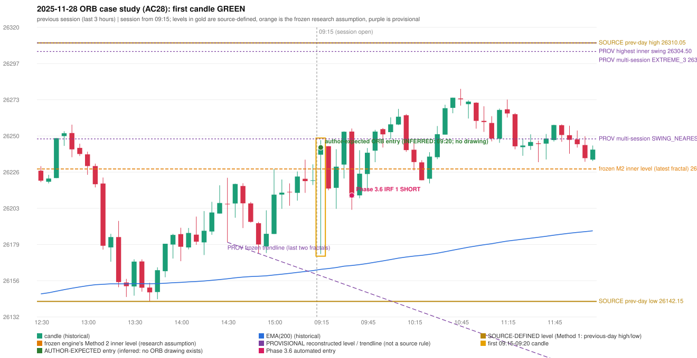

# 2025-11-28 - ORB case study (AC28, handwritten page 5)

> Audit evidence only: no controller, no fills, no P&L. Provisional levels are research constructions, not source rules.

**Author:** ORB should be activated instead of IRF

* Expected direction: NOT STATED. ASSUMPTION (not author evidence): LONG, inferred from the first-candle colour (GREEN)
* Expected method: NOT IDENTIFIABLE (no level, drawing or method written); closest by predicates: Method 1 (fails level_broken), Method 2 (fails trendline), Gap/200DMA (fails gap_crosses_200_average)
* Expected entry candle: 09:15-09:20 candle, entry at the 09:20 open of the next minute bar (rulebook decision time; no ORB drawing exists)
* Engine ORB status: Method 2 LONG: INVALIDATED (TRENDLINE_NOT_SUPPORTIVE)
* Phase 3.6 trade taken instead: IRF Method 1 09:40 SHORT @ 26211.0
* Manual journal row: ORB 09:15

## Original one-minute data (first five bars)

| time | open | high | low | close |
|---|---|---|---|---|
| 09:15 | 26237.45 | 26246.9 | 26172.9 | 26197.6 |
| 09:16 | 26198.25 | 26208.05 | 26189.15 | 26203.05 |
| 09:17 | 26205.65 | 26216.25 | 26196.8 | 26214.0 |
| 09:18 | 26214.55 | 26230.8 | 26213.25 | 26230.35 |
| 09:19 | 26229.75 | 26242.15 | 26223.3 | 26242.15 |

## First candle 26237.45/26246.9/26172.9/26242.15 (GREEN; body 6.4%, upper wick 6.4%, lower wick 87.2%); previous day high/low/close 26310.05/26142.15/26215.55; gap 21.9; EMA(200) 26162.97

## Engine eligibility checks (colour-matching direction, engine order)

| method | predicate | pass | observed | margin |
|---|---|---|---|---|
| Method 1 | level_broken | False | previous-day high 26310.05; candle high/low 26246.9, close 26242.15 | -67.9 |
| Method 1 | trend | True | EMA_PREV_SESSION_CLOSE on the trend side | 58.623 |
| Method 1 | candle_quality | True | body 6.4% opposite wick 6.4% close location 93.6% | -53.649 |
| Method 2 | inner_level_broken | True | latest inner swing 26228.2; close 26242.15 | 13.95 |
| Method 2 | trend | True | EMA_PREV_SESSION_CLOSE on the trend side | 58.623 |
| Method 2 | trendline | False | TRENDLINE_NOT_SUPPORTIVE; line at the open 26158.8 | 83.35 |
| Method 2 | candle_quality | True | body 6.4% opposite wick 6.4% close location 93.6% | -53.649 |
| Method 2 | near_ema_close | True | EMA not near |  |
| Gap/200DMA | gap_in_direction | True | gap +21.90 (UP) | 21.9 |
| Gap/200DMA | gap_crosses_200_average | False | previous close 26215.55 vs previous EMA 26162.18; open 26237.45 vs EMA 26162.97 | -53.373 |
| Gap/200DMA | first_candle_closes_beyond_average | True | close 26242.15 vs EMA 26162.97 | 79.177 |
| Gap/200DMA | candle_shape | True | body 6.4% opposite wick 6.4% close location 93.6%; rejection wick flag False | -53.649 |

## Candidate levels (what the first candle did against each construction)

| family | status | level | broken | open already beyond | close - level |
|---|---|---|---|---|---|
| M1_PREVIOUS_DAY_EXTREME | EXPLICIT_DOCUMENT_RULE (Method 1) | 26310.05 | False | False | -67.9 |
| M2_LATEST_FRACTAL_K2 | CURRENT_ENGINE_ASSUMPTION | 26228.2 | True | True | 13.95 |
| M2_HIGHEST_FRACTAL_K2 | RESEARCH_PROPOSAL | 26304.5 | False | False | -62.35 |
| M2_NEAREST_FRACTAL_FROM_OPEN_K2 | RESEARCH_PROPOSAL | 26247.7 | False | False | -5.55 |
| M2_HIGHEST_BROKEN_FRACTAL_K2 | RESEARCH_PROPOSAL | 26228.2 | True | True | 13.95 |
| MS_EXTREME_2_SESSIONS | RESEARCH_PROPOSAL (not in the written rules; the page-13 ref | 26310.05 | False | False | -67.9 |
| MS_EXTREME_3_SESSIONS | RESEARCH_PROPOSAL (not in the written rules; the page-13 ref | 26310.05 | False | False | -67.9 |
| MS_EXTREME_5_SESSIONS | RESEARCH_PROPOSAL (not in the written rules; the page-13 ref | 26310.05 | False | False | -67.9 |
| MS_SWING_NEAREST_FROM_OPEN_3_SESSIONS | RESEARCH_PROPOSAL | 26247.7 | False | False | -5.55 |

## Trend and trendline

* previous close 26220.8 vs its EMA 26162.18 (margin 58.62); first-candle close 26242.15 vs EMA 26162.97 (margin 79.18); EMA change over the last previous hour 5.81
* active trend: True (EMA_PREV_SESSION_CLOSE on the trend side); structure variant: False (STRUCTURE swing highs 26222.45->26228.2, swing lows 26180.55->26173.3 (not higher-high/higher-low)); literal first-close test: True (EMA5M_BASIC)
* frozen trendline: TRENDLINE_NOT_SUPPORTIVE (line at the open 26158.8); any-pair-of-last-three: TRENDLINE_SUPPORTIVE

## Candle strength

* body 6.35%, opposite wick 6.42%, close location 93.58%; STRICT False, MODERATE False, LOOSE False; owner pin test True (wick/body 13.73, close 6.42% from the favourable extreme; needs <= 30%)

## Missing condition and required definition

* YES: the closest method (Method 1, Method 2, Gap/200DMA) is rejected by a condition the engine decides with a research assumption / numeric approximation / owner variant (ENGINE_ASSUMPTION, READING_OF_SOURCE); the source is silent or qualitative there
* Method 1: the first candle did not break and close beyond the previous-day high/low (Method 1 is source-explicit): the author must have used another level | Method 2: the Method 2 trendline has no construction in the rulebook; the engine's last-two-fractals line was not supportive | Gap/200DMA: the gap did not carry the OPEN through the 200 average (frozen reading: previous close on the wrong side AND open on the right side)

## Variants (signal-only; disabled by default)

* orb-frozen: no ORB signal
* orb-var-inner-highest-fractal: no ORB signal
* orb-var-inner-nearest-from-open: no ORB signal
* orb-var-inner-highest-broken: no ORB signal
* orb-var-trendline-any-pair: Method 2 LONG 09:20
* orb-var-trendline-none: Method 2 LONG 09:20
* orb-var-strength-strict: no ORB signal
* orb-var-strength-loose: no ORB signal
* orb-var-trend-structure: no ORB signal
* orb-var-trend-ema-basic: no ORB signal
* orb-var-gap-candle-crossing: no ORB signal
* orb-var-colour: no ORB signal

