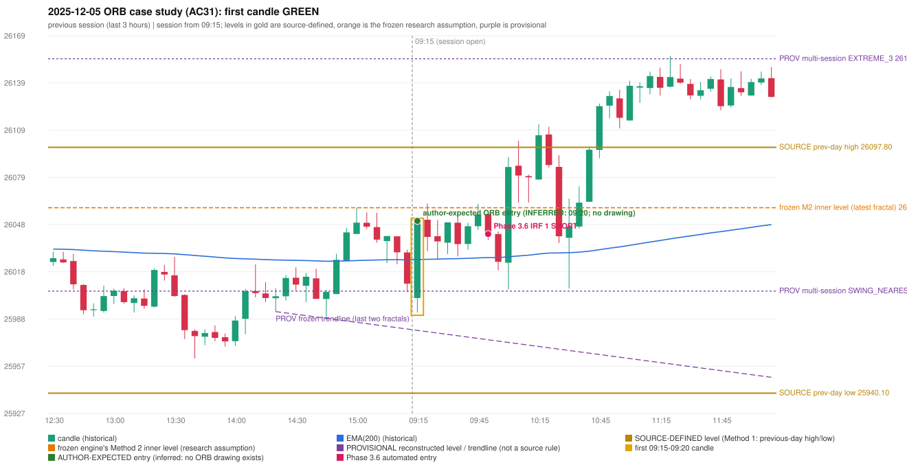

# 2025-12-05 - ORB case study (AC31, handwritten page 5)

> Audit evidence only: no controller, no fills, no P&L. Provisional levels are research constructions, not source rules.

**Author:** ORB should activate instead of IRF.

* Expected direction: NOT STATED. ASSUMPTION (not author evidence): LONG, inferred from the first-candle colour (GREEN)
* Expected method: NOT IDENTIFIABLE (every method fails two or more predicates)
* Expected entry candle: 09:15-09:20 candle, entry at the 09:20 open of the next minute bar (rulebook decision time; no ORB drawing exists)
* Engine ORB status: Gap/200DMA SHORT: INVALIDATED (CLOSE_NOT_BEYOND_MA)
* Phase 3.6 trade taken instead: IRF Method 1 09:55 SHORT @ 26042.15
* Manual journal row: ORB 09:15

## Original one-minute data (first five bars)

| time | open | high | low | close |
|---|---|---|---|---|
| 09:15 | 26001.15 | 26023.25 | 25991.85 | 26004.95 |
| 09:16 | 26000.0 | 26025.3 | 25997.35 | 26022.85 |
| 09:17 | 26022.7 | 26043.4 | 26021.95 | 26040.7 |
| 09:18 | 26039.65 | 26040.95 | 26024.2 | 26028.05 |
| 09:19 | 26028.5 | 26050.6 | 26028.5 | 26050.6 |

## First candle 26001.15/26050.6/25991.85/26050.6 (GREEN; body 84.2%, upper wick 0.0%, lower wick 15.8%); previous day high/low/close 26097.8/25940.1/26033.75; gap -32.6; EMA(200) 26025.83

## Engine eligibility checks (colour-matching direction, engine order)

| method | predicate | pass | observed | margin |
|---|---|---|---|---|
| Method 1 | level_broken | False | previous-day high 26097.8; candle high/low 26050.6, close 26050.6 | -47.2 |
| Method 1 | trend | False | EMA_PREV_SESSION_CLOSE wrong side | -15.227 |
| Method 1 | candle_quality | True | body 84.2% opposite wick 0.0% close location 100.0% | 20.0 |
| Method 2 | inner_level_broken | False | latest inner swing 26059.05; close 26050.6 | -8.45 |
| Method 2 | trend | False | EMA_PREV_SESSION_CLOSE wrong side | -15.227 |
| Method 2 | trendline | False | TRENDLINE_NOT_SUPPORTIVE; line at the open 25980.41 | 70.19 |
| Method 2 | candle_quality | True | body 84.2% opposite wick 0.0% close location 100.0% | 20.0 |
| Method 2 | near_ema_close | True | EMA not near |  |
| Gap/200DMA | gap_in_direction | False | gap -32.60 (DOWN) | -32.6 |
| Gap/200DMA | gap_crosses_200_average | False | previous close 26033.75 vs previous EMA 26025.58; open 26001.15 vs EMA 26025.83 | -24.676 |
| Gap/200DMA | first_candle_closes_beyond_average | True | close 26050.6 vs EMA 26025.83 | 24.774 |
| Gap/200DMA | candle_shape | True | body 84.2% opposite wick 0.0% close location 100.0%; rejection wick flag False | 20.0 |

## Candidate levels (what the first candle did against each construction)

| family | status | level | broken | open already beyond | close - level |
|---|---|---|---|---|---|
| M1_PREVIOUS_DAY_EXTREME | EXPLICIT_DOCUMENT_RULE (Method 1) | 26097.8 | False | False | -47.2 |
| M2_LATEST_FRACTAL_K2 | CURRENT_ENGINE_ASSUMPTION | 26059.05 | False | False | -8.45 |
| M2_HIGHEST_FRACTAL_K2 | RESEARCH_PROPOSAL | 26059.05 | False | False | -8.45 |
| M2_NEAREST_FRACTAL_FROM_OPEN_K2 | RESEARCH_PROPOSAL | 26020.85 | True | False | 29.75 |
| M2_HIGHEST_BROKEN_FRACTAL_K2 | RESEARCH_PROPOSAL | 26044.1 | True | False | 6.5 |
| MS_EXTREME_2_SESSIONS | RESEARCH_PROPOSAL (not in the written rules; the page-13 ref | 26097.8 | False | False | -47.2 |
| MS_EXTREME_3_SESSIONS | RESEARCH_PROPOSAL (not in the written rules; the page-13 ref | 26154.6 | False | False | -104.0 |
| MS_EXTREME_5_SESSIONS | RESEARCH_PROPOSAL (not in the written rules; the page-13 ref | 26325.8 | False | False | -275.2 |
| MS_SWING_NEAREST_FROM_OPEN_3_SESSIONS | RESEARCH_PROPOSAL | 26005.55 | True | False | 45.05 |

## Trend and trendline

* previous close 26010.35 vs its EMA 26025.58 (margin -15.23); first-candle close 26050.6 vs EMA 26025.83 (margin 24.77); EMA change over the last previous hour 0.13
* active trend: False (EMA_PREV_SESSION_CLOSE wrong side); structure variant: False (STRUCTURE: previous close on the wrong side of EMA(200)); literal first-close test: True (EMA5M_BASIC)
* frozen trendline: TRENDLINE_NOT_SUPPORTIVE (line at the open 25980.41); any-pair-of-last-three: TRENDLINE_SUPPORTIVE

## Candle strength

* body 84.17%, opposite wick 0.0%, close location 100.0%; STRICT True, MODERATE True, LOOSE True; owner pin test False (wick/body 0.19, close 0.0% from the favourable extreme; needs <= 30%)

## Missing condition and required definition

* UNDETERMINED: every method fails two or more predicates, so the author's setup cannot be identified; the engine violates no explicit source rule that is shown
* Method 1: the first candle did not break and close beyond the previous-day high/low (Method 1 is source-explicit): the author must have used another level | Method 2: Method 2's inner level has no construction in the rulebook; the engine's latest-fractal choice was not broken | Gap/200DMA: no opening gap in this direction: the Gap / 200-average setup does not apply

## Variants (signal-only; disabled by default)

* orb-frozen: no ORB signal
* orb-var-inner-highest-fractal: no ORB signal
* orb-var-inner-nearest-from-open: no ORB signal
* orb-var-inner-highest-broken: no ORB signal
* orb-var-trendline-any-pair: no ORB signal
* orb-var-trendline-none: no ORB signal
* orb-var-strength-strict: no ORB signal
* orb-var-strength-loose: no ORB signal
* orb-var-trend-structure: no ORB signal
* orb-var-trend-ema-basic: no ORB signal
* orb-var-gap-candle-crossing: no ORB signal
* orb-var-colour: no ORB signal

