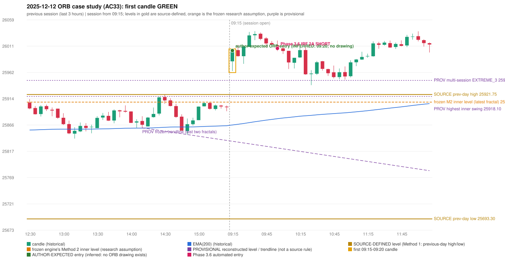

# 2025-12-12 - ORB case study (AC33, handwritten page 5)

> Audit evidence only: no controller, no fills, no P&L. Provisional levels are research constructions, not source rules.

**Author:** Should be ORB, But IRF is activated.

* Expected direction: NOT STATED. ASSUMPTION (not author evidence): LONG, inferred from the first-candle colour (GREEN)
* Expected method: NOT IDENTIFIABLE (no level, drawing or method written); closest by predicates: Method 1 (fails candle_quality)
* Expected entry candle: 09:15-09:20 candle, entry at the 09:20 open of the next minute bar (rulebook decision time; no ORB drawing exists)
* Engine ORB status: Method 1 LONG: INVALIDATED (CANDLE_QUALITY(not a strong body / wick too large)); Method 2 LONG: INVALIDATED (TRENDLINE_NOT_SUPPORTIVE)
* Phase 3.6 trade taken instead: IRF Method 2A 10:00 SHORT @ 26006.5
* Manual journal row: ORB 09:15

## Original one-minute data (first five bars)

| time | open | high | low | close |
|---|---|---|---|---|
| 09:15 | 25982.75 | 25993.25 | 25964.9 | 25981.1 |
| 09:16 | 25979.3 | 25992.25 | 25967.65 | 25989.65 |
| 09:17 | 25989.05 | 25994.15 | 25986.2 | 25987.85 |
| 09:18 | 25988.15 | 25995.15 | 25983.9 | 25992.8 |
| 09:19 | 25989.85 | 26002.8 | 25988.75 | 26002.55 |

## First candle 25982.75/26002.8/25964.9/26002.55 (GREEN; body 52.2%, upper wick 0.7%, lower wick 47.1%); previous day high/low/close 25921.75/25693.3/25898.55; gap 84.2; EMA(200) 25865.85

## Engine eligibility checks (colour-matching direction, engine order)

| method | predicate | pass | observed | margin |
|---|---|---|---|---|
| Method 1 | level_broken | True | previous-day high 25921.75; candle high/low 26002.8, close 26002.55 | 80.8 |
| Method 1 | trend | True | EMA_PREV_SESSION_CLOSE on the trend side | 33.927 |
| Method 1 | candle_quality | False | body 52.2% opposite wick 0.7% close location 99.3% | -7.757 |
| Method 2 | inner_level_broken | True | latest inner swing 25907.8; close 26002.55 | 94.75 |
| Method 2 | trend | True | EMA_PREV_SESSION_CLOSE on the trend side | 33.927 |
| Method 2 | trendline | False | TRENDLINE_NOT_SUPPORTIVE; line at the open 25835.9 | 166.65 |
| Method 2 | candle_quality | False | body 52.2% opposite wick 0.7% close location 99.3% | -7.757 |
| Method 2 | near_ema_close | True | EMA not near |  |
| Gap/200DMA | gap_in_direction | True | gap +84.20 (UP) | 84.2 |
| Gap/200DMA | gap_crosses_200_average | False | previous close 25898.55 vs previous EMA 25864.47; open 25982.75 vs EMA 25865.85 | -34.077 |
| Gap/200DMA | first_candle_closes_beyond_average | True | close 26002.55 vs EMA 25865.85 | 136.703 |
| Gap/200DMA | candle_shape | False | body 52.2% opposite wick 0.7% close location 99.3%; rejection wick flag False | -7.757 |

## Candidate levels (what the first candle did against each construction)

| family | status | level | broken | open already beyond | close - level |
|---|---|---|---|---|---|
| M1_PREVIOUS_DAY_EXTREME | EXPLICIT_DOCUMENT_RULE (Method 1) | 25921.75 | True | True | 80.8 |
| M2_LATEST_FRACTAL_K2 | CURRENT_ENGINE_ASSUMPTION | 25907.8 | True | True | 94.75 |
| M2_HIGHEST_FRACTAL_K2 | RESEARCH_PROPOSAL | 25918.1 | True | True | 84.45 |
| M2_NEAREST_FRACTAL_FROM_OPEN_K2 | RESEARCH_PROPOSAL | None | False | None | None |
| M2_HIGHEST_BROKEN_FRACTAL_K2 | RESEARCH_PROPOSAL | 25918.1 | True | True | 84.45 |
| MS_EXTREME_2_SESSIONS | RESEARCH_PROPOSAL (not in the written rules; the page-13 ref | 25947.65 | True | True | 54.9 |
| MS_EXTREME_3_SESSIONS | RESEARCH_PROPOSAL (not in the written rules; the page-13 ref | 25947.65 | True | True | 54.9 |
| MS_EXTREME_5_SESSIONS | RESEARCH_PROPOSAL (not in the written rules; the page-13 ref | 26202.55 | False | False | -200.0 |
| MS_SWING_NEAREST_FROM_OPEN_3_SESSIONS | RESEARCH_PROPOSAL | None | False | None | None |

## Trend and trendline

* previous close 25898.4 vs its EMA 25864.47 (margin 33.93); first-candle close 26002.55 vs EMA 25865.85 (margin 136.7); EMA change over the last previous hour 3.38
* active trend: True (EMA_PREV_SESSION_CLOSE on the trend side); structure variant: False (STRUCTURE swing highs 25921.75->25907.8, swing lows 25860.6->25848.25 (not higher-high/higher-low)); literal first-close test: True (EMA5M_BASIC)
* frozen trendline: TRENDLINE_NOT_SUPPORTIVE (line at the open 25835.9); any-pair-of-last-three: TRENDLINE_NOT_SUPPORTIVE

## Candle strength

* body 52.24%, opposite wick 0.66%, close location 99.34%; STRICT False, MODERATE False, LOOSE True; owner pin test False (wick/body 0.9, close 0.66% from the favourable extreme; needs <= 30%)

## Missing condition and required definition

* YES: the closest method (Method 1) is rejected by a condition the engine decides with a research assumption / numeric approximation / owner variant (NUMERIC_APPROXIMATION); the source is silent or qualitative there
* Method 1: 'strong body, limited wick' is qualitative in the rulebook; the numeric profile (MODERATE) rejected the candle | Method 2: the Method 2 trendline has no construction in the rulebook; the engine's last-two-fractals line was not supportive | Gap/200DMA: the gap did not carry the OPEN through the 200 average (frozen reading: previous close on the wrong side AND open on the right side)

## Variants (signal-only; disabled by default)

* orb-frozen: no ORB signal
* orb-var-inner-highest-fractal: no ORB signal
* orb-var-inner-nearest-from-open: no ORB signal
* orb-var-inner-highest-broken: no ORB signal
* orb-var-trendline-any-pair: no ORB signal
* orb-var-trendline-none: no ORB signal
* orb-var-strength-strict: no ORB signal
* orb-var-strength-loose: Method 1 LONG 09:20
* orb-var-trend-structure: no ORB signal
* orb-var-trend-ema-basic: no ORB signal
* orb-var-gap-candle-crossing: no ORB signal
* orb-var-colour: no ORB signal

