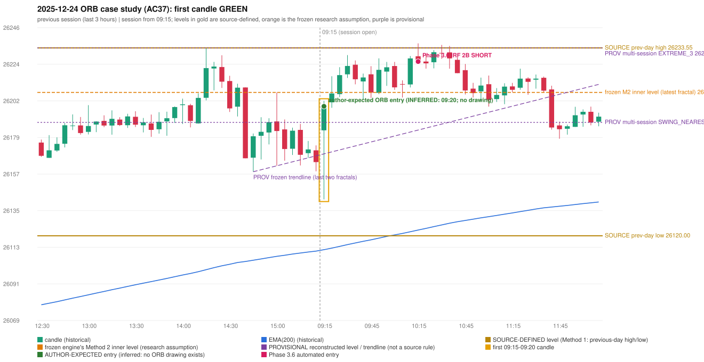

# 2025-12-24 - ORB case study (AC37, handwritten page 6)

> Audit evidence only: no controller, no fills, no P&L. Provisional levels are research constructions, not source rules.

**Author:** ORB should be activated instead of IRF

* Expected direction: NOT STATED. ASSUMPTION (not author evidence): LONG, inferred from the first-candle colour (GREEN)
* Expected method: NOT IDENTIFIABLE (no level, drawing or method written); closest by predicates: Method 1 (fails level_broken), Method 2 (fails inner_level_broken), Gap/200DMA (fails gap_crosses_200_average)
* Expected entry candle: 09:15-09:20 candle, entry at the 09:20 open of the next minute bar (rulebook decision time; no ORB drawing exists)
* Engine ORB status: NO RECORD (no level broken / no gap crossing in either direction)
* Phase 3.6 trade taken instead: IRF Method 2B 10:20 SHORT @ 26225.3
* Manual journal row: ORB 09:15

## Original one-minute data (first five bars)

| time | open | high | low | close |
|---|---|---|---|---|
| 09:15 | 26183.75 | 26201.55 | 26149.5 | 26150.7 |
| 09:16 | 26149.65 | 26164.75 | 26142.0 | 26161.5 |
| 09:17 | 26159.05 | 26173.7 | 26153.7 | 26173.7 |
| 09:18 | 26175.0 | 26189.55 | 26174.1 | 26188.05 |
| 09:19 | 26188.4 | 26200.4 | 26188.4 | 26198.25 |

## First candle 26183.75/26201.55/26142.0/26198.25 (GREEN; body 24.3%, upper wick 5.5%, lower wick 70.1%); previous day high/low/close 26233.55/26120.0/26177.15; gap 6.6; EMA(200) 26111.6

## Engine eligibility checks (colour-matching direction, engine order)

| method | predicate | pass | observed | margin |
|---|---|---|---|---|
| Method 1 | level_broken | False | previous-day high 26233.55; candle high/low 26201.55, close 26198.25 | -35.3 |
| Method 1 | trend | True | EMA_PREV_SESSION_CLOSE on the trend side | 53.82 |
| Method 1 | candle_quality | True | body 24.3% opposite wick 5.5% close location 94.5% | -35.651 |
| Method 2 | inner_level_broken | False | latest inner swing 26206.65; close 26198.25 | -8.4 |
| Method 2 | trend | True | EMA_PREV_SESSION_CLOSE on the trend side | 53.82 |
| Method 2 | trendline | True | TRENDLINE_SUPPORTIVE; line at the open 26169.5 | 28.75 |
| Method 2 | candle_quality | True | body 24.3% opposite wick 5.5% close location 94.5% | -35.651 |
| Method 2 | near_ema_close | True | EMA not near |  |
| Gap/200DMA | gap_in_direction | True | gap +6.60 (UP) | 6.6 |
| Gap/200DMA | gap_crosses_200_average | False | previous close 26177.15 vs previous EMA 26110.73; open 26183.75 vs EMA 26111.60 | -66.42 |
| Gap/200DMA | first_candle_closes_beyond_average | True | close 26198.25 vs EMA 26111.60 | 86.649 |
| Gap/200DMA | candle_shape | True | body 24.3% opposite wick 5.5% close location 94.5%; rejection wick flag False | -35.651 |

## Candidate levels (what the first candle did against each construction)

| family | status | level | broken | open already beyond | close - level |
|---|---|---|---|---|---|
| M1_PREVIOUS_DAY_EXTREME | EXPLICIT_DOCUMENT_RULE (Method 1) | 26233.55 | False | False | -35.3 |
| M2_LATEST_FRACTAL_K2 | CURRENT_ENGINE_ASSUMPTION | 26206.65 | False | False | -8.4 |
| M2_HIGHEST_FRACTAL_K2 | RESEARCH_PROPOSAL | 26206.65 | False | False | -8.4 |
| M2_NEAREST_FRACTAL_FROM_OPEN_K2 | RESEARCH_PROPOSAL | 26188.55 | True | False | 9.7 |
| M2_HIGHEST_BROKEN_FRACTAL_K2 | RESEARCH_PROPOSAL | 26196.95 | True | False | 1.3 |
| MS_EXTREME_2_SESSIONS | RESEARCH_PROPOSAL (not in the written rules; the page-13 ref | 26233.55 | False | False | -35.3 |
| MS_EXTREME_3_SESSIONS | RESEARCH_PROPOSAL (not in the written rules; the page-13 ref | 26233.55 | False | False | -35.3 |
| MS_EXTREME_5_SESSIONS | RESEARCH_PROPOSAL (not in the written rules; the page-13 ref | 26233.55 | False | False | -35.3 |
| MS_SWING_NEAREST_FROM_OPEN_3_SESSIONS | RESEARCH_PROPOSAL | 26188.55 | True | False | 9.7 |

## Trend and trendline

* previous close 26164.55 vs its EMA 26110.73 (margin 53.82); first-candle close 26198.25 vs EMA 26111.6 (margin 86.65); EMA change over the last previous hour 8.9
* active trend: True (EMA_PREV_SESSION_CLOSE on the trend side); structure variant: False (STRUCTURE swing highs 26233.55->26206.65, swing lows 26158.7->26162.3 (not higher-high/higher-low)); literal first-close test: True (EMA5M_BASIC)
* frozen trendline: TRENDLINE_SUPPORTIVE (line at the open 26169.5); any-pair-of-last-three: TRENDLINE_SUPPORTIVE

## Candle strength

* body 24.35%, opposite wick 5.54%, close location 94.46%; STRICT False, MODERATE False, LOOSE False; owner pin test True (wick/body 2.88, close 5.54% from the favourable extreme; needs <= 30%)

## Missing condition and required definition

* YES: the closest method (Method 1, Method 2, Gap/200DMA) is rejected by a condition the engine decides with a research assumption / numeric approximation / owner variant (ENGINE_ASSUMPTION, READING_OF_SOURCE); the source is silent or qualitative there
* Method 1: the first candle did not break and close beyond the previous-day high/low (Method 1 is source-explicit): the author must have used another level | Method 2: Method 2's inner level has no construction in the rulebook; the engine's latest-fractal choice was not broken | Gap/200DMA: the gap did not carry the OPEN through the 200 average (frozen reading: previous close on the wrong side AND open on the right side)

## Variants (signal-only; disabled by default)

* orb-frozen: no ORB signal
* orb-var-inner-highest-fractal: no ORB signal
* orb-var-inner-nearest-from-open: Method 2 LONG 09:20
* orb-var-inner-highest-broken: Method 2 LONG 09:20
* orb-var-trendline-any-pair: no ORB signal
* orb-var-trendline-none: no ORB signal
* orb-var-strength-strict: no ORB signal
* orb-var-strength-loose: no ORB signal
* orb-var-trend-structure: no ORB signal
* orb-var-trend-ema-basic: no ORB signal
* orb-var-gap-candle-crossing: no ORB signal
* orb-var-colour: no ORB signal

