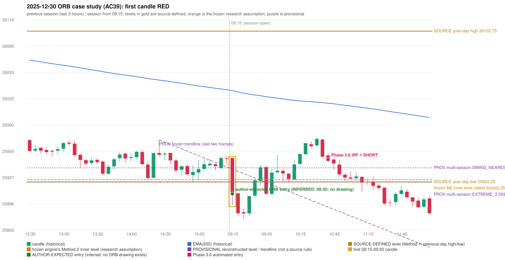

# 2025-12-30 - ORB case study (AC39, handwritten page 6)

> Audit evidence only: no controller, no fills, no P&L. Provisional levels are research constructions, not source rules.

**Author:** ORB should be activated instead of IRF.

* Expected direction: NOT STATED. ASSUMPTION (not author evidence): SHORT, inferred from the first-candle colour (RED)
* Expected method: NOT IDENTIFIABLE (no level, drawing or method written); closest by predicates: Method 1 (fails candle_quality), Method 2 (fails candle_quality)
* Expected entry candle: 09:15-09:20 candle, entry at the 09:20 open of the next minute bar (rulebook decision time; no ORB drawing exists)
* Engine ORB status: Method 1 SHORT: INVALIDATED (CANDLE_QUALITY(not a strong body / wick too large)); Method 2 SHORT: INVALIDATED (CANDLE_QUALITY)
* Phase 3.6 trade taken instead: IRF Method 1 10:45 SHORT @ 25949.1
* Manual journal row: ORB 09:15

## Original one-minute data (first five bars)

| time | open | high | low | close |
|---|---|---|---|---|
| 09:15 | 25951.0 | 25951.0 | 25894.6 | 25902.25 |
| 09:16 | 25902.0 | 25908.65 | 25900.75 | 25903.1 |
| 09:17 | 25904.3 | 25918.2 | 25903.85 | 25915.35 |
| 09:18 | 25915.55 | 25915.8 | 25903.25 | 25904.0 |
| 09:19 | 25906.0 | 25909.05 | 25900.65 | 25908.05 |

## First candle 25951.0/25951.0/25894.6/25908.05 (RED; body 76.2%, upper wick 0.0%, lower wick 23.8%); previous day high/low/close 26102.75/25922.25/25942.1; gap 8.9; EMA(200) 26031.51

## Engine eligibility checks (colour-matching direction, engine order)

| method | predicate | pass | observed | margin |
|---|---|---|---|---|
| Method 1 | level_broken | True | previous-day low 25922.25; candle high/low 25894.6, close 25908.05 | 14.2 |
| Method 1 | trend | True | EMA_PREV_SESSION_CLOSE on the trend side | 82.947 |
| Method 1 | candle_quality | False | body 76.2% opposite wick 23.8% close location 23.8% | -3.848 |
| Method 2 | inner_level_broken | True | latest inner swing 25924.95; close 25908.05 | 16.9 |
| Method 2 | trend | True | EMA_PREV_SESSION_CLOSE on the trend side | 82.947 |
| Method 2 | trendline | True | TRENDLINE_SUPPORTIVE; line at the open 25937.67 | 29.625 |
| Method 2 | candle_quality | False | body 76.2% opposite wick 23.8% close location 23.8% | -3.848 |
| Method 2 | near_ema_close | True | EMA not near |  |
| Gap/200DMA | gap_in_direction | False | gap +8.90 (UP) | -8.9 |
| Gap/200DMA | gap_crosses_200_average | False | previous close 25942.1 vs previous EMA 26032.75; open 25951.0 vs EMA 26031.51 | -90.647 |
| Gap/200DMA | first_candle_closes_beyond_average | True | close 25908.05 vs EMA 26031.51 | 123.456 |
| Gap/200DMA | candle_shape | False | body 76.2% opposite wick 23.8% close location 23.8%; rejection wick flag False | -3.848 |

## Candidate levels (what the first candle did against each construction)

| family | status | level | broken | open already beyond | close - level |
|---|---|---|---|---|---|
| M1_PREVIOUS_DAY_EXTREME | EXPLICIT_DOCUMENT_RULE (Method 1) | 25922.25 | True | False | 14.2 |
| M2_LATEST_FRACTAL_K2 | CURRENT_ENGINE_ASSUMPTION | 25924.95 | True | False | 16.9 |
| M2_HIGHEST_FRACTAL_K2 | RESEARCH_PROPOSAL | 25924.95 | True | False | 16.9 |
| M2_NEAREST_FRACTAL_FROM_OPEN_K2 | RESEARCH_PROPOSAL | 25939.1 | True | False | 31.05 |
| M2_HIGHEST_BROKEN_FRACTAL_K2 | RESEARCH_PROPOSAL | 25924.95 | True | False | 16.9 |
| MS_EXTREME_2_SESSIONS | RESEARCH_PROPOSAL (not in the written rules; the page-13 ref | 25922.25 | True | False | 14.2 |
| MS_EXTREME_3_SESSIONS | RESEARCH_PROPOSAL (not in the written rules; the page-13 ref | 25922.25 | True | False | 14.2 |
| MS_EXTREME_5_SESSIONS | RESEARCH_PROPOSAL (not in the written rules; the page-13 ref | 25922.25 | True | False | 14.2 |
| MS_SWING_NEAREST_FROM_OPEN_3_SESSIONS | RESEARCH_PROPOSAL | 25939.1 | True | False | 31.05 |

## Trend and trendline

* previous close 25949.8 vs its EMA 26032.75 (margin -82.95); first-candle close 25908.05 vs EMA 26031.51 (margin -123.46); EMA change over the last previous hour -11.46
* active trend: True (EMA_PREV_SESSION_CLOSE on the trend side); structure variant: True (STRUCTURE swing highs 25972.45->25951.05, swing lows 25924.95->25922.25); literal first-close test: True (EMA5M_BASIC)
* frozen trendline: TRENDLINE_SUPPORTIVE (line at the open 25937.67); any-pair-of-last-three: TRENDLINE_SUPPORTIVE

## Candle strength

* body 76.15%, opposite wick 23.85%, close location 23.85%; STRICT False, MODERATE False, LOOSE True; owner pin test False (wick/body 0.0, close 23.85% from the favourable extreme; needs <= 30%)

## Missing condition and required definition

* YES: the closest method (Method 1, Method 2) is rejected by a condition the engine decides with a research assumption / numeric approximation / owner variant (NUMERIC_APPROXIMATION); the source is silent or qualitative there
* Method 1: 'strong body, limited wick' is qualitative in the rulebook; the numeric profile (MODERATE) rejected the candle | Method 2: 'strong body, limited wick' is qualitative in the rulebook; the numeric profile (MODERATE) rejected the candle | Gap/200DMA: no opening gap in this direction: the Gap / 200-average setup does not apply

## Variants (signal-only; disabled by default)

* orb-frozen: no ORB signal
* orb-var-inner-highest-fractal: no ORB signal
* orb-var-inner-nearest-from-open: no ORB signal
* orb-var-inner-highest-broken: no ORB signal
* orb-var-trendline-any-pair: no ORB signal
* orb-var-trendline-none: no ORB signal
* orb-var-strength-strict: no ORB signal
* orb-var-strength-loose: Method 1 SHORT 09:20; Method 2 SHORT 09:20
* orb-var-trend-structure: no ORB signal
* orb-var-trend-ema-basic: no ORB signal
* orb-var-gap-candle-crossing: no ORB signal
* orb-var-colour: no ORB signal

