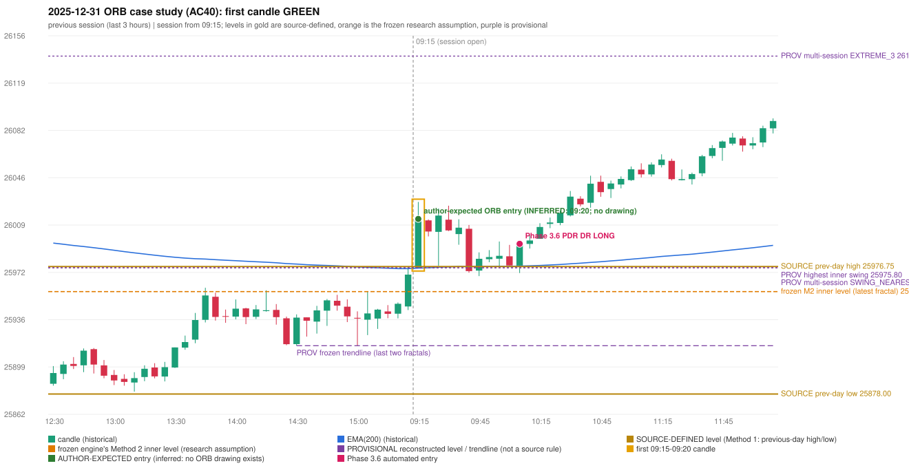

# 2025-12-31 - ORB case study (AC40, handwritten page 6)

> Audit evidence only: no controller, no fills, no P&L. Provisional levels are research constructions, not source rules.

**Author:** ORB should activate first, Which hits SL Ep then PDR. | PDR 1st candle entry.

* Expected direction: NOT STATED. ASSUMPTION (not author evidence): LONG, inferred from the first-candle colour (GREEN)
* Expected method: NOT IDENTIFIABLE (every method fails two or more predicates)
* Expected entry candle: 09:15-09:20 candle, entry at the 09:20 open of the next minute bar (rulebook decision time; no ORB drawing exists)
* Engine ORB status: Method 1 LONG: INVALIDATED (TREND:EMA_PREV_SESSION_CLOSE wrong side); Method 2 LONG: INVALIDATED (TREND:EMA_PREV_SESSION_CLOSE wrong side)
* Phase 3.6 trade taken instead: PDR PDR 10:10 LONG @ 25994.35
* Manual journal row: ORB 09:15

## Original one-minute data (first five bars)

| time | open | high | low | close |
|---|---|---|---|---|
| 09:15 | 25975.45 | 26026.85 | 25975.45 | 26010.1 |
| 09:16 | 26009.4 | 26016.6 | 26001.65 | 26011.1 |
| 09:17 | 26012.1 | 26018.35 | 26006.75 | 26007.9 |
| 09:18 | 26005.4 | 26016.9 | 26002.05 | 26015.4 |
| 09:19 | 26014.8 | 26016.55 | 26009.7 | 26013.65 |

## First candle 25975.45/26026.85/25975.45/26013.65 (GREEN; body 74.3%, upper wick 25.7%, lower wick 0.0%); previous day high/low/close 25976.75/25878.0/25938.85; gap 36.6; EMA(200) 25975.53

## Engine eligibility checks (colour-matching direction, engine order)

| method | predicate | pass | observed | margin |
|---|---|---|---|---|
| Method 1 | level_broken | True | previous-day high 25976.75; candle high/low 26026.85, close 26013.65 | 36.9 |
| Method 1 | trend | False | EMA_PREV_SESSION_CLOSE wrong side | -4.6 |
| Method 1 | candle_quality | False | body 74.3% opposite wick 25.7% close location 74.3% | -5.681 |
| Method 2 | inner_level_broken | True | latest inner swing 25957.35; close 26013.65 | 56.3 |
| Method 2 | trend | False | EMA_PREV_SESSION_CLOSE wrong side | -4.6 |
| Method 2 | trendline | False | TRENDLINE_NOT_SUPPORTIVE; line at the open 25915.45 | 98.2 |
| Method 2 | candle_quality | False | body 74.3% opposite wick 25.7% close location 74.3% | -5.681 |
| Method 2 | near_ema_close | True | EMA not near |  |
| Gap/200DMA | gap_in_direction | True | gap +36.60 (UP) | 36.6 |
| Gap/200DMA | gap_crosses_200_average | False | previous close 25938.85 vs previous EMA 25975.15; open 25975.45 vs EMA 25975.53 | -0.083 |
| Gap/200DMA | first_candle_closes_beyond_average | True | close 26013.65 vs EMA 25975.53 | 38.117 |
| Gap/200DMA | candle_shape | False | body 74.3% opposite wick 25.7% close location 74.3%; rejection wick flag False | -5.681 |

## Candidate levels (what the first candle did against each construction)

| family | status | level | broken | open already beyond | close - level |
|---|---|---|---|---|---|
| M1_PREVIOUS_DAY_EXTREME | EXPLICIT_DOCUMENT_RULE (Method 1) | 25976.75 | True | False | 36.9 |
| M2_LATEST_FRACTAL_K2 | CURRENT_ENGINE_ASSUMPTION | 25957.35 | True | True | 56.3 |
| M2_HIGHEST_FRACTAL_K2 | RESEARCH_PROPOSAL | 25975.8 | True | False | 37.85 |
| M2_NEAREST_FRACTAL_FROM_OPEN_K2 | RESEARCH_PROPOSAL | 25975.8 | True | False | 37.85 |
| M2_HIGHEST_BROKEN_FRACTAL_K2 | RESEARCH_PROPOSAL | 25975.8 | True | False | 37.85 |
| MS_EXTREME_2_SESSIONS | RESEARCH_PROPOSAL (not in the written rules; the page-13 ref | 26102.75 | False | False | -89.1 |
| MS_EXTREME_3_SESSIONS | RESEARCH_PROPOSAL (not in the written rules; the page-13 ref | 26139.85 | False | False | -126.2 |
| MS_EXTREME_5_SESSIONS | RESEARCH_PROPOSAL (not in the written rules; the page-13 ref | 26236.3 | False | False | -222.65 |
| MS_SWING_NEAREST_FROM_OPEN_3_SESSIONS | RESEARCH_PROPOSAL | 25975.8 | True | False | 37.85 |

## Trend and trendline

* previous close 25970.55 vs its EMA 25975.15 (margin -4.6); first-candle close 26013.65 vs EMA 25975.53 (margin 38.12); EMA change over the last previous hour -3.94
* active trend: False (EMA_PREV_SESSION_CLOSE wrong side); structure variant: False (STRUCTURE: previous close on the wrong side of EMA(200)); literal first-close test: True (EMA5M_BASIC)
* frozen trendline: TRENDLINE_NOT_SUPPORTIVE (line at the open 25915.45); any-pair-of-last-three: TRENDLINE_NOT_SUPPORTIVE

## Candle strength

* body 74.32%, opposite wick 25.68%, close location 74.32%; STRICT False, MODERATE False, LOOSE False; owner pin test False (wick/body 0.0, close 25.68% from the favourable extreme; needs <= 30%)

## Missing condition and required definition

* UNDETERMINED: every method fails two or more predicates, so the author's setup cannot be identified; the engine violates no explicit source rule that is shown
* Method 1: the active trend reading (previous close against its EMA) differs from the rulebook's literal 'price above the 200 EMA' at 09:20 | Method 2: the active trend reading (previous close against its EMA) differs from the rulebook's literal 'price above the 200 EMA' at 09:20 | Gap/200DMA: the gap did not carry the OPEN through the 200 average (frozen reading: previous close on the wrong side AND open on the right side)

## Variants (signal-only; disabled by default)

* orb-frozen: no ORB signal
* orb-var-inner-highest-fractal: no ORB signal
* orb-var-inner-nearest-from-open: no ORB signal
* orb-var-inner-highest-broken: no ORB signal
* orb-var-trendline-any-pair: no ORB signal
* orb-var-trendline-none: no ORB signal
* orb-var-strength-strict: no ORB signal
* orb-var-strength-loose: no ORB signal
* orb-var-trend-structure: no ORB signal
* orb-var-trend-ema-basic: no ORB signal
* orb-var-gap-candle-crossing: no ORB signal
* orb-var-colour: no ORB signal

