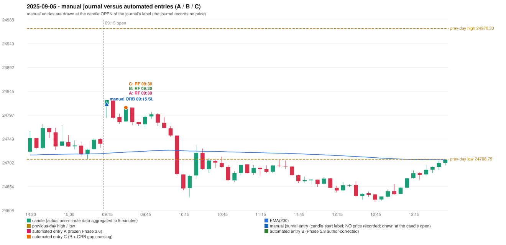

# 2025-09-05 (Friday) - manual journal versus the automated configurations

> SYNTHETIC index-point P&L; no real option P&L; costs illustrative (Rs 70 per trade + slippage scenarios). Configurations A / B / C are never combined.

## Session

* Open 24818.85; previous official close 24734.3; gap +84.55; previous-day high / low 24970.3 / 24708.75
* First 5-minute candle (09:15-09:20): O24818.85 H24827.55 L24791.35 C24827.5, GREEN, body 23.9%; EMA(200) at the first candle 24720.91; previous session's last close 24739.8 vs its EMA 24719.84

## Manual journal

row 4: ORB labelled 09:15, outcome SL

## Configuration A

Candidate signals (confirmed): 09:35 RF/RF LONG [EXECUTED: trade 1: INITIAL_FULL_STOP]

Strategies with no confirmed signal: IRF: no setup record (the strategy's trigger event never occurred) | ORB: Method 2 INVALIDATED TRENDLINE_NOT_SUPPORTIVE | PDR: PDR INVALIDATED OPEN_NOT_STRICTLY_ABOVE_ZONE | PDS: no setup record (the strategy's trigger event never occurred)

| trade | strategy / method | dir | signal -> fill | entry | stop / T1 / T2 | leg 1 | leg 2 | outcome | gross Rs | net Rs (70, 0) | net Rs (70, 1.0) |
|---|---|---|---|---|---|---|---|---|---|---|---|
| 1 | RF/RF | LONG | 09:35 -> 09:35 | 24812.3 | 24777.3 / 24839.3 / 24872.3 | 09:39 @ 24777.3 | 09:39 @ 24777.3 | INITIAL_FULL_STOP | -13,650 | -13,720 | -14,500 |

Selection: This RF signal was the earliest executable signal of the day: 0 confirmed signal(s) earlier, 0 other in the same minute. No later signal was generated. State of the other four engines at that moment: [IRF: no setup record before this time (a base condition was not met, or nothing triggered)] [ORB: Method 2 invalidated at 09:15: TRENDLINE_NOT_SUPPORTIVE] [PDR: PDR invalidated at 09:15: OPEN_NOT_STRICTLY_ABOVE_ZONE] [PDS: no setup record before this time (a base condition was not met, or nothing triggered)]

* Journal row 4 (ORB 09:15): **UNMATCHED_MANUAL**; earliest cause LEVEL_CONSTRUCTION_MISMATCH (+ TRENDLINE_MISMATCH): first candle GREEN O24818.85 H24827.55 L24791.35 C24827.5 (body 23.9%); direction ASSUMED from the colour (the journal has no direction); TIE-BROKEN BY METHOD ORDER: 3 methods tie at 1 failing predicate(s) (Method 1: level_broken; Method 2: trendline; Gap/200DMA: gap_crosses_200_average) - the evidence does not single out one cause, the secondary cause is the other tied one; closest method Method 1 (1 failing predicate(s)): first failing 'level_broken' - previous-day high 24970.3; candle high/low 24827.55, close 24827.5; all methods: Method 1: 1 fail (level_broken); Method 2: 1 fail (trendline); Gap/200DMA: 1 fail (gap_crosses_200_average)
* Automated RF 09:30 has no strict / time-tolerant journal counterpart: DIFFERENT_STRATEGY_SELECTED - the journal traded ORB 09:15; the automated controller took RF RF (candle 09:30) as the first valid signal

## Configuration B

Candidate signals (confirmed): 09:35 RF/RF LONG [EXECUTED: trade 1: INITIAL_FULL_STOP]

Strategies with no confirmed signal: IRF: no setup record (the strategy's trigger event never occurred) | ORB: Method 2 INVALIDATED TRENDLINE_NOT_SUPPORTIVE | PDR: PDR INVALIDATED OPEN_NOT_STRICTLY_ABOVE_ZONE | PDS: no setup record (the strategy's trigger event never occurred)

| trade | strategy / method | dir | signal -> fill | entry | stop / T1 / T2 | leg 1 | leg 2 | outcome | gross Rs | net Rs (70, 0) | net Rs (70, 1.0) |
|---|---|---|---|---|---|---|---|---|---|---|---|
| 1 | RF/RF | LONG | 09:35 -> 09:35 | 24812.3 | 24777.3 / 24839.3 / 24872.3 | 09:39 @ 24777.3 | 09:39 @ 24777.3 | INITIAL_FULL_STOP | -13,650 | -13,720 | -14,500 |

Selection: This RF signal was the earliest executable signal of the day: 0 confirmed signal(s) earlier, 0 other in the same minute. No later signal was generated. State of the other four engines at that moment: [IRF: no setup record before this time (a base condition was not met, or nothing triggered)] [ORB: Method 2 invalidated at 09:15: TRENDLINE_NOT_SUPPORTIVE] [PDR: PDR invalidated at 09:15: OPEN_NOT_STRICTLY_ABOVE_ZONE] [PDS: no setup record before this time (a base condition was not met, or nothing triggered)]

* Journal row 4 (ORB 09:15): **UNMATCHED_MANUAL**; earliest cause LEVEL_CONSTRUCTION_MISMATCH (+ TRENDLINE_MISMATCH): first candle GREEN O24818.85 H24827.55 L24791.35 C24827.5 (body 23.9%); direction ASSUMED from the colour (the journal has no direction); TIE-BROKEN BY METHOD ORDER: 3 methods tie at 1 failing predicate(s) (Method 1: level_broken; Method 2: trendline; Gap/200DMA: gap_crosses_200_average) - the evidence does not single out one cause, the secondary cause is the other tied one; closest method Method 1 (1 failing predicate(s)): first failing 'level_broken' - previous-day high 24970.3; candle high/low 24827.55, close 24827.5; all methods: Method 1: 1 fail (level_broken); Method 2: 1 fail (trendline); Gap/200DMA: 1 fail (gap_crosses_200_average)
* Automated RF 09:30 has no strict / time-tolerant journal counterpart: DIFFERENT_STRATEGY_SELECTED - the journal traded ORB 09:15; the automated controller took RF RF (candle 09:30) as the first valid signal

## Configuration C

Candidate signals (confirmed): 09:35 RF/RF LONG [EXECUTED: trade 1: INITIAL_FULL_STOP]

Strategies with no confirmed signal: IRF: no setup record (the strategy's trigger event never occurred) | ORB: Method 2 INVALIDATED TRENDLINE_NOT_SUPPORTIVE | PDR: PDR INVALIDATED OPEN_NOT_STRICTLY_ABOVE_ZONE | PDS: no setup record (the strategy's trigger event never occurred)

| trade | strategy / method | dir | signal -> fill | entry | stop / T1 / T2 | leg 1 | leg 2 | outcome | gross Rs | net Rs (70, 0) | net Rs (70, 1.0) |
|---|---|---|---|---|---|---|---|---|---|---|---|
| 1 | RF/RF | LONG | 09:35 -> 09:35 | 24812.3 | 24777.3 / 24839.3 / 24872.3 | 09:39 @ 24777.3 | 09:39 @ 24777.3 | INITIAL_FULL_STOP | -13,650 | -13,720 | -14,500 |

Selection: This RF signal was the earliest executable signal of the day: 0 confirmed signal(s) earlier, 0 other in the same minute. No later signal was generated. State of the other four engines at that moment: [IRF: no setup record before this time (a base condition was not met, or nothing triggered)] [ORB: Method 2 invalidated at 09:15: TRENDLINE_NOT_SUPPORTIVE] [PDR: PDR invalidated at 09:15: OPEN_NOT_STRICTLY_ABOVE_ZONE] [PDS: no setup record before this time (a base condition was not met, or nothing triggered)]

* Journal row 4 (ORB 09:15): **UNMATCHED_MANUAL**; earliest cause LEVEL_CONSTRUCTION_MISMATCH (+ TRENDLINE_MISMATCH): first candle GREEN O24818.85 H24827.55 L24791.35 C24827.5 (body 23.9%); direction ASSUMED from the colour (the journal has no direction); TIE-BROKEN BY METHOD ORDER: 3 methods tie at 1 failing predicate(s) (Method 1: level_broken; Method 2: trendline; Gap/200DMA: gap_crosses_200_average) - the evidence does not single out one cause, the secondary cause is the other tied one; closest method Method 1 (1 failing predicate(s)): first failing 'level_broken' - previous-day high 24970.3; candle high/low 24827.55, close 24827.5; all methods: Method 1: 1 fail (level_broken); Method 2: 1 fail (trendline); Gap/200DMA: 1 fail (gap_crosses_200_average)
* Automated RF 09:30 has no strict / time-tolerant journal counterpart: DIFFERENT_STRATEGY_SELECTED - the journal traded ORB 09:15; the automated controller took RF RF (candle 09:30) as the first valid signal

## Chart

