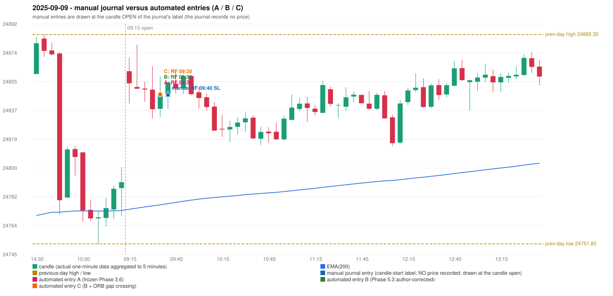

# 2025-09-09 (Tuesday) - manual journal versus the automated configurations

> SYNTHETIC index-point P&L; no real option P&L; costs illustrative (Rs 70 per trade + slippage scenarios). Configurations A / B / C are never combined.

## Session

* Open 24861.9; previous official close 24773.15; gap +88.75; previous-day high / low 24885.3 / 24751.85
* First 5-minute candle (09:15-09:20): O24861.9 H24870.65 L24841.3 C24854.2, RED, body 26.2%; EMA(200) at the first candle 24773.91; previous session's last close 24791.2 vs its EMA 24773.10

## Manual journal

row 6: RF labelled 09:40, outcome SL

## Configuration A

Candidate signals (confirmed): 09:40 RF/RF LONG [EXECUTED: trade 1: T1_THEN_BUFFER_STOP]; 14:20 IRF/Method 1 SHORT [IGNORED: POSITION_ACTIVE (signal kept for diagnostics only; never reused)]; 14:40 IRF/Method 1 SHORT [IGNORED: DAY_FINISHED]; 15:00 IRF/Method 1 SHORT [IGNORED: DAY_FINISHED]

Strategies with no confirmed signal: ORB: no setup record (the strategy's trigger event never occurred) | PDR: PDR INVALIDATED OPEN_NOT_STRICTLY_ABOVE_ZONE | PDS: no setup record (the strategy's trigger event never occurred)

| trade | strategy / method | dir | signal -> fill | entry | stop / T1 / T2 | leg 1 | leg 2 | outcome | gross Rs | net Rs (70, 0) | net Rs (70, 1.0) |
|---|---|---|---|---|---|---|---|---|---|---|---|
| 1 | RF/RF | LONG | 09:40 -> 09:40 | 24847.15 | 24812.15 / 24874.15 / 24907.15 | 14:06 @ 24874.15 | 14:36 @ 24841.15 | T1_THEN_BUFFER_STOP | 4,095 | 4,025 | 3,245 |

Selection: This RF signal was the earliest executable signal of the day: 0 confirmed signal(s) earlier, 0 other in the same minute. 3 later confirmed signal(s) (IRF x3) are logged as ignored or rejected. State of the other four engines at that moment: [IRF: no setup record before this time (a base condition was not met, or nothing triggered)] [ORB: no setup record before this time (a base condition was not met, or nothing triggered)] [PDR: PDR invalidated at 09:15: OPEN_NOT_STRICTLY_ABOVE_ZONE] [PDS: no setup record before this time (a base condition was not met, or nothing triggered)]

* Journal row 6 (RF 09:40): **TIME_TOLERANT** match with 20250909-1-RF (delta -5 min); outcome SL vs automated T1_THEN_BUFFER_STOP (different class: EXIT_MANAGEMENT_MISMATCH; the journal has no exit price / time)

## Configuration B

Candidate signals (confirmed): 09:40 RF/RF LONG [EXECUTED: trade 1: T1_THEN_BUFFER_STOP]; 14:20 IRF/Method 1 SHORT [IGNORED: POSITION_ACTIVE (signal kept for diagnostics only; never reused)]; 15:00 IRF/Method 1 SHORT [IGNORED: DAY_FINISHED]

Strategies with no confirmed signal: ORB: no setup record (the strategy's trigger event never occurred) | PDR: PDR INVALIDATED OPEN_NOT_STRICTLY_ABOVE_ZONE | PDS: no setup record (the strategy's trigger event never occurred)

| trade | strategy / method | dir | signal -> fill | entry | stop / T1 / T2 | leg 1 | leg 2 | outcome | gross Rs | net Rs (70, 0) | net Rs (70, 1.0) |
|---|---|---|---|---|---|---|---|---|---|---|---|
| 1 | RF/RF | LONG | 09:40 -> 09:40 | 24847.15 | 24812.15 / 24874.15 / 24907.15 | 14:06 @ 24874.15 | 14:36 @ 24841.15 | T1_THEN_BUFFER_STOP | 4,095 | 4,025 | 3,245 |

Selection: This RF signal was the earliest executable signal of the day: 0 confirmed signal(s) earlier, 0 other in the same minute. 2 later confirmed signal(s) (IRF x2) are logged as ignored or rejected. State of the other four engines at that moment: [IRF: no setup record before this time (a base condition was not met, or nothing triggered)] [ORB: no setup record before this time (a base condition was not met, or nothing triggered)] [PDR: PDR invalidated at 09:15: OPEN_NOT_STRICTLY_ABOVE_ZONE] [PDS: no setup record before this time (a base condition was not met, or nothing triggered)]

* Journal row 6 (RF 09:40): **TIME_TOLERANT** match with 20250909-1-RF (delta -5 min); outcome SL vs automated T1_THEN_BUFFER_STOP (different class: EXIT_MANAGEMENT_MISMATCH; the journal has no exit price / time)

## Configuration C

Candidate signals (confirmed): 09:40 RF/RF LONG [EXECUTED: trade 1: T1_THEN_BUFFER_STOP]; 14:20 IRF/Method 1 SHORT [IGNORED: POSITION_ACTIVE (signal kept for diagnostics only; never reused)]; 15:00 IRF/Method 1 SHORT [IGNORED: DAY_FINISHED]

Strategies with no confirmed signal: ORB: no setup record (the strategy's trigger event never occurred) | PDR: PDR INVALIDATED OPEN_NOT_STRICTLY_ABOVE_ZONE | PDS: no setup record (the strategy's trigger event never occurred)

| trade | strategy / method | dir | signal -> fill | entry | stop / T1 / T2 | leg 1 | leg 2 | outcome | gross Rs | net Rs (70, 0) | net Rs (70, 1.0) |
|---|---|---|---|---|---|---|---|---|---|---|---|
| 1 | RF/RF | LONG | 09:40 -> 09:40 | 24847.15 | 24812.15 / 24874.15 / 24907.15 | 14:06 @ 24874.15 | 14:36 @ 24841.15 | T1_THEN_BUFFER_STOP | 4,095 | 4,025 | 3,245 |

Selection: This RF signal was the earliest executable signal of the day: 0 confirmed signal(s) earlier, 0 other in the same minute. 2 later confirmed signal(s) (IRF x2) are logged as ignored or rejected. State of the other four engines at that moment: [IRF: no setup record before this time (a base condition was not met, or nothing triggered)] [ORB: no setup record before this time (a base condition was not met, or nothing triggered)] [PDR: PDR invalidated at 09:15: OPEN_NOT_STRICTLY_ABOVE_ZONE] [PDS: no setup record before this time (a base condition was not met, or nothing triggered)]

* Journal row 6 (RF 09:40): **TIME_TOLERANT** match with 20250909-1-RF (delta -5 min); outcome SL vs automated T1_THEN_BUFFER_STOP (different class: EXIT_MANAGEMENT_MISMATCH; the journal has no exit price / time)

## Chart

