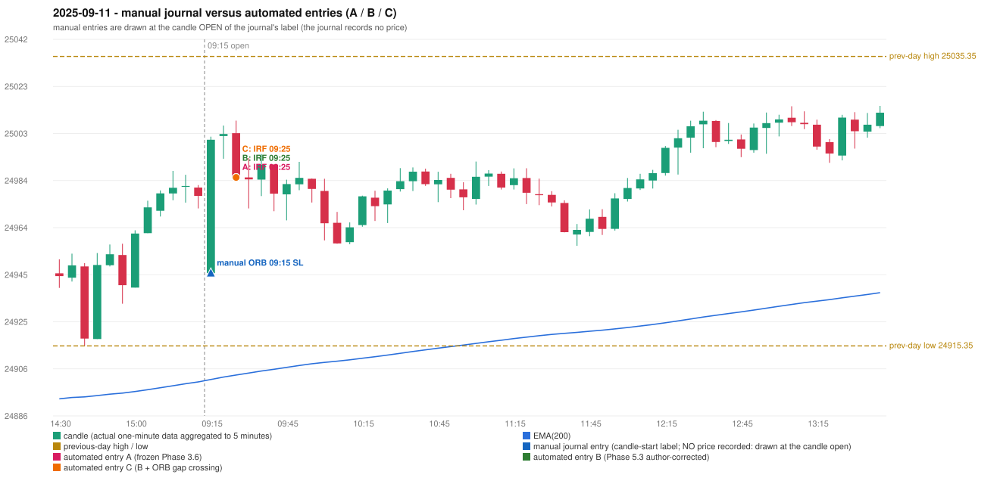

# 2025-09-11 (Thursday) - manual journal versus the automated configurations

> SYNTHETIC index-point P&L; no real option P&L; costs illustrative (Rs 70 per trade + slippage scenarios). Configurations A / B / C are never combined.

## Session

* Open 24945.5; previous official close 24973.1; gap -27.60; previous-day high / low 25035.35 / 24915.35
* First 5-minute candle (09:15-09:20): O24945.5 H25002.1 L24945.5 C25000.8, GREEN, body 97.7%; EMA(200) at the first candle 24901.44; previous session's last close 24977.55 vs its EMA 24900.45

## Manual journal

row 8: ORB labelled 09:15, outcome SL

## Configuration A

Candidate signals (confirmed): 09:30 IRF/Method 1 SHORT [EXECUTED: trade 1: T1_THEN_BUFFER_STOP]; 12:40 IRF/Method 1 SHORT [IGNORED: DAY_FINISHED]; 13:10 IRF/Method 2B SHORT [IGNORED: DAY_FINISHED]; 13:20 IRF/Method 1 SHORT [IGNORED: DAY_FINISHED]; 14:00 IRF/Method 2B SHORT [IGNORED: DAY_FINISHED]; 15:00 IRF/Method 2B SHORT [IGNORED: DAY_FINISHED]; 15:15 IRF/Method 1 SHORT [IGNORED: DAY_FINISHED]

Strategies with no confirmed signal: ORB: Method 2 INVALIDATED TRENDLINE_NOT_SUPPORTIVE | PDR: no setup record (the strategy's trigger event never occurred) | PDS: Method 1/2/3 INVALIDATED GAP_DOWN_OPEN_NOT_BELOW_ZONE | RF: no setup record (the strategy's trigger event never occurred)

| trade | strategy / method | dir | signal -> fill | entry | stop / T1 / T2 | leg 1 | leg 2 | outcome | gross Rs | net Rs (70, 0) | net Rs (70, 1.0) |
|---|---|---|---|---|---|---|---|---|---|---|---|
| 1 | IRF/Method 1 | SHORT | 09:30 -> 09:30 | 24985.2 | 25020.2 / 24958.2 / 24925.2 | 10:09 @ 24958.2 | 11:02 @ 24991.2 | T1_THEN_BUFFER_STOP | 4,095 | 4,025 | 3,245 |

Selection: This IRF Method 1 signal was the earliest executable signal of the day: 0 confirmed signal(s) earlier, 0 other in the same minute. 6 later confirmed signal(s) (IRF x6) are logged as ignored or rejected. State of the other four engines at that moment: [ORB: Method 2 invalidated at 09:15: TRENDLINE_NOT_SUPPORTIVE] [PDR: no setup record before this time (a base condition was not met, or nothing triggered)] [PDS: Method 1/2/3 invalidated at 09:15: GAP_DOWN_OPEN_NOT_BELOW_ZONE] [RF: no setup record before this time (a base condition was not met, or nothing triggered)]

* Journal row 8 (ORB 09:15): **UNMATCHED_MANUAL**; earliest cause LEVEL_CONSTRUCTION_MISMATCH (+ TRENDLINE_MISMATCH): first candle GREEN O24945.5 H25002.1 L24945.5 C25000.8 (body 97.7%); direction ASSUMED from the colour (the journal has no direction); TIE-BROKEN BY METHOD ORDER: 2 methods tie at 1 failing predicate(s) (Method 1: level_broken; Method 2: trendline) - the evidence does not single out one cause, the secondary cause is the other tied one; closest method Method 1 (1 failing predicate(s)): first failing 'level_broken' - previous-day high 25035.35; candle high/low 25002.1, close 25000.8; all methods: Method 1: 1 fail (level_broken); Method 2: 1 fail (trendline); Gap/200DMA: 2 fail (gap_in_direction)
* Automated IRF 09:25 has no strict / time-tolerant journal counterpart: DIFFERENT_STRATEGY_SELECTED - the journal traded ORB 09:15; the automated controller took IRF Method 1 (candle 09:25) as the first valid signal

## Configuration B

Candidate signals (confirmed): 09:30 IRF/Method 1 SHORT [EXECUTED: trade 1: T1_THEN_BUFFER_STOP]; 12:40 IRF/Method 1 SHORT [IGNORED: DAY_FINISHED]; 12:50 IRF/Method 2A SHORT [IGNORED: DAY_FINISHED]; 13:10 IRF/Method 2B SHORT [IGNORED: DAY_FINISHED]; 13:20 IRF/Method 1 SHORT [IGNORED: DAY_FINISHED]; 14:00 IRF/Method 2B SHORT [IGNORED: DAY_FINISHED]; 14:35 IRF/Method 2A SHORT [IGNORED: DAY_FINISHED]; 15:00 IRF/Method 2B SHORT [IGNORED: DAY_FINISHED]; 15:15 IRF/Method 1 SHORT [IGNORED: DAY_FINISHED]

Strategies with no confirmed signal: ORB: Method 2 INVALIDATED TRENDLINE_NOT_SUPPORTIVE | PDR: no setup record (the strategy's trigger event never occurred) | PDS: Method 1/2/3 INVALIDATED GAP_DOWN_OPEN_NOT_BELOW_ZONE | RF: no setup record (the strategy's trigger event never occurred)

| trade | strategy / method | dir | signal -> fill | entry | stop / T1 / T2 | leg 1 | leg 2 | outcome | gross Rs | net Rs (70, 0) | net Rs (70, 1.0) |
|---|---|---|---|---|---|---|---|---|---|---|---|
| 1 | IRF/Method 1 | SHORT | 09:30 -> 09:30 | 24985.2 | 25020.2 / 24958.2 / 24925.2 | 10:09 @ 24958.2 | 11:02 @ 24991.2 | T1_THEN_BUFFER_STOP | 4,095 | 4,025 | 3,245 |

Selection: This IRF Method 1 signal was the earliest executable signal of the day: 0 confirmed signal(s) earlier, 0 other in the same minute. 8 later confirmed signal(s) (IRF x8) are logged as ignored or rejected. State of the other four engines at that moment: [ORB: Method 2 invalidated at 09:15: TRENDLINE_NOT_SUPPORTIVE] [PDR: no setup record before this time (a base condition was not met, or nothing triggered)] [PDS: Method 1/2/3 invalidated at 09:15: GAP_DOWN_OPEN_NOT_BELOW_ZONE] [RF: no setup record before this time (a base condition was not met, or nothing triggered)]

* Journal row 8 (ORB 09:15): **UNMATCHED_MANUAL**; earliest cause LEVEL_CONSTRUCTION_MISMATCH (+ TRENDLINE_MISMATCH): first candle GREEN O24945.5 H25002.1 L24945.5 C25000.8 (body 97.7%); direction ASSUMED from the colour (the journal has no direction); TIE-BROKEN BY METHOD ORDER: 2 methods tie at 1 failing predicate(s) (Method 1: level_broken; Method 2: trendline) - the evidence does not single out one cause, the secondary cause is the other tied one; closest method Method 1 (1 failing predicate(s)): first failing 'level_broken' - previous-day high 25035.35; candle high/low 25002.1, close 25000.8; all methods: Method 1: 1 fail (level_broken); Method 2: 1 fail (trendline); Gap/200DMA: 2 fail (gap_in_direction)
* Automated IRF 09:25 has no strict / time-tolerant journal counterpart: DIFFERENT_STRATEGY_SELECTED - the journal traded ORB 09:15; the automated controller took IRF Method 1 (candle 09:25) as the first valid signal

## Configuration C

Candidate signals (confirmed): 09:30 IRF/Method 1 SHORT [EXECUTED: trade 1: T1_THEN_BUFFER_STOP]; 12:40 IRF/Method 1 SHORT [IGNORED: DAY_FINISHED]; 12:50 IRF/Method 2A SHORT [IGNORED: DAY_FINISHED]; 13:10 IRF/Method 2B SHORT [IGNORED: DAY_FINISHED]; 13:20 IRF/Method 1 SHORT [IGNORED: DAY_FINISHED]; 14:00 IRF/Method 2B SHORT [IGNORED: DAY_FINISHED]; 14:35 IRF/Method 2A SHORT [IGNORED: DAY_FINISHED]; 15:00 IRF/Method 2B SHORT [IGNORED: DAY_FINISHED]; 15:15 IRF/Method 1 SHORT [IGNORED: DAY_FINISHED]

Strategies with no confirmed signal: ORB: Gap/200DMA INVALIDATED CLOSE_NOT_BEYOND_MA; Method 2 INVALIDATED TRENDLINE_NOT_SUPPORTIVE | PDR: no setup record (the strategy's trigger event never occurred) | PDS: Method 1/2/3 INVALIDATED GAP_DOWN_OPEN_NOT_BELOW_ZONE | RF: no setup record (the strategy's trigger event never occurred)

| trade | strategy / method | dir | signal -> fill | entry | stop / T1 / T2 | leg 1 | leg 2 | outcome | gross Rs | net Rs (70, 0) | net Rs (70, 1.0) |
|---|---|---|---|---|---|---|---|---|---|---|---|
| 1 | IRF/Method 1 | SHORT | 09:30 -> 09:30 | 24985.2 | 25020.2 / 24958.2 / 24925.2 | 10:09 @ 24958.2 | 11:02 @ 24991.2 | T1_THEN_BUFFER_STOP | 4,095 | 4,025 | 3,245 |

Selection: This IRF Method 1 signal was the earliest executable signal of the day: 0 confirmed signal(s) earlier, 0 other in the same minute. 8 later confirmed signal(s) (IRF x8) are logged as ignored or rejected. State of the other four engines at that moment: [ORB: Method 2 invalidated at 09:15: TRENDLINE_NOT_SUPPORTIVE; Gap/200DMA invalidated at 09:15: CLOSE_NOT_BEYOND_MA] [PDR: no setup record before this time (a base condition was not met, or nothing triggered)] [PDS: Method 1/2/3 invalidated at 09:15: GAP_DOWN_OPEN_NOT_BELOW_ZONE] [RF: no setup record before this time (a base condition was not met, or nothing triggered)]

* Journal row 8 (ORB 09:15): **UNMATCHED_MANUAL**; earliest cause LEVEL_CONSTRUCTION_MISMATCH (+ TRENDLINE_MISMATCH): first candle GREEN O24945.5 H25002.1 L24945.5 C25000.8 (body 97.7%); direction ASSUMED from the colour (the journal has no direction); TIE-BROKEN BY METHOD ORDER: 2 methods tie at 1 failing predicate(s) (Method 1: level_broken; Method 2: trendline) - the evidence does not single out one cause, the secondary cause is the other tied one; closest method Method 1 (1 failing predicate(s)): first failing 'level_broken' - previous-day high 25035.35; candle high/low 25002.1, close 25000.8; all methods: Method 1: 1 fail (level_broken); Method 2: 1 fail (trendline); Gap/200DMA: 2 fail (gap_in_direction)
* Automated IRF 09:25 has no strict / time-tolerant journal counterpart: DIFFERENT_STRATEGY_SELECTED - the journal traded ORB 09:15; the automated controller took IRF Method 1 (candle 09:25) as the first valid signal

## Handwritten author corrections for this date

* AC04 (page 1): "This should be an ORB trade. | It is shown as IRF, ORB should activate Ep 30 pts SL." - status A / B / C: ORB_STILL_NOT_TRADED / ORB_STILL_NOT_TRADED / ORB_STILL_NOT_TRADED

## Chart

