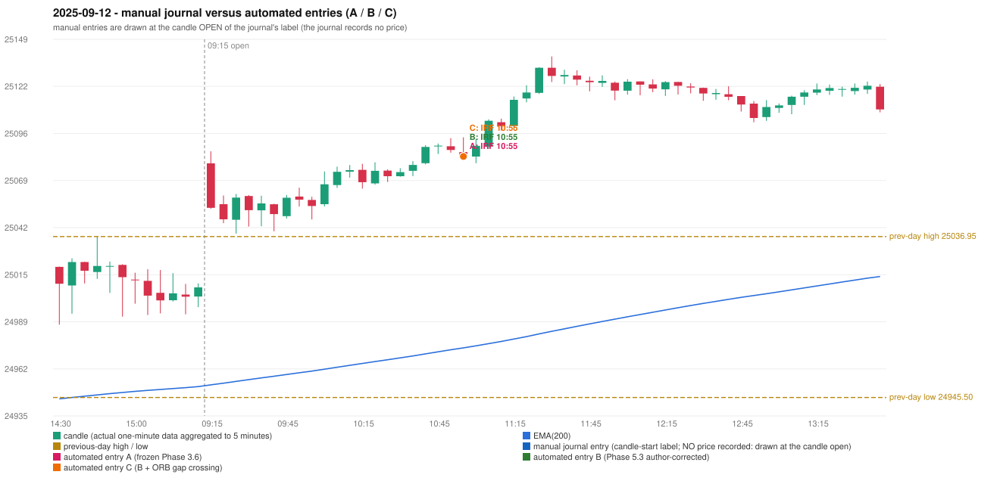

# 2025-09-12 (Friday) - manual journal versus the automated configurations

> SYNTHETIC index-point P&L; no real option P&L; costs illustrative (Rs 70 per trade + slippage scenarios). Configurations A / B / C are never combined.

## Session

* Open 25078.55; previous official close 25005.5; gap +73.05; previous-day high / low 25036.95 / 24945.5
* First 5-minute candle (09:15-09:20): O25078.55 H25085.4 L25052.75 C25053.3, RED, body 77.3%; EMA(200) at the first candle 24952.70; previous session's last close 25008.1 vs its EMA 24951.69

## Manual journal

no manual trade recorded

## Configuration A

Candidate signals (confirmed): 11:00 IRF/Method 1 SHORT [EXECUTED: trade 1: INITIAL_FULL_STOP]; 12:50 IRF/Method 2A SHORT [REJECTED: SECOND_TRADE_RESTRICTED_TO_PDR_PDS]; 13:45 IRF/Method 2B SHORT [REJECTED: SECOND_TRADE_RESTRICTED_TO_PDR_PDS]; 14:40 IRF/Method 2A SHORT [REJECTED: SECOND_TRADE_RESTRICTED_TO_PDR_PDS]; 15:25 IRF/Method 2B SHORT [REJECTED: SECOND_TRADE_RESTRICTED_TO_PDR_PDS]

Strategies with no confirmed signal: ORB: Method 1 INVALIDATED CANDLE_QUALITY(not a strong body / wick too large); Method 2 INVALIDATED CANDLE_QUALITY | PDR: no setup record (the strategy's trigger event never occurred) | PDS: no setup record (the strategy's trigger event never occurred) | RF: RF INVALIDATED GAP_UP_OUTSIDE_YESTERDAYS_RANGE

| trade | strategy / method | dir | signal -> fill | entry | stop / T1 / T2 | leg 1 | leg 2 | outcome | gross Rs | net Rs (70, 0) | net Rs (70, 1.0) |
|---|---|---|---|---|---|---|---|---|---|---|---|
| 1 | IRF/Method 1 | SHORT | 11:00 -> 11:00 | 25082.45 | 25117.45 / 25055.45 / 25022.45 | 11:20 @ 25117.45 | 11:20 @ 25117.45 | INITIAL_FULL_STOP | -13,650 | -13,720 | -14,500 |

Selection: This IRF Method 1 signal was the earliest executable signal of the day: 0 confirmed signal(s) earlier, 0 other in the same minute. 4 later confirmed signal(s) (IRF x4) are logged as ignored or rejected. State of the other four engines at that moment: [ORB: Method 1 invalidated at 09:15: CANDLE_QUALITY(not a strong body / wick too large); Method 2 invalidated at 09:15: CANDLE_QUALITY] [PDR: no setup record before this time (a base condition was not met, or nothing triggered)] [PDS: no setup record before this time (a base condition was not met, or nothing triggered)] [RF: RF invalidated at 09:25: GAP_UP_OUTSIDE_YESTERDAYS_RANGE]

* Automated IRF 10:55 has no strict / time-tolerant journal counterpart: UNRESOLVED_DISCRETIONARY_SELECTION - the journal records no trade this day; the automated system took IRF Method 1 SHORT (candle 10:55) mechanically

## Configuration B

Candidate signals (confirmed): 11:00 IRF/Method 1 SHORT [EXECUTED: trade 1: INITIAL_FULL_STOP]; 11:00 IRF/Method 2A SHORT [MERGED_SAME_STRATEGY_METHOD: traded as another method of the same strategy/direction in the same minute]

Strategies with no confirmed signal: ORB: Method 1 INVALIDATED CANDLE_QUALITY(not a strong body / wick too large); Method 2 INVALIDATED CANDLE_QUALITY | PDR: no setup record (the strategy's trigger event never occurred) | PDS: no setup record (the strategy's trigger event never occurred) | RF: RF INVALIDATED GAP_UP_OUTSIDE_YESTERDAYS_RANGE

| trade | strategy / method | dir | signal -> fill | entry | stop / T1 / T2 | leg 1 | leg 2 | outcome | gross Rs | net Rs (70, 0) | net Rs (70, 1.0) |
|---|---|---|---|---|---|---|---|---|---|---|---|
| 1 | IRF/Method 1 | SHORT | 11:00 -> 11:00 | 25082.45 | 25117.45 / 25055.45 / 25022.45 | 11:20 @ 25117.45 | 11:20 @ 25117.45 | INITIAL_FULL_STOP | -13,650 | -13,720 | -14,500 |

Selection: This IRF Method 1 signal was the earliest executable signal of the day: 0 confirmed signal(s) earlier, 1 other in the same minute. No later signal was generated. State of the other four engines at that moment: [ORB: Method 1 invalidated at 09:15: CANDLE_QUALITY(not a strong body / wick too large); Method 2 invalidated at 09:15: CANDLE_QUALITY] [PDR: no setup record before this time (a base condition was not met, or nothing triggered)] [PDS: no setup record before this time (a base condition was not met, or nothing triggered)] [RF: RF invalidated at 09:25: GAP_UP_OUTSIDE_YESTERDAYS_RANGE]

* Automated IRF 10:55 has no strict / time-tolerant journal counterpart: UNRESOLVED_DISCRETIONARY_SELECTION - the journal records no trade this day; the automated system took IRF Method 1 SHORT (candle 10:55) mechanically

## Configuration C

Candidate signals (confirmed): 11:00 IRF/Method 1 SHORT [EXECUTED: trade 1: INITIAL_FULL_STOP]; 11:00 IRF/Method 2A SHORT [MERGED_SAME_STRATEGY_METHOD: traded as another method of the same strategy/direction in the same minute]

Strategies with no confirmed signal: ORB: Method 1 INVALIDATED CANDLE_QUALITY(not a strong body / wick too large); Method 2 INVALIDATED CANDLE_QUALITY | PDR: no setup record (the strategy's trigger event never occurred) | PDS: no setup record (the strategy's trigger event never occurred) | RF: RF INVALIDATED GAP_UP_OUTSIDE_YESTERDAYS_RANGE

| trade | strategy / method | dir | signal -> fill | entry | stop / T1 / T2 | leg 1 | leg 2 | outcome | gross Rs | net Rs (70, 0) | net Rs (70, 1.0) |
|---|---|---|---|---|---|---|---|---|---|---|---|
| 1 | IRF/Method 1 | SHORT | 11:00 -> 11:00 | 25082.45 | 25117.45 / 25055.45 / 25022.45 | 11:20 @ 25117.45 | 11:20 @ 25117.45 | INITIAL_FULL_STOP | -13,650 | -13,720 | -14,500 |

Selection: This IRF Method 1 signal was the earliest executable signal of the day: 0 confirmed signal(s) earlier, 1 other in the same minute. No later signal was generated. State of the other four engines at that moment: [ORB: Method 1 invalidated at 09:15: CANDLE_QUALITY(not a strong body / wick too large); Method 2 invalidated at 09:15: CANDLE_QUALITY] [PDR: no setup record before this time (a base condition was not met, or nothing triggered)] [PDS: no setup record before this time (a base condition was not met, or nothing triggered)] [RF: RF invalidated at 09:25: GAP_UP_OUTSIDE_YESTERDAYS_RANGE]

* Automated IRF 10:55 has no strict / time-tolerant journal counterpart: UNRESOLVED_DISCRETIONARY_SELECTION - the journal records no trade this day; the automated system took IRF Method 1 SHORT (candle 10:55) mechanically

## Handwritten author corrections for this date

* AC05 (page 1): "This should be RF entry, IRF should not be taken as RF is activated." - status A / B / C: NOT_ADDRESSED_BY_THE_CONFIGURATIONS / NOT_ADDRESSED_BY_THE_CONFIGURATIONS / NOT_ADDRESSED_BY_THE_CONFIGURATIONS

## Chart

