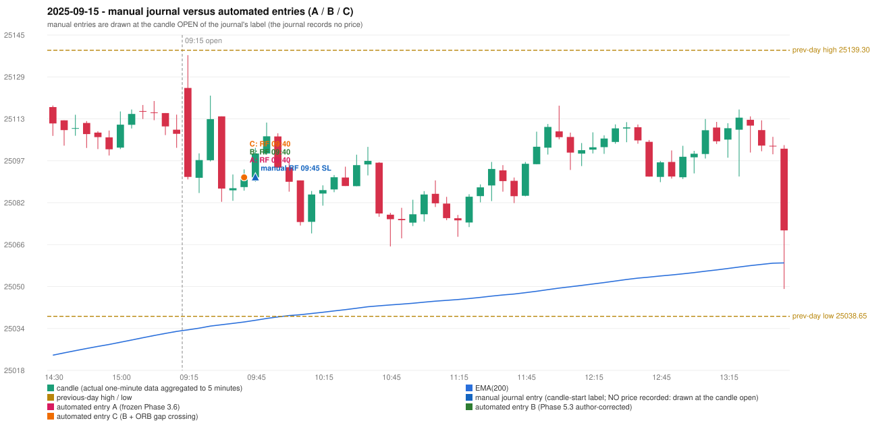

# 2025-09-15 (Monday) - manual journal versus the automated configurations

> SYNTHETIC index-point P&L; no real option P&L; costs illustrative (Rs 70 per trade + slippage scenarios). Configurations A / B / C are never combined.

## Session

* Open 25125.05; previous official close 25114.0; gap +11.05; previous-day high / low 25139.3 / 25038.65
* First 5-minute candle (09:15-09:20): O25125.05 H25137.45 L25090.45 C25091.4, RED, body 71.6%; EMA(200) at the first candle 25033.52; previous session's last close 25107.7 vs its EMA 25032.94

## Manual journal

row 9: RF labelled 09:45, outcome SL

## Configuration A

Candidate signals (confirmed): 09:45 RF/RF LONG [EXECUTED: trade 1: T1_THEN_BUFFER_STOP]

Strategies with no confirmed signal: IRF: no setup record (the strategy's trigger event never occurred) | ORB: Method 2 INVALIDATED TREND:EMA_PREV_SESSION_CLOSE wrong side | PDR: PDR INVALIDATED OPEN_NOT_STRICTLY_ABOVE_ZONE | PDS: no setup record (the strategy's trigger event never occurred)

| trade | strategy / method | dir | signal -> fill | entry | stop / T1 / T2 | leg 1 | leg 2 | outcome | gross Rs | net Rs (70, 0) | net Rs (70, 1.0) |
|---|---|---|---|---|---|---|---|---|---|---|---|
| 1 | RF/RF | LONG | 09:45 -> 09:45 | 25091.2 | 25056.2 / 25118.2 / 25151.2 | 12:02 @ 25118.2 | 13:41 @ 25085.2 | T1_THEN_BUFFER_STOP | 4,095 | 4,025 | 3,245 |

Selection: This RF signal was the earliest executable signal of the day: 0 confirmed signal(s) earlier, 0 other in the same minute. No later signal was generated. State of the other four engines at that moment: [IRF: no setup record before this time (a base condition was not met, or nothing triggered)] [ORB: Method 2 invalidated at 09:15: TREND:EMA_PREV_SESSION_CLOSE wrong side] [PDR: PDR invalidated at 09:15: OPEN_NOT_STRICTLY_ABOVE_ZONE] [PDS: no setup record before this time (a base condition was not met, or nothing triggered)]

* Journal row 9 (RF 09:45): **TIME_TOLERANT** match with 20250915-1-RF (delta -5 min); outcome SL vs automated T1_THEN_BUFFER_STOP (different class: EXIT_MANAGEMENT_MISMATCH; the journal has no exit price / time)

## Configuration B

Candidate signals (confirmed): 09:45 RF/RF LONG [EXECUTED: trade 1: T1_THEN_BUFFER_STOP]

Strategies with no confirmed signal: IRF: no setup record (the strategy's trigger event never occurred) | ORB: Method 2 INVALIDATED TREND:EMA_PREV_SESSION_CLOSE wrong side | PDR: PDR INVALIDATED OPEN_NOT_STRICTLY_ABOVE_ZONE | PDS: no setup record (the strategy's trigger event never occurred)

| trade | strategy / method | dir | signal -> fill | entry | stop / T1 / T2 | leg 1 | leg 2 | outcome | gross Rs | net Rs (70, 0) | net Rs (70, 1.0) |
|---|---|---|---|---|---|---|---|---|---|---|---|
| 1 | RF/RF | LONG | 09:45 -> 09:45 | 25091.2 | 25056.2 / 25118.2 / 25151.2 | 12:02 @ 25118.2 | 13:41 @ 25085.2 | T1_THEN_BUFFER_STOP | 4,095 | 4,025 | 3,245 |

Selection: This RF signal was the earliest executable signal of the day: 0 confirmed signal(s) earlier, 0 other in the same minute. No later signal was generated. State of the other four engines at that moment: [IRF: no setup record before this time (a base condition was not met, or nothing triggered)] [ORB: Method 2 invalidated at 09:15: TREND:EMA_PREV_SESSION_CLOSE wrong side] [PDR: PDR invalidated at 09:15: OPEN_NOT_STRICTLY_ABOVE_ZONE] [PDS: no setup record before this time (a base condition was not met, or nothing triggered)]

* Journal row 9 (RF 09:45): **TIME_TOLERANT** match with 20250915-1-RF (delta -5 min); outcome SL vs automated T1_THEN_BUFFER_STOP (different class: EXIT_MANAGEMENT_MISMATCH; the journal has no exit price / time)

## Configuration C

Candidate signals (confirmed): 09:45 RF/RF LONG [EXECUTED: trade 1: T1_THEN_BUFFER_STOP]

Strategies with no confirmed signal: IRF: no setup record (the strategy's trigger event never occurred) | ORB: Method 2 INVALIDATED TREND:EMA_PREV_SESSION_CLOSE wrong side | PDR: PDR INVALIDATED OPEN_NOT_STRICTLY_ABOVE_ZONE | PDS: no setup record (the strategy's trigger event never occurred)

| trade | strategy / method | dir | signal -> fill | entry | stop / T1 / T2 | leg 1 | leg 2 | outcome | gross Rs | net Rs (70, 0) | net Rs (70, 1.0) |
|---|---|---|---|---|---|---|---|---|---|---|---|
| 1 | RF/RF | LONG | 09:45 -> 09:45 | 25091.2 | 25056.2 / 25118.2 / 25151.2 | 12:02 @ 25118.2 | 13:41 @ 25085.2 | T1_THEN_BUFFER_STOP | 4,095 | 4,025 | 3,245 |

Selection: This RF signal was the earliest executable signal of the day: 0 confirmed signal(s) earlier, 0 other in the same minute. No later signal was generated. State of the other four engines at that moment: [IRF: no setup record before this time (a base condition was not met, or nothing triggered)] [ORB: Method 2 invalidated at 09:15: TREND:EMA_PREV_SESSION_CLOSE wrong side] [PDR: PDR invalidated at 09:15: OPEN_NOT_STRICTLY_ABOVE_ZONE] [PDS: no setup record before this time (a base condition was not met, or nothing triggered)]

* Journal row 9 (RF 09:45): **TIME_TOLERANT** match with 20250915-1-RF (delta -5 min); outcome SL vs automated T1_THEN_BUFFER_STOP (different class: EXIT_MANAGEMENT_MISMATCH; the journal has no exit price / time)

## Chart

