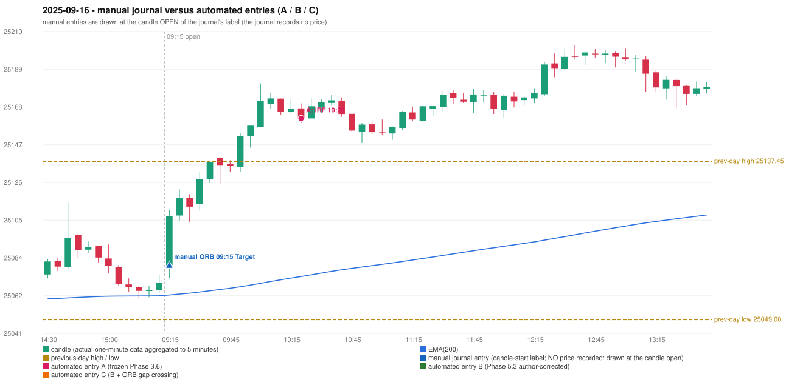

# 2025-09-16 (Tuesday) - manual journal versus the automated configurations

> SYNTHETIC index-point P&L; no real option P&L; costs illustrative (Rs 70 per trade + slippage scenarios). Configurations A / B / C are never combined.

## Session

* Open 25079.5; previous official close 25069.2; gap +10.30; previous-day high / low 25137.45 / 25049.0
* First 5-minute candle (09:15-09:20): O25079.5 H25110.25 L25072.25 C25106.75, GREEN, body 71.7%; EMA(200) at the first candle 25062.82; previous session's last close 25069.7 vs its EMA 25062.37

## Manual journal

row 10: ORB labelled 09:15, outcome Target

## Configuration A

Candidate signals (confirmed): 10:25 IRF/Method 2A SHORT [EXECUTED: trade 1: INITIAL_FULL_STOP]; 10:45 IRF/Method 2B SHORT [IGNORED: POSITION_ACTIVE (signal kept for diagnostics only; never reused)]; 13:15 IRF/Method 2A SHORT [REJECTED: SECOND_TRADE_RESTRICTED_TO_PDR_PDS]; 14:10 IRF/Method 2B SHORT [REJECTED: SECOND_TRADE_RESTRICTED_TO_PDR_PDS]; 15:00 IRF/Method 2B SHORT [REJECTED: SECOND_TRADE_RESTRICTED_TO_PDR_PDS]

Strategies with no confirmed signal: ORB: no setup record (the strategy's trigger event never occurred) | PDR: PDR INVALIDATED OPEN_NOT_STRICTLY_ABOVE_ZONE | PDS: no setup record (the strategy's trigger event never occurred) | RF: no setup record (the strategy's trigger event never occurred)

| trade | strategy / method | dir | signal -> fill | entry | stop / T1 / T2 | leg 1 | leg 2 | outcome | gross Rs | net Rs (70, 0) | net Rs (70, 1.0) |
|---|---|---|---|---|---|---|---|---|---|---|---|
| 1 | IRF/Method 2A | SHORT | 10:25 -> 10:25 | 25161.5 | 25196.5 / 25134.5 / 25101.5 | 12:29 @ 25196.5 | 12:29 @ 25196.5 | INITIAL_FULL_STOP | -13,650 | -13,720 | -14,500 |

Selection: This IRF Method 2A signal was the earliest executable signal of the day: 0 confirmed signal(s) earlier, 0 other in the same minute. 4 later confirmed signal(s) (IRF x4) are logged as ignored or rejected. State of the other four engines at that moment: [ORB: no setup record before this time (a base condition was not met, or nothing triggered)] [PDR: PDR invalidated at 09:15: OPEN_NOT_STRICTLY_ABOVE_ZONE] [PDS: no setup record before this time (a base condition was not met, or nothing triggered)] [RF: no setup record before this time (a base condition was not met, or nothing triggered)]

* Journal row 10 (ORB 09:15): **UNMATCHED_MANUAL**; earliest cause LEVEL_CONSTRUCTION_MISMATCH (+ OPENING_GAP_MISMATCH): first candle GREEN O25079.5 H25110.25 L25072.25 C25106.75 (body 71.7%); direction ASSUMED from the colour (the journal has no direction); TIE-BROKEN BY METHOD ORDER: 2 methods tie at 1 failing predicate(s) (Method 1: level_broken; Gap/200DMA: gap_crosses_200_average) - the evidence does not single out one cause, the secondary cause is the other tied one; closest method Method 1 (1 failing predicate(s)): first failing 'level_broken' - previous-day high 25137.45; candle high/low 25110.25, close 25106.75; all methods: Method 1: 1 fail (level_broken); Method 2: 2 fail (inner_level_broken); Gap/200DMA: 1 fail (gap_crosses_200_average)
* Automated IRF 10:20 has no strict / time-tolerant journal counterpart: DIFFERENT_STRATEGY_SELECTED - the journal traded ORB 09:15; the automated controller took IRF Method 2A (candle 10:20) as the first valid signal

## Configuration B

Candidate signals (confirmed): none

Strategies with no confirmed signal: IRF: Method 1/2 INCOMPLETE_AT_EOD SESSION_ENDED_BEFORE_CONFIRMATION | ORB: no setup record (the strategy's trigger event never occurred) | PDR: PDR INVALIDATED OPEN_NOT_STRICTLY_ABOVE_ZONE | PDS: no setup record (the strategy's trigger event never occurred) | RF: no setup record (the strategy's trigger event never occurred)

No trade: final day state READY_FOR_FIRST_TRADE. No strategy qualified.

* Journal row 10 (ORB 09:15): **UNMATCHED_MANUAL**; earliest cause LEVEL_CONSTRUCTION_MISMATCH (+ OPENING_GAP_MISMATCH): first candle GREEN O25079.5 H25110.25 L25072.25 C25106.75 (body 71.7%); direction ASSUMED from the colour (the journal has no direction); TIE-BROKEN BY METHOD ORDER: 2 methods tie at 1 failing predicate(s) (Method 1: level_broken; Gap/200DMA: gap_crosses_200_average) - the evidence does not single out one cause, the secondary cause is the other tied one; closest method Method 1 (1 failing predicate(s)): first failing 'level_broken' - previous-day high 25137.45; candle high/low 25110.25, close 25106.75; all methods: Method 1: 1 fail (level_broken); Method 2: 2 fail (inner_level_broken); Gap/200DMA: 1 fail (gap_crosses_200_average)

## Configuration C

Candidate signals (confirmed): none

Strategies with no confirmed signal: IRF: Method 1/2 INCOMPLETE_AT_EOD SESSION_ENDED_BEFORE_CONFIRMATION | ORB: no setup record (the strategy's trigger event never occurred) | PDR: PDR INVALIDATED OPEN_NOT_STRICTLY_ABOVE_ZONE | PDS: no setup record (the strategy's trigger event never occurred) | RF: no setup record (the strategy's trigger event never occurred)

No trade: final day state READY_FOR_FIRST_TRADE. No strategy qualified.

* Journal row 10 (ORB 09:15): **UNMATCHED_MANUAL**; earliest cause LEVEL_CONSTRUCTION_MISMATCH (+ OPENING_GAP_MISMATCH): first candle GREEN O25079.5 H25110.25 L25072.25 C25106.75 (body 71.7%); direction ASSUMED from the colour (the journal has no direction); TIE-BROKEN BY METHOD ORDER: 2 methods tie at 1 failing predicate(s) (Method 1: level_broken; Gap/200DMA: gap_crosses_200_average) - the evidence does not single out one cause, the secondary cause is the other tied one; closest method Method 1 (1 failing predicate(s)): first failing 'level_broken' - previous-day high 25137.45; candle high/low 25110.25, close 25106.75; all methods: Method 1: 1 fail (level_broken); Method 2: 2 fail (inner_level_broken); Gap/200DMA: 1 fail (gap_crosses_200_average)

## Handwritten author corrections for this date

* AC06 (page 2): "IRF is taken, which is wrong. | ORB should take place in this condition[s]" - status A / B / C: ORB_STILL_NOT_TRADED / ORB_STILL_NOT_TRADED / ORB_STILL_NOT_TRADED

## Chart

