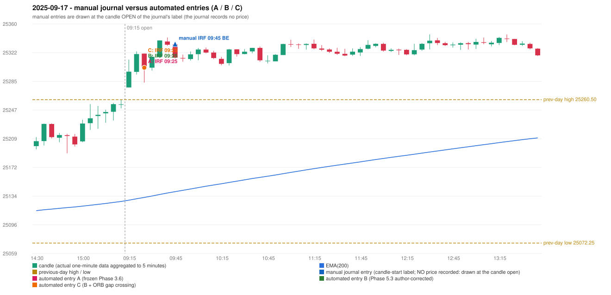

# 2025-09-17 (Wednesday) - manual journal versus the automated configurations

> SYNTHETIC index-point P&L; no real option P&L; costs illustrative (Rs 70 per trade + slippage scenarios). Configurations A / B / C are never combined.

## Session

* Open 25276.6; previous official close 25239.1; gap +37.50; previous-day high / low 25260.5 / 25072.25
* First 5-minute candle (09:15-09:20): O25276.6 H25313.15 L25276.6 C25297.3, GREEN, body 56.6%; EMA(200) at the first candle 25128.56; previous session's last close 25254.45 vs its EMA 25126.87

## Manual journal

row 11: IRF labelled 09:45, outcome BE

## Configuration A

Candidate signals (confirmed): 09:30 IRF/Method 1 SHORT [EXECUTED: trade 1: INITIAL_FULL_STOP]; 10:20 IRF/Method 1 SHORT [REJECTED: SECOND_TRADE_RESTRICTED_TO_PDR_PDS]; 10:20 IRF/Method 2A SHORT [REJECTED: SECOND_TRADE_RESTRICTED_TO_PDR_PDS]; 10:45 IRF/Method 1 SHORT [REJECTED: SECOND_TRADE_RESTRICTED_TO_PDR_PDS]; 10:45 IRF/Method 2B SHORT [REJECTED: SECOND_TRADE_RESTRICTED_TO_PDR_PDS]; 11:20 IRF/Method 2B SHORT [REJECTED: SECOND_TRADE_RESTRICTED_TO_PDR_PDS]; 12:40 IRF/Method 2B SHORT [REJECTED: SECOND_TRADE_RESTRICTED_TO_PDR_PDS]; 13:25 IRF/Method 2B SHORT [REJECTED: SECOND_TRADE_RESTRICTED_TO_PDR_PDS]; 14:05 IRF/Method 1 SHORT [REJECTED: SECOND_TRADE_RESTRICTED_TO_PDR_PDS]; 14:25 IRF/Method 1 SHORT [REJECTED: SECOND_TRADE_RESTRICTED_TO_PDR_PDS]; 14:45 IRF/Method 1 SHORT [REJECTED: SECOND_TRADE_RESTRICTED_TO_PDR_PDS]

Strategies with no confirmed signal: ORB: Method 1 INVALIDATED CANDLE_QUALITY(not a strong body / wick too large); Method 2 INVALIDATED CANDLE_QUALITY | PDR: no setup record (the strategy's trigger event never occurred) | PDS: no setup record (the strategy's trigger event never occurred) | RF: no setup record (the strategy's trigger event never occurred)

| trade | strategy / method | dir | signal -> fill | entry | stop / T1 / T2 | leg 1 | leg 2 | outcome | gross Rs | net Rs (70, 0) | net Rs (70, 1.0) |
|---|---|---|---|---|---|---|---|---|---|---|---|
| 1 | IRF/Method 1 | SHORT | 09:30 -> 09:30 | 25302.6 | 25337.6 / 25275.6 / 25242.6 | 09:39 @ 25337.6 | 09:39 @ 25337.6 | INITIAL_FULL_STOP | -13,650 | -13,720 | -14,500 |

Selection: This IRF Method 1 signal was the earliest executable signal of the day: 0 confirmed signal(s) earlier, 0 other in the same minute. 10 later confirmed signal(s) (IRF x10) are logged as ignored or rejected. State of the other four engines at that moment: [ORB: Method 1 invalidated at 09:15: CANDLE_QUALITY(not a strong body / wick too large); Method 2 invalidated at 09:15: CANDLE_QUALITY] [PDR: no setup record before this time (a base condition was not met, or nothing triggered)] [PDS: no setup record before this time (a base condition was not met, or nothing triggered)] [RF: no setup record before this time (a base condition was not met, or nothing triggered)]

* Journal row 11 (IRF 09:45): **DATE_STRATEGY_ONLY**; earliest cause EARLIER_SIGNAL (+ ENTRY_TIME_MISMATCH): the automated IRF trade has its signal candle at 09:25 versus the manual label 09:45 (-20 minutes; outside the 15-minute tolerance)
* Automated IRF 09:25 has no strict / time-tolerant journal counterpart: EARLIER_SIGNAL - the journal has IRF at 09:45; the automated trade's signal candle is 09:25

## Configuration B

Candidate signals (confirmed): 09:30 IRF/Method 1 SHORT [EXECUTED: trade 1: INITIAL_FULL_STOP]; 09:50 IRF/Method 2A SHORT [REJECTED: SECOND_TRADE_RESTRICTED_TO_PDR_PDS]; 10:20 IRF/Method 1 SHORT [REJECTED: SECOND_TRADE_RESTRICTED_TO_PDR_PDS]; 10:45 IRF/Method 1 SHORT [REJECTED: SECOND_TRADE_RESTRICTED_TO_PDR_PDS]; 10:45 IRF/Method 2B SHORT [REJECTED: SECOND_TRADE_RESTRICTED_TO_PDR_PDS]; 11:20 IRF/Method 2A SHORT [REJECTED: SECOND_TRADE_RESTRICTED_TO_PDR_PDS]; 11:20 IRF/Method 2B SHORT [REJECTED: SECOND_TRADE_RESTRICTED_TO_PDR_PDS]; 12:40 IRF/Method 2B SHORT [REJECTED: SECOND_TRADE_RESTRICTED_TO_PDR_PDS]; 13:25 IRF/Method 2B SHORT [REJECTED: SECOND_TRADE_RESTRICTED_TO_PDR_PDS]; 14:05 IRF/Method 1 SHORT [REJECTED: SECOND_TRADE_RESTRICTED_TO_PDR_PDS]; 14:25 IRF/Method 1 SHORT [REJECTED: SECOND_TRADE_RESTRICTED_TO_PDR_PDS]; 14:45 IRF/Method 1 SHORT [REJECTED: SECOND_TRADE_RESTRICTED_TO_PDR_PDS]

Strategies with no confirmed signal: ORB: Method 1 INVALIDATED CANDLE_QUALITY(not a strong body / wick too large); Method 2 INVALIDATED CANDLE_QUALITY | PDR: no setup record (the strategy's trigger event never occurred) | PDS: no setup record (the strategy's trigger event never occurred) | RF: no setup record (the strategy's trigger event never occurred)

| trade | strategy / method | dir | signal -> fill | entry | stop / T1 / T2 | leg 1 | leg 2 | outcome | gross Rs | net Rs (70, 0) | net Rs (70, 1.0) |
|---|---|---|---|---|---|---|---|---|---|---|---|
| 1 | IRF/Method 1 | SHORT | 09:30 -> 09:30 | 25302.6 | 25337.6 / 25275.6 / 25242.6 | 09:39 @ 25337.6 | 09:39 @ 25337.6 | INITIAL_FULL_STOP | -13,650 | -13,720 | -14,500 |

Selection: This IRF Method 1 signal was the earliest executable signal of the day: 0 confirmed signal(s) earlier, 0 other in the same minute. 11 later confirmed signal(s) (IRF x11) are logged as ignored or rejected. State of the other four engines at that moment: [ORB: Method 1 invalidated at 09:15: CANDLE_QUALITY(not a strong body / wick too large); Method 2 invalidated at 09:15: CANDLE_QUALITY] [PDR: no setup record before this time (a base condition was not met, or nothing triggered)] [PDS: no setup record before this time (a base condition was not met, or nothing triggered)] [RF: no setup record before this time (a base condition was not met, or nothing triggered)]

* Journal row 11 (IRF 09:45): **DATE_STRATEGY_ONLY**; earliest cause EARLIER_SIGNAL (+ ENTRY_TIME_MISMATCH): the automated IRF trade has its signal candle at 09:25 versus the manual label 09:45 (-20 minutes; outside the 15-minute tolerance)
* Automated IRF 09:25 has no strict / time-tolerant journal counterpart: EARLIER_SIGNAL - the journal has IRF at 09:45; the automated trade's signal candle is 09:25

## Configuration C

Candidate signals (confirmed): 09:30 IRF/Method 1 SHORT [EXECUTED: trade 1: INITIAL_FULL_STOP]; 09:50 IRF/Method 2A SHORT [REJECTED: SECOND_TRADE_RESTRICTED_TO_PDR_PDS]; 10:20 IRF/Method 1 SHORT [REJECTED: SECOND_TRADE_RESTRICTED_TO_PDR_PDS]; 10:45 IRF/Method 1 SHORT [REJECTED: SECOND_TRADE_RESTRICTED_TO_PDR_PDS]; 10:45 IRF/Method 2B SHORT [REJECTED: SECOND_TRADE_RESTRICTED_TO_PDR_PDS]; 11:20 IRF/Method 2A SHORT [REJECTED: SECOND_TRADE_RESTRICTED_TO_PDR_PDS]; 11:20 IRF/Method 2B SHORT [REJECTED: SECOND_TRADE_RESTRICTED_TO_PDR_PDS]; 12:40 IRF/Method 2B SHORT [REJECTED: SECOND_TRADE_RESTRICTED_TO_PDR_PDS]; 13:25 IRF/Method 2B SHORT [REJECTED: SECOND_TRADE_RESTRICTED_TO_PDR_PDS]; 14:05 IRF/Method 1 SHORT [REJECTED: SECOND_TRADE_RESTRICTED_TO_PDR_PDS]; 14:25 IRF/Method 1 SHORT [REJECTED: SECOND_TRADE_RESTRICTED_TO_PDR_PDS]; 14:45 IRF/Method 1 SHORT [REJECTED: SECOND_TRADE_RESTRICTED_TO_PDR_PDS]

Strategies with no confirmed signal: ORB: Method 1 INVALIDATED CANDLE_QUALITY(not a strong body / wick too large); Method 2 INVALIDATED CANDLE_QUALITY | PDR: no setup record (the strategy's trigger event never occurred) | PDS: no setup record (the strategy's trigger event never occurred) | RF: no setup record (the strategy's trigger event never occurred)

| trade | strategy / method | dir | signal -> fill | entry | stop / T1 / T2 | leg 1 | leg 2 | outcome | gross Rs | net Rs (70, 0) | net Rs (70, 1.0) |
|---|---|---|---|---|---|---|---|---|---|---|---|
| 1 | IRF/Method 1 | SHORT | 09:30 -> 09:30 | 25302.6 | 25337.6 / 25275.6 / 25242.6 | 09:39 @ 25337.6 | 09:39 @ 25337.6 | INITIAL_FULL_STOP | -13,650 | -13,720 | -14,500 |

Selection: This IRF Method 1 signal was the earliest executable signal of the day: 0 confirmed signal(s) earlier, 0 other in the same minute. 11 later confirmed signal(s) (IRF x11) are logged as ignored or rejected. State of the other four engines at that moment: [ORB: Method 1 invalidated at 09:15: CANDLE_QUALITY(not a strong body / wick too large); Method 2 invalidated at 09:15: CANDLE_QUALITY] [PDR: no setup record before this time (a base condition was not met, or nothing triggered)] [PDS: no setup record before this time (a base condition was not met, or nothing triggered)] [RF: no setup record before this time (a base condition was not met, or nothing triggered)]

* Journal row 11 (IRF 09:45): **DATE_STRATEGY_ONLY**; earliest cause EARLIER_SIGNAL (+ ENTRY_TIME_MISMATCH): the automated IRF trade has its signal candle at 09:25 versus the manual label 09:45 (-20 minutes; outside the 15-minute tolerance)
* Automated IRF 09:25 has no strict / time-tolerant journal counterpart: EARLIER_SIGNAL - the journal has IRF at 09:45; the automated trade's signal candle is 09:25

## Handwritten author corrections for this date

* AC07 (page 2): "IRF should be taken after 5 candles at 6th candle, because the entry candle body is 40% Wick is 60%. | entry should be activated here. | This should be ignored." - status A / B / C: IRF_TRADE_UNCHANGED / IRF_TRADE_UNCHANGED / IRF_TRADE_UNCHANGED

## Chart

