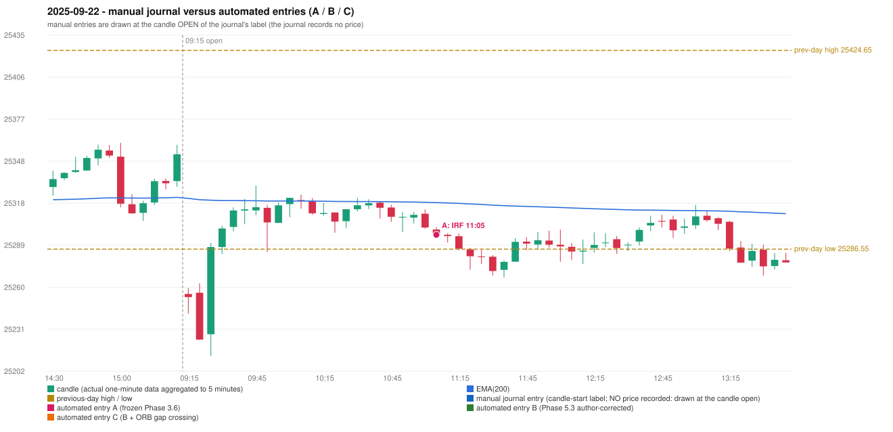

# 2025-09-22 (Monday) - manual journal versus the automated configurations

> SYNTHETIC index-point P&L; no real option P&L; costs illustrative (Rs 70 per trade + slippage scenarios). Configurations A / B / C are never combined.

## Session

* Open 25255.45; previous official close 25327.05; gap -71.60; previous-day high / low 25424.65 / 25286.55
* First 5-minute candle (09:15-09:20): O25255.45 H25259.55 L25241.8 C25253.3, RED, body 12.1%; EMA(200) at the first candle 25321.85; previous session's last close 25352.5 vs its EMA 25322.54

## Manual journal

no manual trade recorded

## Configuration A

Candidate signals (confirmed): 11:10 IRF/Method 2A SHORT [EXECUTED: trade 1: T1_THEN_BUFFER_STOP]; 11:25 PDS/Method 3 SHORT [IGNORED: POSITION_ACTIVE (signal kept for diagnostics only; never reused)]; 12:55 IRF/Method 2B SHORT [IGNORED: DAY_FINISHED]; 13:20 PDS/Method 3 SHORT [IGNORED: DAY_FINISHED]; 13:25 PDS/Method 1 SHORT [IGNORED: DAY_FINISHED]; 14:00 IRF/Method 1 SHORT [IGNORED: DAY_FINISHED]; 14:00 IRF/Method 2A SHORT [IGNORED: DAY_FINISHED]; 14:00 PDS/Method 3 SHORT [IGNORED: DAY_FINISHED]

Strategies with no confirmed signal: ORB: Gap/200DMA INVALIDATED CANDLE_QUALITY_OR_REJECTION_WICK; Method 1 INVALIDATED TREND:EMA_PREV_SESSION_CLOSE wrong side; Method 2 INVALIDATED TREND:EMA_PREV_SESSI | PDR: no setup record (the strategy's trigger event never occurred) | RF: RF INVALIDATED GAP_NOT_UP(DOWN)

| trade | strategy / method | dir | signal -> fill | entry | stop / T1 / T2 | leg 1 | leg 2 | outcome | gross Rs | net Rs (70, 0) | net Rs (70, 1.0) |
|---|---|---|---|---|---|---|---|---|---|---|---|
| 1 | IRF/Method 2A | SHORT | 11:10 -> 11:10 | 25296.55 | 25331.55 / 25269.55 / 25236.55 | 11:32 @ 25269.55 | 12:40 @ 25303.0 | T1_THEN_BUFFER_STOP | 4,007 | 3,937 | 3,157 |

Selection: This IRF Method 2A signal was the earliest executable signal of the day: 0 confirmed signal(s) earlier, 0 other in the same minute. 7 later confirmed signal(s) (IRF x3, PDS x4) are logged as ignored or rejected. State of the other four engines at that moment: [ORB: Method 1 invalidated at 09:15: TREND:EMA_PREV_SESSION_CLOSE wrong side; Method 2 invalidated at 09:15: TREND:EMA_PREV_SESSION_CLOSE wrong side] [PDR: no setup record before this time (a base condition was not met, or nothing triggered)] [PDS: no setup record before this time (a base condition was not met, or nothing triggered)] [RF: no setup record before this time (a base condition was not met, or nothing triggered)]

* Automated IRF 11:05 has no strict / time-tolerant journal counterpart: UNRESOLVED_DISCRETIONARY_SELECTION - the journal records no trade this day; the automated system took IRF Method 2A SHORT (candle 11:05) mechanically

## Configuration B

Candidate signals (confirmed): 11:25 IRF/Method 2A SHORT [CONFLICT: SIMULTANEOUS_SIGNAL_CONFLICT_UNRESOLVED: IRF/Method 2A/SHORT, PDS/Method 3/SHORT]; 11:25 PDS/Method 3 SHORT [CONFLICT: SIMULTANEOUS_SIGNAL_CONFLICT_UNRESOLVED: IRF/Method 2A/SHORT, PDS/Method 3/SHORT]; 13:20 PDS/Method 3 SHORT [IGNORED: DAY_UNRESOLVED_EXECUTION]; 13:25 PDS/Method 1 SHORT [IGNORED: DAY_UNRESOLVED_EXECUTION]; 13:35 PDS/Method 1 SHORT [IGNORED: DAY_UNRESOLVED_EXECUTION]; 13:55 PDS/Method 2 SHORT [IGNORED: DAY_UNRESOLVED_EXECUTION]; 14:00 IRF/Method 1 SHORT [IGNORED: DAY_UNRESOLVED_EXECUTION]; 14:00 IRF/Method 2A SHORT [IGNORED: DAY_UNRESOLVED_EXECUTION]; 14:00 IRF/Method 2B SHORT [IGNORED: DAY_UNRESOLVED_EXECUTION]

Strategies with no confirmed signal: ORB: Gap/200DMA INVALIDATED CANDLE_QUALITY_OR_REJECTION_WICK; Method 1 INVALIDATED TREND:EMA_PREV_SESSION_CLOSE wrong side; Method 2 INVALIDATED TREND:EMA_PREV_SESSI | PDR: no setup record (the strategy's trigger event never occurred) | RF: RF INVALIDATED GAP_NOT_UP(DOWN)

No trade: final day state UNRESOLVED_EXECUTION. Signals existed but none became a trade (see the dispositions above).

## Configuration C

Candidate signals (confirmed): 11:25 IRF/Method 2A SHORT [CONFLICT: SIMULTANEOUS_SIGNAL_CONFLICT_UNRESOLVED: IRF/Method 2A/SHORT, PDS/Method 3/SHORT]; 11:25 PDS/Method 3 SHORT [CONFLICT: SIMULTANEOUS_SIGNAL_CONFLICT_UNRESOLVED: IRF/Method 2A/SHORT, PDS/Method 3/SHORT]; 13:20 PDS/Method 3 SHORT [IGNORED: DAY_UNRESOLVED_EXECUTION]; 13:25 PDS/Method 1 SHORT [IGNORED: DAY_UNRESOLVED_EXECUTION]; 13:35 PDS/Method 1 SHORT [IGNORED: DAY_UNRESOLVED_EXECUTION]; 13:55 PDS/Method 2 SHORT [IGNORED: DAY_UNRESOLVED_EXECUTION]; 14:00 IRF/Method 1 SHORT [IGNORED: DAY_UNRESOLVED_EXECUTION]; 14:00 IRF/Method 2A SHORT [IGNORED: DAY_UNRESOLVED_EXECUTION]; 14:00 IRF/Method 2B SHORT [IGNORED: DAY_UNRESOLVED_EXECUTION]

Strategies with no confirmed signal: ORB: Gap/200DMA INVALIDATED CANDLE_QUALITY_OR_REJECTION_WICK; Method 1 INVALIDATED TREND:EMA_PREV_SESSION_CLOSE wrong side; Method 2 INVALIDATED TREND:EMA_PREV_SESSI | PDR: no setup record (the strategy's trigger event never occurred) | RF: RF INVALIDATED GAP_NOT_UP(DOWN)

No trade: final day state UNRESOLVED_EXECUTION. Signals existed but none became a trade (see the dispositions above).

## Handwritten author corrections for this date

* AC08 (page 2): "Entry should have activated earlier, marking first red candles Support/Resista[nce]" - status A / B / C: IRF_TRADE_UNCHANGED / IRF_TRADE_CHANGED / IRF_TRADE_CHANGED

## Chart

