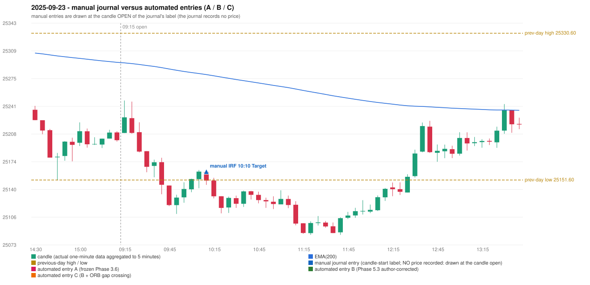

# 2025-09-23 (Tuesday) - manual journal versus the automated configurations

> SYNTHETIC index-point P&L; no real option P&L; costs illustrative (Rs 70 per trade + slippage scenarios). Configurations A / B / C are never combined.

## Session

* Open 25209.0; previous official close 25202.35; gap +6.65; previous-day high / low 25330.6 / 25151.6
* First 5-minute candle (09:15-09:20): O25209.0 H25248.6 L25209.0 C25228.05, GREEN, body 48.1%; EMA(200) at the first candle 25294.44; previous session's last close 25200.2 vs its EMA 25295.11

## Manual journal

row 12: IRF labelled 10:10, outcome Target

## Configuration A

Candidate signals (confirmed): none

Strategies with no confirmed signal: IRF: Method 1/2 INCOMPLETE_AT_EOD SESSION_ENDED_BEFORE_CONFIRMATION | ORB: Method 2 INVALIDATED TREND:EMA_PREV_SESSION_CLOSE wrong side | PDR: PDR INVALIDATED OPEN_NOT_STRICTLY_ABOVE_ZONE | PDS: no setup record (the strategy's trigger event never occurred) | RF: RF INVALIDATED TREND:EMA_PREV_SESSION_CLOSE wrong side

No trade: final day state READY_FOR_FIRST_TRADE. No strategy qualified.

* Journal row 12 (IRF 10:10): **UNMATCHED_MANUAL**; earliest cause UNRESOLVED_DISCRETIONARY_SELECTION: the engine produced no IRF signal near the manual entry (setup records: Method 1/2: SESSION_ENDED_BEFORE_CONFIRMATION); the journal gives no reason for the manual entry (rule points that are discretionary or unresolved: IRF Method 1 boundary IRF-M1-003, Method 3 wick share, the day's-low rule)

## Configuration B

Candidate signals (confirmed): none

Strategies with no confirmed signal: IRF: Method 1/2 INCOMPLETE_AT_EOD SESSION_ENDED_BEFORE_CONFIRMATION | ORB: Method 2 INVALIDATED TREND:EMA_PREV_SESSION_CLOSE wrong side | PDR: PDR INVALIDATED OPEN_NOT_STRICTLY_ABOVE_ZONE | PDS: no setup record (the strategy's trigger event never occurred) | RF: RF INVALIDATED TREND:EMA_PREV_SESSION_CLOSE wrong side

No trade: final day state READY_FOR_FIRST_TRADE. No strategy qualified.

* Journal row 12 (IRF 10:10): **UNMATCHED_MANUAL**; earliest cause UNRESOLVED_DISCRETIONARY_SELECTION: the engine produced no IRF signal near the manual entry (setup records: Method 1/2: SESSION_ENDED_BEFORE_CONFIRMATION); the journal gives no reason for the manual entry (rule points that are discretionary or unresolved: IRF Method 1 boundary IRF-M1-003, Method 3 wick share, the day's-low rule)

## Configuration C

Candidate signals (confirmed): none

Strategies with no confirmed signal: IRF: Method 1/2 INCOMPLETE_AT_EOD SESSION_ENDED_BEFORE_CONFIRMATION | ORB: Gap/200DMA INVALIDATED CLOSE_NOT_BEYOND_MA; Method 2 INVALIDATED TREND:EMA_PREV_SESSION_CLOSE wrong side | PDR: PDR INVALIDATED OPEN_NOT_STRICTLY_ABOVE_ZONE | PDS: no setup record (the strategy's trigger event never occurred) | RF: RF INVALIDATED TREND:EMA_PREV_SESSION_CLOSE wrong side

No trade: final day state READY_FOR_FIRST_TRADE. No strategy qualified.

* Journal row 12 (IRF 10:10): **UNMATCHED_MANUAL**; earliest cause UNRESOLVED_DISCRETIONARY_SELECTION: the engine produced no IRF signal near the manual entry (setup records: Method 1/2: SESSION_ENDED_BEFORE_CONFIRMATION); the journal gives no reason for the manual entry (rule points that are discretionary or unresolved: IRF Method 1 boundary IRF-M1-003, Method 3 wick share, the day's-low rule)

## Chart

