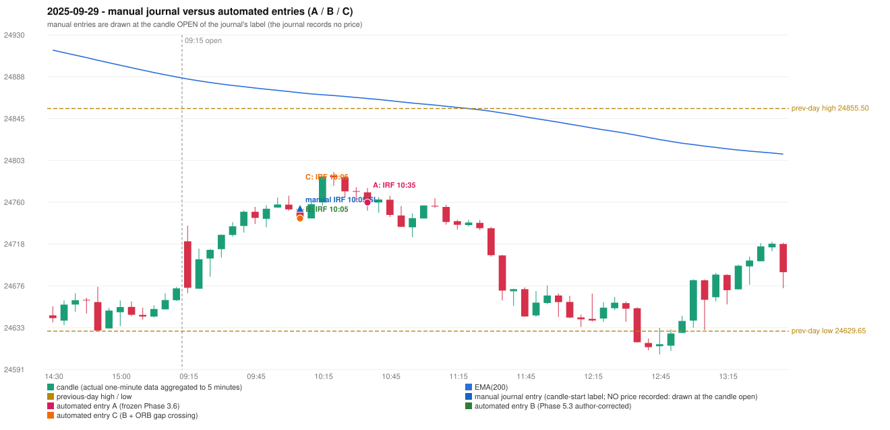

# 2025-09-29 (Monday) - manual journal versus the automated configurations

> SYNTHETIC index-point P&L; no real option P&L; costs illustrative (Rs 70 per trade + slippage scenarios). Configurations A / B / C are never combined.

## Session

* Open 24720.8; previous official close 24654.7; gap +66.10; previous-day high / low 24855.5 / 24629.65
* First 5-minute candle (09:15-09:20): O24720.8 H24736.65 L24668.25 C24673.7, RED, body 68.9%; EMA(200) at the first candle 24885.39; previous session's last close 24673.1 vs its EMA 24887.52

## Manual journal

row 16: IRF labelled 10:05, outcome SL

## Configuration A

Candidate signals (confirmed): 10:40 IRF/Method 2B SHORT [EXECUTED: trade 1: TARGET]; 10:55 IRF/Method 1 SHORT [IGNORED: POSITION_ACTIVE (signal kept for diagnostics only; never reused)]; 11:30 IRF/Method 1 SHORT [IGNORED: POSITION_ACTIVE (signal kept for diagnostics only; never reused)]

Strategies with no confirmed signal: ORB: no setup record (the strategy's trigger event never occurred) | PDR: PDR INVALIDATED OPEN_NOT_STRICTLY_ABOVE_ZONE | PDS: no setup record (the strategy's trigger event never occurred) | RF: RF INVALIDATED TREND:EMA_PREV_SESSION_CLOSE wrong side

| trade | strategy / method | dir | signal -> fill | entry | stop / T1 / T2 | leg 1 | leg 2 | outcome | gross Rs | net Rs (70, 0) | net Rs (70, 1.0) |
|---|---|---|---|---|---|---|---|---|---|---|---|
| 1 | IRF/Method 2B | SHORT | 10:40 -> 10:40 | 24760.25 | 24795.25 / 24733.25 / 24700.25 | 10:55 @ 24733.25 | 11:35 @ 24700.25 | TARGET | 16,965 | 16,895 | 16,115 |

Selection: This IRF Method 2B signal was the earliest executable signal of the day: 0 confirmed signal(s) earlier, 0 other in the same minute. 2 later confirmed signal(s) (IRF x2) are logged as ignored or rejected. State of the other four engines at that moment: [ORB: no setup record before this time (a base condition was not met, or nothing triggered)] [PDR: PDR invalidated at 09:15: OPEN_NOT_STRICTLY_ABOVE_ZONE] [PDS: no setup record before this time (a base condition was not met, or nothing triggered)] [RF: no setup record before this time (a base condition was not met, or nothing triggered)]

* Journal row 16 (IRF 10:05): **DATE_STRATEGY_ONLY**; earliest cause LATER_SIGNAL (+ ENTRY_TIME_MISMATCH): the automated IRF trade has its signal candle at 10:35 versus the manual label 10:05 (+30 minutes; outside the 15-minute tolerance)
* Automated IRF 10:35 has no strict / time-tolerant journal counterpart: LATER_SIGNAL - the journal has IRF at 10:05; the automated trade's signal candle is 10:35

## Configuration B

Candidate signals (confirmed): 10:10 IRF/Method 2A SHORT [EXECUTED: trade 1: INITIAL_FULL_STOP]; 10:30 IRF/Method 2A SHORT [REJECTED: SECOND_TRADE_RESTRICTED_TO_PDR_PDS]; 10:55 IRF/Method 1 SHORT [REJECTED: SECOND_TRADE_RESTRICTED_TO_PDR_PDS]; 11:30 IRF/Method 1 SHORT [REJECTED: SECOND_TRADE_RESTRICTED_TO_PDR_PDS]

Strategies with no confirmed signal: ORB: no setup record (the strategy's trigger event never occurred) | PDR: PDR INVALIDATED OPEN_NOT_STRICTLY_ABOVE_ZONE | PDS: no setup record (the strategy's trigger event never occurred) | RF: RF INVALIDATED TREND:EMA_PREV_SESSION_CLOSE wrong side

| trade | strategy / method | dir | signal -> fill | entry | stop / T1 / T2 | leg 1 | leg 2 | outcome | gross Rs | net Rs (70, 0) | net Rs (70, 1.0) |
|---|---|---|---|---|---|---|---|---|---|---|---|
| 1 | IRF/Method 2A | SHORT | 10:10 -> 10:10 | 24744.0 | 24779.0 / 24717.0 / 24684.0 | 10:19 @ 24779.3 | 10:19 @ 24779.3 | INITIAL_FULL_STOP | -13,767 | -13,837 | -14,617 |

Selection: This IRF Method 2A signal was the earliest executable signal of the day: 0 confirmed signal(s) earlier, 0 other in the same minute. 3 later confirmed signal(s) (IRF x3) are logged as ignored or rejected. State of the other four engines at that moment: [ORB: no setup record before this time (a base condition was not met, or nothing triggered)] [PDR: PDR invalidated at 09:15: OPEN_NOT_STRICTLY_ABOVE_ZONE] [PDS: no setup record before this time (a base condition was not met, or nothing triggered)] [RF: no setup record before this time (a base condition was not met, or nothing triggered)]

* Journal row 16 (IRF 10:05): **STRICT** match with 20250929-1-IRF (delta +0 min); outcome SL vs automated INITIAL_FULL_STOP (same class)

## Configuration C

Candidate signals (confirmed): 10:10 IRF/Method 2A SHORT [EXECUTED: trade 1: INITIAL_FULL_STOP]; 10:30 IRF/Method 2A SHORT [REJECTED: SECOND_TRADE_RESTRICTED_TO_PDR_PDS]; 10:55 IRF/Method 1 SHORT [REJECTED: SECOND_TRADE_RESTRICTED_TO_PDR_PDS]; 11:30 IRF/Method 1 SHORT [REJECTED: SECOND_TRADE_RESTRICTED_TO_PDR_PDS]

Strategies with no confirmed signal: ORB: Gap/200DMA INVALIDATED CLOSE_NOT_BEYOND_MA | PDR: PDR INVALIDATED OPEN_NOT_STRICTLY_ABOVE_ZONE | PDS: no setup record (the strategy's trigger event never occurred) | RF: RF INVALIDATED TREND:EMA_PREV_SESSION_CLOSE wrong side

| trade | strategy / method | dir | signal -> fill | entry | stop / T1 / T2 | leg 1 | leg 2 | outcome | gross Rs | net Rs (70, 0) | net Rs (70, 1.0) |
|---|---|---|---|---|---|---|---|---|---|---|---|
| 1 | IRF/Method 2A | SHORT | 10:10 -> 10:10 | 24744.0 | 24779.0 / 24717.0 / 24684.0 | 10:19 @ 24779.3 | 10:19 @ 24779.3 | INITIAL_FULL_STOP | -13,767 | -13,837 | -14,617 |

Selection: This IRF Method 2A signal was the earliest executable signal of the day: 0 confirmed signal(s) earlier, 0 other in the same minute. 3 later confirmed signal(s) (IRF x3) are logged as ignored or rejected. State of the other four engines at that moment: [ORB: Gap/200DMA invalidated at 09:15: CLOSE_NOT_BEYOND_MA] [PDR: PDR invalidated at 09:15: OPEN_NOT_STRICTLY_ABOVE_ZONE] [PDS: no setup record before this time (a base condition was not met, or nothing triggered)] [RF: no setup record before this time (a base condition was not met, or nothing triggered)]

* Journal row 16 (IRF 10:05): **STRICT** match with 20250929-1-IRF (delta +0 min); outcome SL vs automated INITIAL_FULL_STOP (same class)

## Handwritten author corrections for this date

* AC09 (page 2): "Late entry, red candle should be marked, 1st red candle." - status A / B / C: IRF_TRADE_UNCHANGED / IRF_TRADE_CHANGED / IRF_TRADE_CHANGED

## Chart

