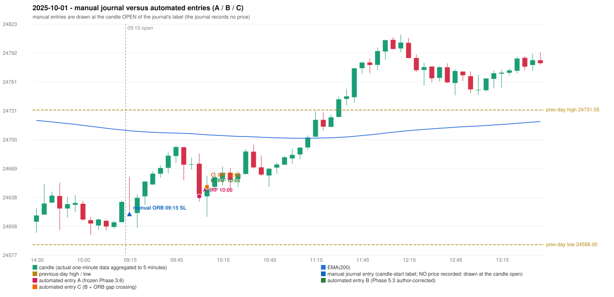

# 2025-10-01 (Wednesday) - manual journal versus the automated configurations

> SYNTHETIC index-point P&L; no real option P&L; costs illustrative (Rs 70 per trade + slippage scenarios). Configurations A / B / C are never combined.

## Session

* Open 24620.55; previous official close 24611.1; gap +9.45; previous-day high / low 24731.55 / 24588.0
* First 5-minute candle (09:15-09:20): O24620.55 H24660.2 L24620.15 C24620.5, RED, body 0.1%; EMA(200) at the first candle 24709.44; previous session's last close 24633.6 vs its EMA 24710.33

## Manual journal

row 17: ORB labelled 09:15, outcome SL

## Configuration A

Candidate signals (confirmed): 10:05 IRF/Method 1 SHORT [EXECUTED: trade 1: INITIAL_FULL_STOP]; 10:05 IRF/Method 2A SHORT [MERGED_SAME_STRATEGY_METHOD: traded as another method of the same strategy/direction in the same minute]; 10:25 IRF/Method 1 SHORT [IGNORED: POSITION_ACTIVE (signal kept for diagnostics only; never reused)]

Strategies with no confirmed signal: ORB: no setup record (the strategy's trigger event never occurred) | PDR: PDR INVALIDATED OPEN_NOT_STRICTLY_ABOVE_ZONE | PDS: no setup record (the strategy's trigger event never occurred) | RF: no setup record (the strategy's trigger event never occurred)

| trade | strategy / method | dir | signal -> fill | entry | stop / T1 / T2 | leg 1 | leg 2 | outcome | gross Rs | net Rs (70, 0) | net Rs (70, 1.0) |
|---|---|---|---|---|---|---|---|---|---|---|---|
| 1 | IRF/Method 1 | SHORT | 10:05 -> 10:05 | 24639.55 | 24674.55 / 24612.55 / 24579.55 | 10:30 @ 24674.55 | 10:30 @ 24674.55 | INITIAL_FULL_STOP | -13,650 | -13,720 | -14,500 |

Selection: This IRF Method 1 signal was the earliest executable signal of the day: 0 confirmed signal(s) earlier, 1 other in the same minute. 1 later confirmed signal(s) (IRF x1) are logged as ignored or rejected. State of the other four engines at that moment: [ORB: no setup record before this time (a base condition was not met, or nothing triggered)] [PDR: PDR invalidated at 09:15: OPEN_NOT_STRICTLY_ABOVE_ZONE] [PDS: no setup record before this time (a base condition was not met, or nothing triggered)] [RF: no setup record before this time (a base condition was not met, or nothing triggered)]

* Journal row 17 (ORB 09:15): **UNMATCHED_MANUAL**; earliest cause LEVEL_CONSTRUCTION_MISMATCH: first candle RED O24620.55 H24660.2 L24620.15 C24620.5 (body 0.1%); direction ASSUMED from the colour (the journal has no direction); closest method Method 1 (1 failing predicate(s)): first failing 'level_broken' - previous-day low 24588.0; candle high/low 24620.15, close 24620.5; all methods: Method 1: 1 fail (level_broken); Method 2: 2 fail (inner_level_broken); Gap/200DMA: 2 fail (gap_in_direction)
* Automated IRF 10:00 has no strict / time-tolerant journal counterpart: DIFFERENT_STRATEGY_SELECTED - the journal traded ORB 09:15; the automated controller took IRF Method 1 (candle 10:00) as the first valid signal

## Configuration B

Candidate signals (confirmed): 10:10 IRF/Method 2A SHORT [EXECUTED: trade 1: INITIAL_FULL_STOP]; 10:25 IRF/Method 1 SHORT [IGNORED: POSITION_ACTIVE (signal kept for diagnostics only; never reused)]; 10:50 IRF/Method 2A SHORT [REJECTED: SECOND_TRADE_RESTRICTED_TO_PDR_PDS]

Strategies with no confirmed signal: ORB: no setup record (the strategy's trigger event never occurred) | PDR: PDR INVALIDATED OPEN_NOT_STRICTLY_ABOVE_ZONE | PDS: no setup record (the strategy's trigger event never occurred) | RF: no setup record (the strategy's trigger event never occurred)

| trade | strategy / method | dir | signal -> fill | entry | stop / T1 / T2 | leg 1 | leg 2 | outcome | gross Rs | net Rs (70, 0) | net Rs (70, 1.0) |
|---|---|---|---|---|---|---|---|---|---|---|---|
| 1 | IRF/Method 2A | SHORT | 10:10 -> 10:10 | 24649.7 | 24684.7 / 24622.7 / 24589.7 | 10:32 @ 24684.7 | 10:32 @ 24684.7 | INITIAL_FULL_STOP | -13,650 | -13,720 | -14,500 |

Selection: This IRF Method 2A signal was the earliest executable signal of the day: 0 confirmed signal(s) earlier, 0 other in the same minute. 2 later confirmed signal(s) (IRF x2) are logged as ignored or rejected. State of the other four engines at that moment: [ORB: no setup record before this time (a base condition was not met, or nothing triggered)] [PDR: PDR invalidated at 09:15: OPEN_NOT_STRICTLY_ABOVE_ZONE] [PDS: no setup record before this time (a base condition was not met, or nothing triggered)] [RF: no setup record before this time (a base condition was not met, or nothing triggered)]

* Journal row 17 (ORB 09:15): **UNMATCHED_MANUAL**; earliest cause LEVEL_CONSTRUCTION_MISMATCH: first candle RED O24620.55 H24660.2 L24620.15 C24620.5 (body 0.1%); direction ASSUMED from the colour (the journal has no direction); closest method Method 1 (1 failing predicate(s)): first failing 'level_broken' - previous-day low 24588.0; candle high/low 24620.15, close 24620.5; all methods: Method 1: 1 fail (level_broken); Method 2: 2 fail (inner_level_broken); Gap/200DMA: 2 fail (gap_in_direction)
* Automated IRF 10:05 has no strict / time-tolerant journal counterpart: DIFFERENT_STRATEGY_SELECTED - the journal traded ORB 09:15; the automated controller took IRF Method 2A (candle 10:05) as the first valid signal

## Configuration C

Candidate signals (confirmed): 10:10 IRF/Method 2A SHORT [EXECUTED: trade 1: INITIAL_FULL_STOP]; 10:25 IRF/Method 1 SHORT [IGNORED: POSITION_ACTIVE (signal kept for diagnostics only; never reused)]; 10:50 IRF/Method 2A SHORT [REJECTED: SECOND_TRADE_RESTRICTED_TO_PDR_PDS]

Strategies with no confirmed signal: ORB: Gap/200DMA INVALIDATED CLOSE_NOT_BEYOND_MA | PDR: PDR INVALIDATED OPEN_NOT_STRICTLY_ABOVE_ZONE | PDS: no setup record (the strategy's trigger event never occurred) | RF: no setup record (the strategy's trigger event never occurred)

| trade | strategy / method | dir | signal -> fill | entry | stop / T1 / T2 | leg 1 | leg 2 | outcome | gross Rs | net Rs (70, 0) | net Rs (70, 1.0) |
|---|---|---|---|---|---|---|---|---|---|---|---|
| 1 | IRF/Method 2A | SHORT | 10:10 -> 10:10 | 24649.7 | 24684.7 / 24622.7 / 24589.7 | 10:32 @ 24684.7 | 10:32 @ 24684.7 | INITIAL_FULL_STOP | -13,650 | -13,720 | -14,500 |

Selection: This IRF Method 2A signal was the earliest executable signal of the day: 0 confirmed signal(s) earlier, 0 other in the same minute. 2 later confirmed signal(s) (IRF x2) are logged as ignored or rejected. State of the other four engines at that moment: [ORB: Gap/200DMA invalidated at 09:15: CLOSE_NOT_BEYOND_MA] [PDR: PDR invalidated at 09:15: OPEN_NOT_STRICTLY_ABOVE_ZONE] [PDS: no setup record before this time (a base condition was not met, or nothing triggered)] [RF: no setup record before this time (a base condition was not met, or nothing triggered)]

* Journal row 17 (ORB 09:15): **UNMATCHED_MANUAL**; earliest cause LEVEL_CONSTRUCTION_MISMATCH: first candle RED O24620.55 H24660.2 L24620.15 C24620.5 (body 0.1%); direction ASSUMED from the colour (the journal has no direction); closest method Method 1 (1 failing predicate(s)): first failing 'level_broken' - previous-day low 24588.0; candle high/low 24620.15, close 24620.5; all methods: Method 1: 1 fail (level_broken); Method 2: 2 fail (inner_level_broken); Gap/200DMA: 2 fail (gap_in_direction)
* Automated IRF 10:05 has no strict / time-tolerant journal counterpart: DIFFERENT_STRATEGY_SELECTED - the journal traded ORB 09:15; the automated controller took IRF Method 2A (candle 10:05) as the first valid signal

## Chart

