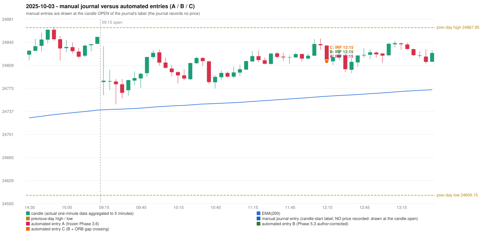

# 2025-10-03 (Friday) - manual journal versus the automated configurations

> SYNTHETIC index-point P&L; no real option P&L; costs illustrative (Rs 70 per trade + slippage scenarios). Configurations A / B / C are never combined.

## Session

* Open 24783.0; previous official close 24836.3; gap -53.30; previous-day high / low 24867.85 / 24606.15
* First 5-minute candle (09:15-09:20): O24783.0 H24838.9 L24762.45 C24785.05, GREEN, body 2.7%; EMA(200) at the first candle 24739.62; previous session's last close 24853.4 vs its EMA 24739.16

## Manual journal

no manual trade recorded

## Configuration A

Candidate signals (confirmed): 12:20 IRF/Method 1 SHORT [EXECUTED: trade 1: INITIAL_FULL_STOP]; 12:35 IRF/Method 2A SHORT [IGNORED: POSITION_ACTIVE (signal kept for diagnostics only; never reused)]; 13:25 IRF/Method 1 SHORT [IGNORED: POSITION_ACTIVE (signal kept for diagnostics only; never reused)]; 13:30 IRF/Method 2A SHORT [IGNORED: POSITION_ACTIVE (signal kept for diagnostics only; never reused)]

Strategies with no confirmed signal: ORB: Method 2 INVALIDATED TREND:EMA_PREV_SESSION_CLOSE wrong side | PDR: no setup record (the strategy's trigger event never occurred) | PDS: Method 1/2/3 INVALIDATED GAP_DOWN_OPEN_NOT_BELOW_ZONE | RF: no setup record (the strategy's trigger event never occurred)

| trade | strategy / method | dir | signal -> fill | entry | stop / T1 / T2 | leg 1 | leg 2 | outcome | gross Rs | net Rs (70, 0) | net Rs (70, 1.0) |
|---|---|---|---|---|---|---|---|---|---|---|---|
| 1 | IRF/Method 1 | SHORT | 12:20 -> 12:20 | 24815.2 | 24850.2 / 24788.2 / 24755.2 | 14:36 @ 24850.2 | 14:36 @ 24850.2 | INITIAL_FULL_STOP | -13,650 | -13,720 | -14,500 |

Selection: This IRF Method 1 signal was the earliest executable signal of the day: 0 confirmed signal(s) earlier, 0 other in the same minute. 3 later confirmed signal(s) (IRF x3) are logged as ignored or rejected. State of the other four engines at that moment: [ORB: Method 2 invalidated at 09:15: TREND:EMA_PREV_SESSION_CLOSE wrong side] [PDR: no setup record before this time (a base condition was not met, or nothing triggered)] [PDS: Method 1/2/3 invalidated at 09:15: GAP_DOWN_OPEN_NOT_BELOW_ZONE] [RF: no setup record before this time (a base condition was not met, or nothing triggered)]

* Automated IRF 12:15 has no strict / time-tolerant journal counterpart: UNRESOLVED_DISCRETIONARY_SELECTION - the journal records no trade this day; the automated system took IRF Method 1 SHORT (candle 12:15) mechanically

## Configuration B

Candidate signals (confirmed): 12:20 IRF/Method 1 SHORT [EXECUTED: trade 1: INITIAL_FULL_STOP]; 12:35 IRF/Method 2A SHORT [IGNORED: POSITION_ACTIVE (signal kept for diagnostics only; never reused)]; 13:25 IRF/Method 1 SHORT [IGNORED: POSITION_ACTIVE (signal kept for diagnostics only; never reused)]; 13:30 IRF/Method 2A SHORT [IGNORED: POSITION_ACTIVE (signal kept for diagnostics only; never reused)]

Strategies with no confirmed signal: ORB: Method 2 INVALIDATED TREND:EMA_PREV_SESSION_CLOSE wrong side | PDR: no setup record (the strategy's trigger event never occurred) | PDS: Method 1/2/3 INVALIDATED GAP_DOWN_OPEN_NOT_BELOW_ZONE | RF: no setup record (the strategy's trigger event never occurred)

| trade | strategy / method | dir | signal -> fill | entry | stop / T1 / T2 | leg 1 | leg 2 | outcome | gross Rs | net Rs (70, 0) | net Rs (70, 1.0) |
|---|---|---|---|---|---|---|---|---|---|---|---|
| 1 | IRF/Method 1 | SHORT | 12:20 -> 12:20 | 24815.2 | 24850.2 / 24788.2 / 24755.2 | 14:36 @ 24850.2 | 14:36 @ 24850.2 | INITIAL_FULL_STOP | -13,650 | -13,720 | -14,500 |

Selection: This IRF Method 1 signal was the earliest executable signal of the day: 0 confirmed signal(s) earlier, 0 other in the same minute. 3 later confirmed signal(s) (IRF x3) are logged as ignored or rejected. State of the other four engines at that moment: [ORB: Method 2 invalidated at 09:15: TREND:EMA_PREV_SESSION_CLOSE wrong side] [PDR: no setup record before this time (a base condition was not met, or nothing triggered)] [PDS: Method 1/2/3 invalidated at 09:15: GAP_DOWN_OPEN_NOT_BELOW_ZONE] [RF: no setup record before this time (a base condition was not met, or nothing triggered)]

* Automated IRF 12:15 has no strict / time-tolerant journal counterpart: UNRESOLVED_DISCRETIONARY_SELECTION - the journal records no trade this day; the automated system took IRF Method 1 SHORT (candle 12:15) mechanically

## Configuration C

Candidate signals (confirmed): 12:20 IRF/Method 1 SHORT [EXECUTED: trade 1: INITIAL_FULL_STOP]; 12:35 IRF/Method 2A SHORT [IGNORED: POSITION_ACTIVE (signal kept for diagnostics only; never reused)]; 13:25 IRF/Method 1 SHORT [IGNORED: POSITION_ACTIVE (signal kept for diagnostics only; never reused)]; 13:30 IRF/Method 2A SHORT [IGNORED: POSITION_ACTIVE (signal kept for diagnostics only; never reused)]

Strategies with no confirmed signal: ORB: Gap/200DMA INVALIDATED CLOSE_NOT_BEYOND_MA; Method 2 INVALIDATED TREND:EMA_PREV_SESSION_CLOSE wrong side | PDR: no setup record (the strategy's trigger event never occurred) | PDS: Method 1/2/3 INVALIDATED GAP_DOWN_OPEN_NOT_BELOW_ZONE | RF: no setup record (the strategy's trigger event never occurred)

| trade | strategy / method | dir | signal -> fill | entry | stop / T1 / T2 | leg 1 | leg 2 | outcome | gross Rs | net Rs (70, 0) | net Rs (70, 1.0) |
|---|---|---|---|---|---|---|---|---|---|---|---|
| 1 | IRF/Method 1 | SHORT | 12:20 -> 12:20 | 24815.2 | 24850.2 / 24788.2 / 24755.2 | 14:36 @ 24850.2 | 14:36 @ 24850.2 | INITIAL_FULL_STOP | -13,650 | -13,720 | -14,500 |

Selection: This IRF Method 1 signal was the earliest executable signal of the day: 0 confirmed signal(s) earlier, 0 other in the same minute. 3 later confirmed signal(s) (IRF x3) are logged as ignored or rejected. State of the other four engines at that moment: [ORB: Method 2 invalidated at 09:15: TREND:EMA_PREV_SESSION_CLOSE wrong side; Gap/200DMA invalidated at 09:15: CLOSE_NOT_BEYOND_MA] [PDR: no setup record before this time (a base condition was not met, or nothing triggered)] [PDS: Method 1/2/3 invalidated at 09:15: GAP_DOWN_OPEN_NOT_BELOW_ZONE] [RF: no setup record before this time (a base condition was not met, or nothing triggered)]

* Automated IRF 12:15 has no strict / time-tolerant journal counterpart: UNRESOLVED_DISCRETIONARY_SELECTION - the journal records no trade this day; the automated system took IRF Method 1 SHORT (candle 12:15) mechanically

## Chart

