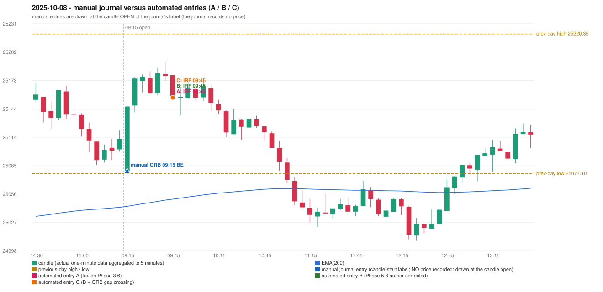

# 2025-10-08 (Wednesday) - manual journal versus the automated configurations

> SYNTHETIC index-point P&L; no real option P&L; costs illustrative (Rs 70 per trade + slippage scenarios). Configurations A / B / C are never combined.

## Session

* Open 25079.75; previous official close 25108.3; gap -28.55; previous-day high / low 25220.35 / 25077.1
* First 5-minute candle (09:15-09:20): O25079.75 H25146.95 L25079.75 C25146.05, GREEN, body 98.7%; EMA(200) at the first candle 25043.72; previous session's last close 25112.8 vs its EMA 25042.69

## Manual journal

row 20: ORB labelled 09:15, outcome BE

## Configuration A

Candidate signals (confirmed): 09:50 IRF/Method 2A SHORT [EXECUTED: trade 1: TARGET]; 10:15 IRF/Method 2B SHORT [IGNORED: POSITION_ACTIVE (signal kept for diagnostics only; never reused)]; 10:20 IRF/Method 1 SHORT [IGNORED: POSITION_ACTIVE (signal kept for diagnostics only; never reused)]

Strategies with no confirmed signal: ORB: no setup record (the strategy's trigger event never occurred) | PDR: no setup record (the strategy's trigger event never occurred) | PDS: Method 1/2/3 INVALIDATED GAP_DOWN_OPEN_NOT_BELOW_ZONE | RF: RF INVALIDATED GAP_NOT_UP(DOWN)

| trade | strategy / method | dir | signal -> fill | entry | stop / T1 / T2 | leg 1 | leg 2 | outcome | gross Rs | net Rs (70, 0) | net Rs (70, 1.0) |
|---|---|---|---|---|---|---|---|---|---|---|---|
| 1 | IRF/Method 2A | SHORT | 09:50 -> 09:50 | 25155.1 | 25190.1 / 25128.1 / 25095.1 | 10:22 @ 25128.1 | 10:57 @ 25095.1 | TARGET | 16,965 | 16,895 | 16,115 |

Selection: This IRF Method 2A signal was the earliest executable signal of the day: 0 confirmed signal(s) earlier, 0 other in the same minute. 2 later confirmed signal(s) (IRF x2) are logged as ignored or rejected. State of the other four engines at that moment: [ORB: no setup record before this time (a base condition was not met, or nothing triggered)] [PDR: no setup record before this time (a base condition was not met, or nothing triggered)] [PDS: Method 1/2/3 invalidated at 09:15: GAP_DOWN_OPEN_NOT_BELOW_ZONE] [RF: no setup record before this time (a base condition was not met, or nothing triggered)]

* Journal row 20 (ORB 09:15): **UNMATCHED_MANUAL**; earliest cause LEVEL_CONSTRUCTION_MISMATCH: first candle GREEN O25079.75 H25146.95 L25079.75 C25146.05 (body 98.7%); direction ASSUMED from the colour (the journal has no direction); closest method Method 1 (1 failing predicate(s)): first failing 'level_broken' - previous-day high 25220.35; candle high/low 25146.95, close 25146.05; all methods: Method 1: 1 fail (level_broken); Method 2: 2 fail (inner_level_broken); Gap/200DMA: 2 fail (gap_in_direction)
* Automated IRF 09:45 has no strict / time-tolerant journal counterpart: DIFFERENT_STRATEGY_SELECTED - the journal traded ORB 09:15; the automated controller took IRF Method 2A (candle 09:45) as the first valid signal

## Configuration B

Candidate signals (confirmed): 09:50 IRF/Method 2A SHORT [EXECUTED: trade 1: TARGET]; 10:15 IRF/Method 2B SHORT [IGNORED: POSITION_ACTIVE (signal kept for diagnostics only; never reused)]; 10:20 IRF/Method 1 SHORT [IGNORED: POSITION_ACTIVE (signal kept for diagnostics only; never reused)]

Strategies with no confirmed signal: ORB: no setup record (the strategy's trigger event never occurred) | PDR: no setup record (the strategy's trigger event never occurred) | PDS: Method 1/2/3 INVALIDATED GAP_DOWN_OPEN_NOT_BELOW_ZONE | RF: RF INVALIDATED GAP_NOT_UP(DOWN)

| trade | strategy / method | dir | signal -> fill | entry | stop / T1 / T2 | leg 1 | leg 2 | outcome | gross Rs | net Rs (70, 0) | net Rs (70, 1.0) |
|---|---|---|---|---|---|---|---|---|---|---|---|
| 1 | IRF/Method 2A | SHORT | 09:50 -> 09:50 | 25155.1 | 25190.1 / 25128.1 / 25095.1 | 10:22 @ 25128.1 | 10:57 @ 25095.1 | TARGET | 16,965 | 16,895 | 16,115 |

Selection: This IRF Method 2A signal was the earliest executable signal of the day: 0 confirmed signal(s) earlier, 0 other in the same minute. 2 later confirmed signal(s) (IRF x2) are logged as ignored or rejected. State of the other four engines at that moment: [ORB: no setup record before this time (a base condition was not met, or nothing triggered)] [PDR: no setup record before this time (a base condition was not met, or nothing triggered)] [PDS: Method 1/2/3 invalidated at 09:15: GAP_DOWN_OPEN_NOT_BELOW_ZONE] [RF: no setup record before this time (a base condition was not met, or nothing triggered)]

* Journal row 20 (ORB 09:15): **UNMATCHED_MANUAL**; earliest cause LEVEL_CONSTRUCTION_MISMATCH: first candle GREEN O25079.75 H25146.95 L25079.75 C25146.05 (body 98.7%); direction ASSUMED from the colour (the journal has no direction); closest method Method 1 (1 failing predicate(s)): first failing 'level_broken' - previous-day high 25220.35; candle high/low 25146.95, close 25146.05; all methods: Method 1: 1 fail (level_broken); Method 2: 2 fail (inner_level_broken); Gap/200DMA: 2 fail (gap_in_direction)
* Automated IRF 09:45 has no strict / time-tolerant journal counterpart: DIFFERENT_STRATEGY_SELECTED - the journal traded ORB 09:15; the automated controller took IRF Method 2A (candle 09:45) as the first valid signal

## Configuration C

Candidate signals (confirmed): 09:50 IRF/Method 2A SHORT [EXECUTED: trade 1: TARGET]; 10:15 IRF/Method 2B SHORT [IGNORED: POSITION_ACTIVE (signal kept for diagnostics only; never reused)]; 10:20 IRF/Method 1 SHORT [IGNORED: POSITION_ACTIVE (signal kept for diagnostics only; never reused)]

Strategies with no confirmed signal: ORB: Gap/200DMA INVALIDATED CLOSE_NOT_BEYOND_MA | PDR: no setup record (the strategy's trigger event never occurred) | PDS: Method 1/2/3 INVALIDATED GAP_DOWN_OPEN_NOT_BELOW_ZONE | RF: RF INVALIDATED GAP_NOT_UP(DOWN)

| trade | strategy / method | dir | signal -> fill | entry | stop / T1 / T2 | leg 1 | leg 2 | outcome | gross Rs | net Rs (70, 0) | net Rs (70, 1.0) |
|---|---|---|---|---|---|---|---|---|---|---|---|
| 1 | IRF/Method 2A | SHORT | 09:50 -> 09:50 | 25155.1 | 25190.1 / 25128.1 / 25095.1 | 10:22 @ 25128.1 | 10:57 @ 25095.1 | TARGET | 16,965 | 16,895 | 16,115 |

Selection: This IRF Method 2A signal was the earliest executable signal of the day: 0 confirmed signal(s) earlier, 0 other in the same minute. 2 later confirmed signal(s) (IRF x2) are logged as ignored or rejected. State of the other four engines at that moment: [ORB: Gap/200DMA invalidated at 09:15: CLOSE_NOT_BEYOND_MA] [PDR: no setup record before this time (a base condition was not met, or nothing triggered)] [PDS: Method 1/2/3 invalidated at 09:15: GAP_DOWN_OPEN_NOT_BELOW_ZONE] [RF: no setup record before this time (a base condition was not met, or nothing triggered)]

* Journal row 20 (ORB 09:15): **UNMATCHED_MANUAL**; earliest cause LEVEL_CONSTRUCTION_MISMATCH: first candle GREEN O25079.75 H25146.95 L25079.75 C25146.05 (body 98.7%); direction ASSUMED from the colour (the journal has no direction); closest method Method 1 (1 failing predicate(s)): first failing 'level_broken' - previous-day high 25220.35; candle high/low 25146.95, close 25146.05; all methods: Method 1: 1 fail (level_broken); Method 2: 2 fail (inner_level_broken); Gap/200DMA: 2 fail (gap_in_direction)
* Automated IRF 09:45 has no strict / time-tolerant journal counterpart: DIFFERENT_STRATEGY_SELECTED - the journal traded ORB 09:15; the automated controller took IRF Method 2A (candle 09:45) as the first valid signal

## Handwritten author corrections for this date

* AC12 (page 3): "This should be an ORB trade, but is shown as IRF. | ORB should activate, Instead IRF is activated." - status A / B / C: ORB_STILL_NOT_TRADED / ORB_STILL_NOT_TRADED / ORB_STILL_NOT_TRADED

## Chart

