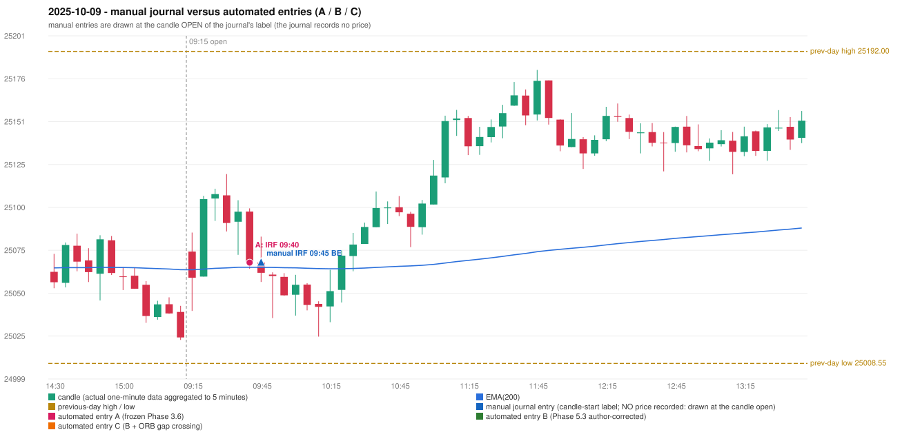

# 2025-10-09 (Thursday) - manual journal versus the automated configurations

> SYNTHETIC index-point P&L; no real option P&L; costs illustrative (Rs 70 per trade + slippage scenarios). Configurations A / B / C are never combined.

## Session

* Open 25074.3; previous official close 25046.15; gap +28.15; previous-day high / low 25192.0 / 25008.55
* First 5-minute candle (09:15-09:20): O25074.3 H25085.5 L25039.4 C25058.95, RED, body 33.3%; EMA(200) at the first candle 25063.60; previous session's last close 25023.8 vs its EMA 25063.64

## Manual journal

row 21: IRF labelled 09:45, outcome BE

## Configuration A

Candidate signals (confirmed): 09:45 IRF/Method 1 SHORT [EXECUTED: trade 1: T1_THEN_BUFFER_STOP]; 12:00 IRF/Method 2A SHORT [IGNORED: DAY_FINISHED]; 12:25 IRF/Method 2B SHORT [IGNORED: DAY_FINISHED]; 14:15 IRF/Method 2A SHORT [IGNORED: DAY_FINISHED]; 14:15 IRF/Method 2B SHORT [IGNORED: DAY_FINISHED]

Strategies with no confirmed signal: ORB: Gap/200DMA INVALIDATED CLOSE_NOT_BEYOND_MA | PDR: PDR INVALIDATED OPEN_NOT_STRICTLY_ABOVE_ZONE | PDS: no setup record (the strategy's trigger event never occurred) | RF: no setup record (the strategy's trigger event never occurred)

| trade | strategy / method | dir | signal -> fill | entry | stop / T1 / T2 | leg 1 | leg 2 | outcome | gross Rs | net Rs (70, 0) | net Rs (70, 1.0) |
|---|---|---|---|---|---|---|---|---|---|---|---|
| 1 | IRF/Method 1 | SHORT | 09:45 -> 09:45 | 25067.8 | 25102.8 / 25040.8 / 25007.8 | 09:53 @ 25040.8 | 10:24 @ 25073.8 | T1_THEN_BUFFER_STOP | 4,095 | 4,025 | 3,245 |

Selection: This IRF Method 1 signal was the earliest executable signal of the day: 0 confirmed signal(s) earlier, 0 other in the same minute. 4 later confirmed signal(s) (IRF x4) are logged as ignored or rejected. State of the other four engines at that moment: [ORB: Gap/200DMA invalidated at 09:15: CLOSE_NOT_BEYOND_MA] [PDR: PDR invalidated at 09:15: OPEN_NOT_STRICTLY_ABOVE_ZONE] [PDS: no setup record before this time (a base condition was not met, or nothing triggered)] [RF: no setup record before this time (a base condition was not met, or nothing triggered)]

* Journal row 21 (IRF 09:45): **TIME_TOLERANT** match with 20251009-1-IRF (delta -5 min); outcome BE vs automated T1_THEN_BUFFER_STOP (same class)

## Configuration B

Candidate signals (confirmed): none

Strategies with no confirmed signal: IRF: Method 1/2 INCOMPLETE_AT_EOD SESSION_ENDED_BEFORE_CONFIRMATION | ORB: Gap/200DMA INVALIDATED CLOSE_NOT_BEYOND_MA | PDR: PDR INVALIDATED OPEN_NOT_STRICTLY_ABOVE_ZONE | PDS: no setup record (the strategy's trigger event never occurred) | RF: no setup record (the strategy's trigger event never occurred)

No trade: final day state READY_FOR_FIRST_TRADE. No strategy qualified.

* Journal row 21 (IRF 09:45): **UNMATCHED_MANUAL**; earliest cause EMA_FILTER_MISMATCH: an IRF Method 2A candidate at 09:45 was REJECTED by the 28-point EMA clearance (range distance 0.0, EMA EMA_INSIDE_CANDLE) - PROVISIONAL_EMA_RANGE_DISTANCE

## Configuration C

Candidate signals (confirmed): none

Strategies with no confirmed signal: IRF: Method 1/2 INCOMPLETE_AT_EOD SESSION_ENDED_BEFORE_CONFIRMATION | ORB: Gap/200DMA INVALIDATED CLOSE_NOT_BEYOND_MA | PDR: PDR INVALIDATED OPEN_NOT_STRICTLY_ABOVE_ZONE | PDS: no setup record (the strategy's trigger event never occurred) | RF: no setup record (the strategy's trigger event never occurred)

No trade: final day state READY_FOR_FIRST_TRADE. No strategy qualified.

* Journal row 21 (IRF 09:45): **UNMATCHED_MANUAL**; earliest cause EMA_FILTER_MISMATCH: an IRF Method 2A candidate at 09:45 was REJECTED by the 28-point EMA clearance (range distance 0.0, EMA EMA_INSIDE_CANDLE) - PROVISIONAL_EMA_RANGE_DISTANCE

## Handwritten author corrections for this date

* AC13 (page 3): "Wait for EMA. | The candle should close below EMA when the space btn. the entry candle is less than 27. | Wait. | 200 EMA [5 min TF] | Entry." - status A / B / C: IRF_UNCHANGED / IRF_SIGNAL_REJECTED_OR_CHANGED / IRF_SIGNAL_REJECTED_OR_CHANGED

## Chart

