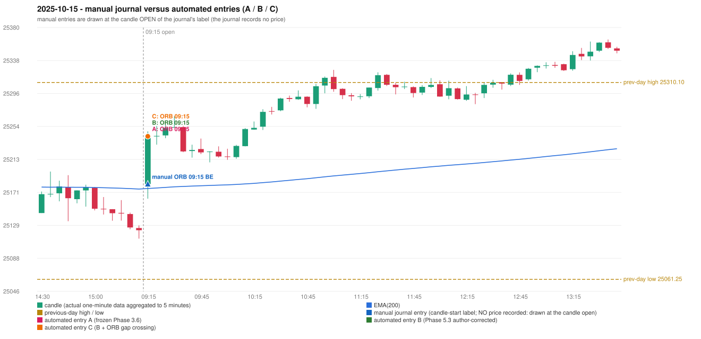

# 2025-10-15 (Wednesday) - manual journal versus the automated configurations

> SYNTHETIC index-point P&L; no real option P&L; costs illustrative (Rs 70 per trade + slippage scenarios). Configurations A / B / C are never combined.

## Session

* Open 25181.55; previous official close 25145.5; gap +36.05; previous-day high / low 25310.1 / 25061.25
* First 5-minute candle (09:15-09:20): O25181.55 H25248.25 L25163.2 C25239.95, GREEN, body 68.7%; EMA(200) at the first candle 25176.02; previous session's last close 25123.35 vs its EMA 25175.38

## Manual journal

row 24: ORB labelled 09:15, outcome BE

## Configuration A

Candidate signals (confirmed): 09:20 ORB/Gap/200DMA LONG [EXECUTED: trade 1: INITIAL_FULL_STOP]; 09:40 IRF/Method 1 SHORT [IGNORED: POSITION_ACTIVE (signal kept for diagnostics only; never reused)]; 12:15 IRF/Method 2A SHORT [REJECTED: SECOND_TRADE_RESTRICTED_TO_PDR_PDS]; 14:00 IRF/Method 2A SHORT [REJECTED: SECOND_TRADE_RESTRICTED_TO_PDR_PDS]

Strategies with no confirmed signal: PDR: PDR INVALIDATED OPEN_NOT_STRICTLY_ABOVE_ZONE | PDS: no setup record (the strategy's trigger event never occurred) | RF: no setup record (the strategy's trigger event never occurred)

| trade | strategy / method | dir | signal -> fill | entry | stop / T1 / T2 | leg 1 | leg 2 | outcome | gross Rs | net Rs (70, 0) | net Rs (70, 1.0) |
|---|---|---|---|---|---|---|---|---|---|---|---|
| 1 | ORB/Gap/200DMA | LONG | 09:20 -> 09:20 | 25242.0 | 25212.0 / 25269.0 / 25302.0 | 09:50 @ 25212.0 | 09:50 @ 25212.0 | INITIAL_FULL_STOP | -11,700 | -11,770 | -12,550 |

Selection: This ORB Gap/200DMA signal was the earliest executable signal of the day: 0 confirmed signal(s) earlier, 0 other in the same minute. 3 later confirmed signal(s) (IRF x3) are logged as ignored or rejected. State of the other four engines at that moment: [IRF: no setup record before this time (a base condition was not met, or nothing triggered)] [PDR: PDR invalidated at 09:15: OPEN_NOT_STRICTLY_ABOVE_ZONE] [PDS: no setup record before this time (a base condition was not met, or nothing triggered)] [RF: no setup record before this time (a base condition was not met, or nothing triggered)]

* Journal row 24 (ORB 09:15): **STRICT** match with 20251015-1-ORB (delta +0 min); outcome BE vs automated INITIAL_FULL_STOP (different class: EXIT_MANAGEMENT_MISMATCH; the journal has no exit price / time)

## Configuration B

Candidate signals (confirmed): 09:20 ORB/Gap/200DMA LONG [EXECUTED: trade 1: INITIAL_FULL_STOP]; 09:40 IRF/Method 1 SHORT [IGNORED: POSITION_ACTIVE (signal kept for diagnostics only; never reused)]; 09:50 IRF/Method 2A SHORT [IGNORED: POSITION_ACTIVE (signal kept for diagnostics only; never reused)]; 11:10 IRF/Method 2B SHORT [REJECTED: SECOND_TRADE_RESTRICTED_TO_PDR_PDS]; 11:40 IRF/Method 2A SHORT [REJECTED: SECOND_TRADE_RESTRICTED_TO_PDR_PDS]; 12:05 IRF/Method 2B SHORT [REJECTED: SECOND_TRADE_RESTRICTED_TO_PDR_PDS]; 14:50 IRF/Method 2A SHORT [REJECTED: SECOND_TRADE_RESTRICTED_TO_PDR_PDS]; 14:50 IRF/Method 2B SHORT [REJECTED: SECOND_TRADE_RESTRICTED_TO_PDR_PDS]

Strategies with no confirmed signal: PDR: PDR INVALIDATED OPEN_NOT_STRICTLY_ABOVE_ZONE | PDS: no setup record (the strategy's trigger event never occurred) | RF: no setup record (the strategy's trigger event never occurred)

| trade | strategy / method | dir | signal -> fill | entry | stop / T1 / T2 | leg 1 | leg 2 | outcome | gross Rs | net Rs (70, 0) | net Rs (70, 1.0) |
|---|---|---|---|---|---|---|---|---|---|---|---|
| 1 | ORB/Gap/200DMA | LONG | 09:20 -> 09:20 | 25242.0 | 25212.0 / 25269.0 / 25302.0 | 09:50 @ 25212.0 | 09:50 @ 25212.0 | INITIAL_FULL_STOP | -11,700 | -11,770 | -12,550 |

Selection: This ORB Gap/200DMA signal was the earliest executable signal of the day: 0 confirmed signal(s) earlier, 0 other in the same minute. 7 later confirmed signal(s) (IRF x7) are logged as ignored or rejected. State of the other four engines at that moment: [IRF: no setup record before this time (a base condition was not met, or nothing triggered)] [PDR: PDR invalidated at 09:15: OPEN_NOT_STRICTLY_ABOVE_ZONE] [PDS: no setup record before this time (a base condition was not met, or nothing triggered)] [RF: no setup record before this time (a base condition was not met, or nothing triggered)]

* Journal row 24 (ORB 09:15): **STRICT** match with 20251015-1-ORB (delta +0 min); outcome BE vs automated INITIAL_FULL_STOP (different class: EXIT_MANAGEMENT_MISMATCH; the journal has no exit price / time)

## Configuration C

Candidate signals (confirmed): 09:20 ORB/Gap/200DMA LONG [EXECUTED: trade 1: INITIAL_FULL_STOP]; 09:40 IRF/Method 1 SHORT [IGNORED: POSITION_ACTIVE (signal kept for diagnostics only; never reused)]; 09:50 IRF/Method 2A SHORT [IGNORED: POSITION_ACTIVE (signal kept for diagnostics only; never reused)]; 11:10 IRF/Method 2B SHORT [REJECTED: SECOND_TRADE_RESTRICTED_TO_PDR_PDS]; 11:40 IRF/Method 2A SHORT [REJECTED: SECOND_TRADE_RESTRICTED_TO_PDR_PDS]; 12:05 IRF/Method 2B SHORT [REJECTED: SECOND_TRADE_RESTRICTED_TO_PDR_PDS]; 14:50 IRF/Method 2A SHORT [REJECTED: SECOND_TRADE_RESTRICTED_TO_PDR_PDS]; 14:50 IRF/Method 2B SHORT [REJECTED: SECOND_TRADE_RESTRICTED_TO_PDR_PDS]

Strategies with no confirmed signal: PDR: PDR INVALIDATED OPEN_NOT_STRICTLY_ABOVE_ZONE | PDS: no setup record (the strategy's trigger event never occurred) | RF: no setup record (the strategy's trigger event never occurred)

| trade | strategy / method | dir | signal -> fill | entry | stop / T1 / T2 | leg 1 | leg 2 | outcome | gross Rs | net Rs (70, 0) | net Rs (70, 1.0) |
|---|---|---|---|---|---|---|---|---|---|---|---|
| 1 | ORB/Gap/200DMA | LONG | 09:20 -> 09:20 | 25242.0 | 25212.0 / 25269.0 / 25302.0 | 09:50 @ 25212.0 | 09:50 @ 25212.0 | INITIAL_FULL_STOP | -11,700 | -11,770 | -12,550 |

Selection: This ORB Gap/200DMA signal was the earliest executable signal of the day: 0 confirmed signal(s) earlier, 0 other in the same minute. 7 later confirmed signal(s) (IRF x7) are logged as ignored or rejected. State of the other four engines at that moment: [IRF: no setup record before this time (a base condition was not met, or nothing triggered)] [PDR: PDR invalidated at 09:15: OPEN_NOT_STRICTLY_ABOVE_ZONE] [PDS: no setup record before this time (a base condition was not met, or nothing triggered)] [RF: no setup record before this time (a base condition was not met, or nothing triggered)]

* Journal row 24 (ORB 09:15): **STRICT** match with 20251015-1-ORB (delta +0 min); outcome BE vs automated INITIAL_FULL_STOP (different class: EXIT_MANAGEMENT_MISMATCH; the journal has no exit price / time)

## Chart

