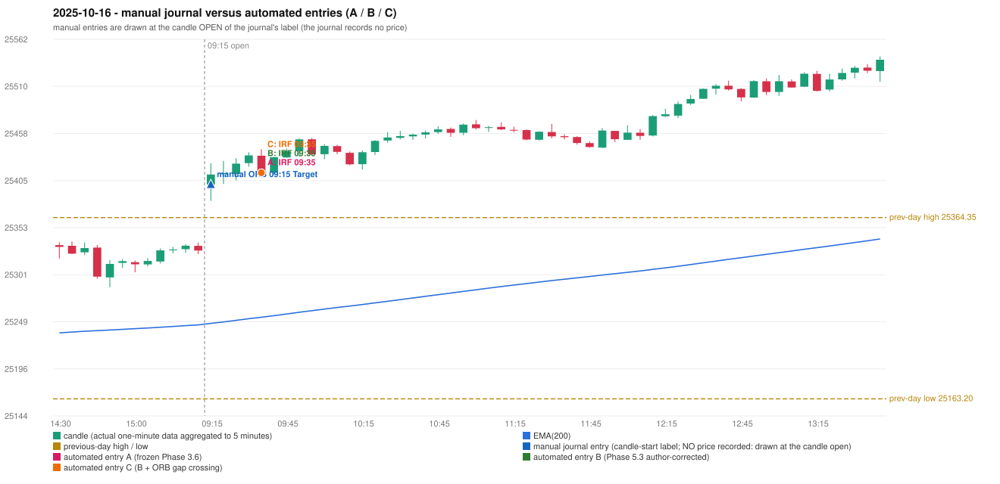

# 2025-10-16 (Thursday) - manual journal versus the automated configurations

> SYNTHETIC index-point P&L; no real option P&L; costs illustrative (Rs 70 per trade + slippage scenarios). Configurations A / B / C are never combined.

## Session

* Open 25401.0; previous official close 25323.55; gap +77.45; previous-day high / low 25364.35 / 25163.2
* First 5-minute candle (09:15-09:20): O25401.0 H25424.65 L25382.85 C25412.15, GREEN, body 26.7%; EMA(200) at the first candle 25246.91; previous session's last close 25327.75 vs its EMA 25245.25

## Manual journal

row 25: ORB labelled 09:15, outcome Target

## Configuration A

Candidate signals (confirmed): 09:40 IRF/Method 1 SHORT [EXECUTED: trade 1: INITIAL_FULL_STOP]; 10:15 IRF/Method 1 SHORT [REJECTED: SECOND_TRADE_RESTRICTED_TO_PDR_PDS]; 10:15 IRF/Method 2A SHORT [REJECTED: SECOND_TRADE_RESTRICTED_TO_PDR_PDS]; 10:55 IRF/Method 2B SHORT [REJECTED: SECOND_TRADE_RESTRICTED_TO_PDR_PDS]; 11:25 IRF/Method 2A SHORT [REJECTED: SECOND_TRADE_RESTRICTED_TO_PDR_PDS]; 11:45 IRF/Method 2A SHORT [REJECTED: SECOND_TRADE_RESTRICTED_TO_PDR_PDS]; 12:10 IRF/Method 2B SHORT [REJECTED: SECOND_TRADE_RESTRICTED_TO_PDR_PDS]; 13:00 IRF/Method 2B SHORT [REJECTED: SECOND_TRADE_RESTRICTED_TO_PDR_PDS]; 13:20 IRF/Method 2B SHORT [REJECTED: SECOND_TRADE_RESTRICTED_TO_PDR_PDS]; 15:15 IRF/Method 2A SHORT [REJECTED: SECOND_TRADE_RESTRICTED_TO_PDR_PDS]

Strategies with no confirmed signal: ORB: Method 1 INVALIDATED CANDLE_QUALITY(not a strong body / wick too large); Method 2 INVALIDATED TRENDLINE_NOT_SUPPORTIVE | PDR: no setup record (the strategy's trigger event never occurred) | PDS: no setup record (the strategy's trigger event never occurred) | RF: no setup record (the strategy's trigger event never occurred)

| trade | strategy / method | dir | signal -> fill | entry | stop / T1 / T2 | leg 1 | leg 2 | outcome | gross Rs | net Rs (70, 0) | net Rs (70, 1.0) |
|---|---|---|---|---|---|---|---|---|---|---|---|
| 1 | IRF/Method 1 | SHORT | 09:40 -> 09:40 | 25414.1 | 25449.1 / 25387.1 / 25354.1 | 09:53 @ 25449.1 | 09:53 @ 25449.1 | INITIAL_FULL_STOP | -13,650 | -13,720 | -14,500 |

Selection: This IRF Method 1 signal was the earliest executable signal of the day: 0 confirmed signal(s) earlier, 0 other in the same minute. 9 later confirmed signal(s) (IRF x9) are logged as ignored or rejected. State of the other four engines at that moment: [ORB: Method 1 invalidated at 09:15: CANDLE_QUALITY(not a strong body / wick too large); Method 2 invalidated at 09:15: TRENDLINE_NOT_SUPPORTIVE] [PDR: no setup record before this time (a base condition was not met, or nothing triggered)] [PDS: no setup record before this time (a base condition was not met, or nothing triggered)] [RF: no setup record before this time (a base condition was not met, or nothing triggered)]

* Journal row 25 (ORB 09:15): **UNMATCHED_MANUAL**; earliest cause CANDLE_STRENGTH_MISMATCH: first candle GREEN O25401.0 H25424.65 L25382.85 C25412.15 (body 26.7%); direction ASSUMED from the colour (the journal has no direction); closest method Method 1 (1 failing predicate(s)): first failing 'candle_quality' - body 26.7% opposite wick 29.9% close location 70.1%; all methods: Method 1: 1 fail (candle_quality); Method 2: 2 fail (trendline); Gap/200DMA: 2 fail (gap_crosses_200_average)
* Automated IRF 09:35 has no strict / time-tolerant journal counterpart: DIFFERENT_STRATEGY_SELECTED - the journal traded ORB 09:15; the automated controller took IRF Method 1 (candle 09:35) as the first valid signal

## Configuration B

Candidate signals (confirmed): 09:40 IRF/Method 1 SHORT [EXECUTED: trade 1: INITIAL_FULL_STOP]; 10:15 IRF/Method 1 SHORT [REJECTED: SECOND_TRADE_RESTRICTED_TO_PDR_PDS]; 10:15 IRF/Method 2A SHORT [REJECTED: SECOND_TRADE_RESTRICTED_TO_PDR_PDS]; 10:55 IRF/Method 2B SHORT [REJECTED: SECOND_TRADE_RESTRICTED_TO_PDR_PDS]; 11:20 IRF/Method 2A SHORT [REJECTED: SECOND_TRADE_RESTRICTED_TO_PDR_PDS]; 11:45 IRF/Method 2A SHORT [REJECTED: SECOND_TRADE_RESTRICTED_TO_PDR_PDS]; 12:10 IRF/Method 2B SHORT [REJECTED: SECOND_TRADE_RESTRICTED_TO_PDR_PDS]; 12:50 IRF/Method 2A SHORT [REJECTED: SECOND_TRADE_RESTRICTED_TO_PDR_PDS]; 13:20 IRF/Method 2B SHORT [REJECTED: SECOND_TRADE_RESTRICTED_TO_PDR_PDS]

Strategies with no confirmed signal: ORB: Method 1 INVALIDATED CANDLE_QUALITY(not a strong body / wick too large); Method 2 INVALIDATED TRENDLINE_NOT_SUPPORTIVE | PDR: no setup record (the strategy's trigger event never occurred) | PDS: no setup record (the strategy's trigger event never occurred) | RF: no setup record (the strategy's trigger event never occurred)

| trade | strategy / method | dir | signal -> fill | entry | stop / T1 / T2 | leg 1 | leg 2 | outcome | gross Rs | net Rs (70, 0) | net Rs (70, 1.0) |
|---|---|---|---|---|---|---|---|---|---|---|---|
| 1 | IRF/Method 1 | SHORT | 09:40 -> 09:40 | 25414.1 | 25449.1 / 25387.1 / 25354.1 | 09:53 @ 25449.1 | 09:53 @ 25449.1 | INITIAL_FULL_STOP | -13,650 | -13,720 | -14,500 |

Selection: This IRF Method 1 signal was the earliest executable signal of the day: 0 confirmed signal(s) earlier, 0 other in the same minute. 8 later confirmed signal(s) (IRF x8) are logged as ignored or rejected. State of the other four engines at that moment: [ORB: Method 1 invalidated at 09:15: CANDLE_QUALITY(not a strong body / wick too large); Method 2 invalidated at 09:15: TRENDLINE_NOT_SUPPORTIVE] [PDR: no setup record before this time (a base condition was not met, or nothing triggered)] [PDS: no setup record before this time (a base condition was not met, or nothing triggered)] [RF: no setup record before this time (a base condition was not met, or nothing triggered)]

* Journal row 25 (ORB 09:15): **UNMATCHED_MANUAL**; earliest cause CANDLE_STRENGTH_MISMATCH: first candle GREEN O25401.0 H25424.65 L25382.85 C25412.15 (body 26.7%); direction ASSUMED from the colour (the journal has no direction); closest method Method 1 (1 failing predicate(s)): first failing 'candle_quality' - body 26.7% opposite wick 29.9% close location 70.1%; all methods: Method 1: 1 fail (candle_quality); Method 2: 2 fail (trendline); Gap/200DMA: 2 fail (gap_crosses_200_average)
* Automated IRF 09:35 has no strict / time-tolerant journal counterpart: DIFFERENT_STRATEGY_SELECTED - the journal traded ORB 09:15; the automated controller took IRF Method 1 (candle 09:35) as the first valid signal

## Configuration C

Candidate signals (confirmed): 09:40 IRF/Method 1 SHORT [EXECUTED: trade 1: INITIAL_FULL_STOP]; 10:15 IRF/Method 1 SHORT [REJECTED: SECOND_TRADE_RESTRICTED_TO_PDR_PDS]; 10:15 IRF/Method 2A SHORT [REJECTED: SECOND_TRADE_RESTRICTED_TO_PDR_PDS]; 10:55 IRF/Method 2B SHORT [REJECTED: SECOND_TRADE_RESTRICTED_TO_PDR_PDS]; 11:20 IRF/Method 2A SHORT [REJECTED: SECOND_TRADE_RESTRICTED_TO_PDR_PDS]; 11:45 IRF/Method 2A SHORT [REJECTED: SECOND_TRADE_RESTRICTED_TO_PDR_PDS]; 12:10 IRF/Method 2B SHORT [REJECTED: SECOND_TRADE_RESTRICTED_TO_PDR_PDS]; 12:50 IRF/Method 2A SHORT [REJECTED: SECOND_TRADE_RESTRICTED_TO_PDR_PDS]; 13:20 IRF/Method 2B SHORT [REJECTED: SECOND_TRADE_RESTRICTED_TO_PDR_PDS]

Strategies with no confirmed signal: ORB: Method 1 INVALIDATED CANDLE_QUALITY(not a strong body / wick too large); Method 2 INVALIDATED TRENDLINE_NOT_SUPPORTIVE | PDR: no setup record (the strategy's trigger event never occurred) | PDS: no setup record (the strategy's trigger event never occurred) | RF: no setup record (the strategy's trigger event never occurred)

| trade | strategy / method | dir | signal -> fill | entry | stop / T1 / T2 | leg 1 | leg 2 | outcome | gross Rs | net Rs (70, 0) | net Rs (70, 1.0) |
|---|---|---|---|---|---|---|---|---|---|---|---|
| 1 | IRF/Method 1 | SHORT | 09:40 -> 09:40 | 25414.1 | 25449.1 / 25387.1 / 25354.1 | 09:53 @ 25449.1 | 09:53 @ 25449.1 | INITIAL_FULL_STOP | -13,650 | -13,720 | -14,500 |

Selection: This IRF Method 1 signal was the earliest executable signal of the day: 0 confirmed signal(s) earlier, 0 other in the same minute. 8 later confirmed signal(s) (IRF x8) are logged as ignored or rejected. State of the other four engines at that moment: [ORB: Method 1 invalidated at 09:15: CANDLE_QUALITY(not a strong body / wick too large); Method 2 invalidated at 09:15: TRENDLINE_NOT_SUPPORTIVE] [PDR: no setup record before this time (a base condition was not met, or nothing triggered)] [PDS: no setup record before this time (a base condition was not met, or nothing triggered)] [RF: no setup record before this time (a base condition was not met, or nothing triggered)]

* Journal row 25 (ORB 09:15): **UNMATCHED_MANUAL**; earliest cause CANDLE_STRENGTH_MISMATCH: first candle GREEN O25401.0 H25424.65 L25382.85 C25412.15 (body 26.7%); direction ASSUMED from the colour (the journal has no direction); closest method Method 1 (1 failing predicate(s)): first failing 'candle_quality' - body 26.7% opposite wick 29.9% close location 70.1%; all methods: Method 1: 1 fail (candle_quality); Method 2: 2 fail (trendline); Gap/200DMA: 2 fail (gap_crosses_200_average)
* Automated IRF 09:35 has no strict / time-tolerant journal counterpart: DIFFERENT_STRATEGY_SELECTED - the journal traded ORB 09:15; the automated controller took IRF Method 1 (candle 09:35) as the first valid signal

## Handwritten author corrections for this date

* AC14 (page 3): "ORB should have activated, instead IRF is activated." - status A / B / C: ORB_STILL_NOT_TRADED / ORB_STILL_NOT_TRADED / ORB_STILL_NOT_TRADED

## Chart

