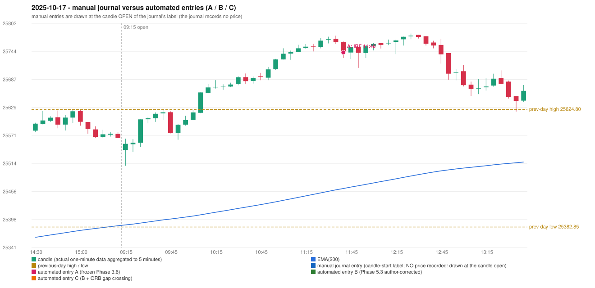

# 2025-10-17 (Friday) - manual journal versus the automated configurations

> SYNTHETIC index-point P&L; no real option P&L; costs illustrative (Rs 70 per trade + slippage scenarios). Configurations A / B / C are never combined.

## Session

* Open 25541.3; previous official close 25585.3; gap -44.00; previous-day high / low 25624.8 / 25382.85
* First 5-minute candle (09:15-09:20): O25541.3 H25564.7 L25508.95 C25554.05, GREEN, body 22.9%; EMA(200) at the first candle 25387.17; previous session's last close 25566.3 vs its EMA 25385.49

## Manual journal

no manual trade recorded

## Configuration A

Candidate signals (confirmed): 11:45 IRF/Method 2A SHORT [EXECUTED: trade 1: T1_THEN_BUFFER_STOP]; 12:40 IRF/Method 2B SHORT [IGNORED: DAY_FINISHED]

Strategies with no confirmed signal: ORB: Method 2 INVALIDATED TREND:EMA_PREV_SESSION_CLOSE wrong side | PDR: no setup record (the strategy's trigger event never occurred) | PDS: Method 1/2/3 INVALIDATED GAP_DOWN_OPEN_NOT_BELOW_ZONE | RF: no setup record (the strategy's trigger event never occurred)

| trade | strategy / method | dir | signal -> fill | entry | stop / T1 / T2 | leg 1 | leg 2 | outcome | gross Rs | net Rs (70, 0) | net Rs (70, 1.0) |
|---|---|---|---|---|---|---|---|---|---|---|---|
| 1 | IRF/Method 2A | SHORT | 11:45 -> 11:45 | 25742.05 | 25777.05 / 25715.05 / 25682.05 | 11:52 @ 25715.05 | 11:56 @ 25748.05 | T1_THEN_BUFFER_STOP | 4,095 | 4,025 | 3,245 |

Selection: This IRF Method 2A signal was the earliest executable signal of the day: 0 confirmed signal(s) earlier, 0 other in the same minute. 1 later confirmed signal(s) (IRF x1) are logged as ignored or rejected. State of the other four engines at that moment: [ORB: Method 2 invalidated at 09:15: TREND:EMA_PREV_SESSION_CLOSE wrong side] [PDR: no setup record before this time (a base condition was not met, or nothing triggered)] [PDS: Method 1/2/3 invalidated at 09:15: GAP_DOWN_OPEN_NOT_BELOW_ZONE] [RF: no setup record before this time (a base condition was not met, or nothing triggered)]

* Automated IRF 11:40 has no strict / time-tolerant journal counterpart: UNRESOLVED_DISCRETIONARY_SELECTION - the journal records no trade this day; the automated system took IRF Method 2A SHORT (candle 11:40) mechanically

## Configuration B

Candidate signals (confirmed): none

Strategies with no confirmed signal: IRF: Method 1/2 INCOMPLETE_AT_EOD SESSION_ENDED_BEFORE_CONFIRMATION | ORB: Method 2 INVALIDATED TREND:EMA_PREV_SESSION_CLOSE wrong side | PDR: no setup record (the strategy's trigger event never occurred) | PDS: Method 1/2/3 INVALIDATED GAP_DOWN_OPEN_NOT_BELOW_ZONE | RF: no setup record (the strategy's trigger event never occurred)

No trade: final day state READY_FOR_FIRST_TRADE. No strategy qualified.

## Configuration C

Candidate signals (confirmed): none

Strategies with no confirmed signal: IRF: Method 1/2 INCOMPLETE_AT_EOD SESSION_ENDED_BEFORE_CONFIRMATION | ORB: Gap/200DMA INVALIDATED CLOSE_NOT_BEYOND_MA; Method 2 INVALIDATED TREND:EMA_PREV_SESSION_CLOSE wrong side | PDR: no setup record (the strategy's trigger event never occurred) | PDS: Method 1/2/3 INVALIDATED GAP_DOWN_OPEN_NOT_BELOW_ZONE | RF: no setup record (the strategy's trigger event never occurred)

No trade: final day state READY_FOR_FIRST_TRADE. No strategy qualified.

## Handwritten author corrections for this date

* AC15 (page 3): "ORB should have activated, instead IRF is activated." - status A / B / C: ORB_STILL_NOT_TRADED / ORB_STILL_NOT_TRADED / ORB_STILL_NOT_TRADED

## Chart

