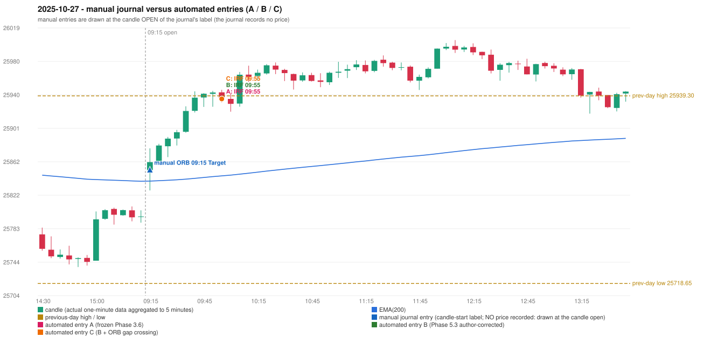

# 2025-10-27 (Monday) - manual journal versus the automated configurations

> SYNTHETIC index-point P&L; no real option P&L; costs illustrative (Rs 70 per trade + slippage scenarios). Configurations A / B / C are never combined.

## Session

* Open 25851.95; previous official close 25795.15; gap +56.80; previous-day high / low 25939.3 / 25718.65
* First 5-minute candle (09:15-09:20): O25851.95 H25877.6 L25828.1 C25861.4, GREEN, body 19.1%; EMA(200) at the first candle 25839.10; previous session's last close 25797.45 vs its EMA 25838.87

## Manual journal

row 29: ORB labelled 09:15, outcome Target

## Configuration A

Candidate signals (confirmed): 10:00 IRF/Method 2B SHORT [EXECUTED: trade 1: INITIAL_FULL_STOP]; 11:45 IRF/Method 2A SHORT [REJECTED: SECOND_TRADE_RESTRICTED_TO_PDR_PDS]; 12:25 IRF/Method 2A SHORT [REJECTED: SECOND_TRADE_RESTRICTED_TO_PDR_PDS]; 13:20 IRF/Method 2A SHORT [REJECTED: SECOND_TRADE_RESTRICTED_TO_PDR_PDS]; 14:15 IRF/Method 2B SHORT [REJECTED: SECOND_TRADE_RESTRICTED_TO_PDR_PDS]; 14:40 IRF/Method 2B SHORT [REJECTED: SECOND_TRADE_RESTRICTED_TO_PDR_PDS]

Strategies with no confirmed signal: ORB: Gap/200DMA INVALIDATED CANDLE_QUALITY_OR_REJECTION_WICK; Method 2 INVALIDATED TREND:EMA_PREV_SESSION_CLOSE wrong side | PDR: PDR INVALIDATED OPEN_NOT_STRICTLY_ABOVE_ZONE | PDS: no setup record (the strategy's trigger event never occurred) | RF: no setup record (the strategy's trigger event never occurred)

| trade | strategy / method | dir | signal -> fill | entry | stop / T1 / T2 | leg 1 | leg 2 | outcome | gross Rs | net Rs (70, 0) | net Rs (70, 1.0) |
|---|---|---|---|---|---|---|---|---|---|---|---|
| 1 | IRF/Method 2B | SHORT | 10:00 -> 10:00 | 25935.75 | 25970.75 / 25908.75 / 25875.75 | 10:10 @ 25970.75 | 10:10 @ 25970.75 | INITIAL_FULL_STOP | -13,650 | -13,720 | -14,500 |

Selection: This IRF Method 2B signal was the earliest executable signal of the day: 0 confirmed signal(s) earlier, 0 other in the same minute. 5 later confirmed signal(s) (IRF x5) are logged as ignored or rejected. State of the other four engines at that moment: [ORB: Method 2 invalidated at 09:15: TREND:EMA_PREV_SESSION_CLOSE wrong side; Gap/200DMA invalidated at 09:15: CANDLE_QUALITY_OR_REJECTION_WICK] [PDR: PDR invalidated at 09:15: OPEN_NOT_STRICTLY_ABOVE_ZONE] [PDS: no setup record before this time (a base condition was not met, or nothing triggered)] [RF: no setup record before this time (a base condition was not met, or nothing triggered)]

* Journal row 29 (ORB 09:15): **UNMATCHED_MANUAL**; earliest cause CANDLE_STRENGTH_MISMATCH: first candle GREEN O25851.95 H25877.6 L25828.1 C25861.4 (body 19.1%); direction ASSUMED from the colour (the journal has no direction); closest method Gap/200DMA (1 failing predicate(s)): first failing 'candle_shape' - body 19.1% opposite wick 32.7% close location 67.3%; rejection wick flag False; all methods: Method 1: 3 fail (level_broken); Method 2: 2 fail (trend); Gap/200DMA: 1 fail (candle_shape)
* Automated IRF 09:55 has no strict / time-tolerant journal counterpart: DIFFERENT_STRATEGY_SELECTED - the journal traded ORB 09:15; the automated controller took IRF Method 2B (candle 09:55) as the first valid signal

## Configuration B

Candidate signals (confirmed): 10:00 IRF/Method 2B SHORT [EXECUTED: trade 1: INITIAL_FULL_STOP]; 13:20 IRF/Method 2A SHORT [REJECTED: SECOND_TRADE_RESTRICTED_TO_PDR_PDS]; 13:20 IRF/Method 2B SHORT [REJECTED: SECOND_TRADE_RESTRICTED_TO_PDR_PDS]; 14:15 IRF/Method 2B SHORT [REJECTED: SECOND_TRADE_RESTRICTED_TO_PDR_PDS]; 14:40 IRF/Method 2B SHORT [REJECTED: SECOND_TRADE_RESTRICTED_TO_PDR_PDS]

Strategies with no confirmed signal: ORB: Gap/200DMA INVALIDATED CANDLE_QUALITY_OR_REJECTION_WICK; Method 2 INVALIDATED TREND:EMA_PREV_SESSION_CLOSE wrong side | PDR: PDR INVALIDATED OPEN_NOT_STRICTLY_ABOVE_ZONE | PDS: no setup record (the strategy's trigger event never occurred) | RF: no setup record (the strategy's trigger event never occurred)

| trade | strategy / method | dir | signal -> fill | entry | stop / T1 / T2 | leg 1 | leg 2 | outcome | gross Rs | net Rs (70, 0) | net Rs (70, 1.0) |
|---|---|---|---|---|---|---|---|---|---|---|---|
| 1 | IRF/Method 2B | SHORT | 10:00 -> 10:00 | 25935.75 | 25970.75 / 25908.75 / 25875.75 | 10:10 @ 25970.75 | 10:10 @ 25970.75 | INITIAL_FULL_STOP | -13,650 | -13,720 | -14,500 |

Selection: This IRF Method 2B signal was the earliest executable signal of the day: 0 confirmed signal(s) earlier, 0 other in the same minute. 4 later confirmed signal(s) (IRF x4) are logged as ignored or rejected. State of the other four engines at that moment: [ORB: Method 2 invalidated at 09:15: TREND:EMA_PREV_SESSION_CLOSE wrong side; Gap/200DMA invalidated at 09:15: CANDLE_QUALITY_OR_REJECTION_WICK] [PDR: PDR invalidated at 09:15: OPEN_NOT_STRICTLY_ABOVE_ZONE] [PDS: no setup record before this time (a base condition was not met, or nothing triggered)] [RF: no setup record before this time (a base condition was not met, or nothing triggered)]

* Journal row 29 (ORB 09:15): **UNMATCHED_MANUAL**; earliest cause CANDLE_STRENGTH_MISMATCH: first candle GREEN O25851.95 H25877.6 L25828.1 C25861.4 (body 19.1%); direction ASSUMED from the colour (the journal has no direction); closest method Gap/200DMA (1 failing predicate(s)): first failing 'candle_shape' - body 19.1% opposite wick 32.7% close location 67.3%; rejection wick flag False; all methods: Method 1: 3 fail (level_broken); Method 2: 2 fail (trend); Gap/200DMA: 1 fail (candle_shape)
* Automated IRF 09:55 has no strict / time-tolerant journal counterpart: DIFFERENT_STRATEGY_SELECTED - the journal traded ORB 09:15; the automated controller took IRF Method 2B (candle 09:55) as the first valid signal

## Configuration C

Candidate signals (confirmed): 10:00 IRF/Method 2B SHORT [EXECUTED: trade 1: INITIAL_FULL_STOP]; 13:20 IRF/Method 2A SHORT [REJECTED: SECOND_TRADE_RESTRICTED_TO_PDR_PDS]; 13:20 IRF/Method 2B SHORT [REJECTED: SECOND_TRADE_RESTRICTED_TO_PDR_PDS]; 14:15 IRF/Method 2B SHORT [REJECTED: SECOND_TRADE_RESTRICTED_TO_PDR_PDS]; 14:40 IRF/Method 2B SHORT [REJECTED: SECOND_TRADE_RESTRICTED_TO_PDR_PDS]

Strategies with no confirmed signal: ORB: Gap/200DMA INVALIDATED CANDLE_QUALITY_OR_REJECTION_WICK; Method 2 INVALIDATED TREND:EMA_PREV_SESSION_CLOSE wrong side | PDR: PDR INVALIDATED OPEN_NOT_STRICTLY_ABOVE_ZONE | PDS: no setup record (the strategy's trigger event never occurred) | RF: no setup record (the strategy's trigger event never occurred)

| trade | strategy / method | dir | signal -> fill | entry | stop / T1 / T2 | leg 1 | leg 2 | outcome | gross Rs | net Rs (70, 0) | net Rs (70, 1.0) |
|---|---|---|---|---|---|---|---|---|---|---|---|
| 1 | IRF/Method 2B | SHORT | 10:00 -> 10:00 | 25935.75 | 25970.75 / 25908.75 / 25875.75 | 10:10 @ 25970.75 | 10:10 @ 25970.75 | INITIAL_FULL_STOP | -13,650 | -13,720 | -14,500 |

Selection: This IRF Method 2B signal was the earliest executable signal of the day: 0 confirmed signal(s) earlier, 0 other in the same minute. 4 later confirmed signal(s) (IRF x4) are logged as ignored or rejected. State of the other four engines at that moment: [ORB: Method 2 invalidated at 09:15: TREND:EMA_PREV_SESSION_CLOSE wrong side; Gap/200DMA invalidated at 09:15: CANDLE_QUALITY_OR_REJECTION_WICK] [PDR: PDR invalidated at 09:15: OPEN_NOT_STRICTLY_ABOVE_ZONE] [PDS: no setup record before this time (a base condition was not met, or nothing triggered)] [RF: no setup record before this time (a base condition was not met, or nothing triggered)]

* Journal row 29 (ORB 09:15): **UNMATCHED_MANUAL**; earliest cause CANDLE_STRENGTH_MISMATCH: first candle GREEN O25851.95 H25877.6 L25828.1 C25861.4 (body 19.1%); direction ASSUMED from the colour (the journal has no direction); closest method Gap/200DMA (1 failing predicate(s)): first failing 'candle_shape' - body 19.1% opposite wick 32.7% close location 67.3%; rejection wick flag False; all methods: Method 1: 3 fail (level_broken); Method 2: 2 fail (trend); Gap/200DMA: 1 fail (candle_shape)
* Automated IRF 09:55 has no strict / time-tolerant journal counterpart: DIFFERENT_STRATEGY_SELECTED - the journal traded ORB 09:15; the automated controller took IRF Method 2B (candle 09:55) as the first valid signal

## Handwritten author corrections for this date

* AC16 (page 3): "ORB should have activated, instead IRF is activated. | IRF activation is also wrong." - status A / B / C: ORB_STILL_NOT_TRADED / ORB_STILL_NOT_TRADED / ORB_STILL_NOT_TRADED

## Chart

