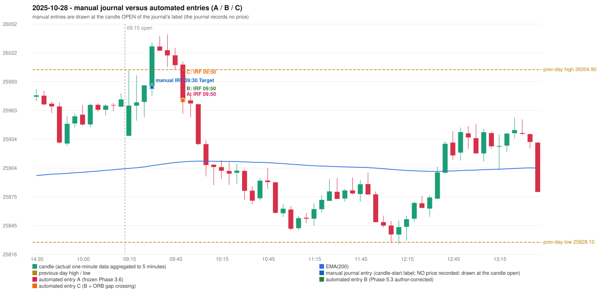

# 2025-10-28 (Tuesday) - manual journal versus the automated configurations

> SYNTHETIC index-point P&L; no real option P&L; costs illustrative (Rs 70 per trade + slippage scenarios). Configurations A / B / C are never combined.

## Session

* Open 25937.1; previous official close 25966.05; gap -28.95; previous-day high / low 26004.9 / 25828.1
* First 5-minute candle (09:15-09:20): O25937.1 H26004.05 L25937.1 C25968.1, GREEN, body 46.3%; EMA(200) at the first candle 25903.75; previous session's last close 25974.4 vs its EMA 25903.10

## Manual journal

row 30: IRF labelled 09:30, outcome Target

## Configuration A

Candidate signals (confirmed): 09:55 IRF/Method 1 SHORT [EXECUTED: trade 1: TARGET]; 10:35 IRF/Method 2A SHORT [IGNORED: DAY_FINISHED]

Strategies with no confirmed signal: ORB: no setup record (the strategy's trigger event never occurred) | PDR: no setup record (the strategy's trigger event never occurred) | PDS: Method 1/2/3 INVALIDATED GAP_DOWN_OPEN_NOT_BELOW_ZONE | RF: RF INVALIDATED GAP_NOT_UP(DOWN)

| trade | strategy / method | dir | signal -> fill | entry | stop / T1 / T2 | leg 1 | leg 2 | outcome | gross Rs | net Rs (70, 0) | net Rs (70, 1.0) |
|---|---|---|---|---|---|---|---|---|---|---|---|
| 1 | IRF/Method 1 | SHORT | 09:55 -> 09:55 | 25973.4 | 26008.4 / 25946.4 / 25913.4 | 10:01 @ 25946.4 | 10:05 @ 25913.4 | TARGET | 16,965 | 16,895 | 16,115 |

Selection: This IRF Method 1 signal was the earliest executable signal of the day: 0 confirmed signal(s) earlier, 0 other in the same minute. 1 later confirmed signal(s) (IRF x1) are logged as ignored or rejected. State of the other four engines at that moment: [ORB: no setup record before this time (a base condition was not met, or nothing triggered)] [PDR: no setup record before this time (a base condition was not met, or nothing triggered)] [PDS: Method 1/2/3 invalidated at 09:15: GAP_DOWN_OPEN_NOT_BELOW_ZONE] [RF: no setup record before this time (a base condition was not met, or nothing triggered)]

* Journal row 30 (IRF 09:30): **DATE_STRATEGY_ONLY**; earliest cause LATER_SIGNAL (+ ENTRY_TIME_MISMATCH): the automated IRF trade has its signal candle at 09:50 versus the manual label 09:30 (+20 minutes; outside the 15-minute tolerance)
* Automated IRF 09:50 has no strict / time-tolerant journal counterpart: LATER_SIGNAL - the journal has IRF at 09:30; the automated trade's signal candle is 09:50

## Configuration B

Candidate signals (confirmed): 09:55 IRF/Method 1 SHORT [EXECUTED: trade 1: TARGET]; 09:55 IRF/Method 2A SHORT [MERGED_SAME_STRATEGY_METHOD: traded as another method of the same strategy/direction in the same minute]

Strategies with no confirmed signal: ORB: no setup record (the strategy's trigger event never occurred) | PDR: no setup record (the strategy's trigger event never occurred) | PDS: Method 1/2/3 INVALIDATED GAP_DOWN_OPEN_NOT_BELOW_ZONE | RF: RF INVALIDATED GAP_NOT_UP(DOWN)

| trade | strategy / method | dir | signal -> fill | entry | stop / T1 / T2 | leg 1 | leg 2 | outcome | gross Rs | net Rs (70, 0) | net Rs (70, 1.0) |
|---|---|---|---|---|---|---|---|---|---|---|---|
| 1 | IRF/Method 1 | SHORT | 09:55 -> 09:55 | 25973.4 | 26008.4 / 25946.4 / 25913.4 | 10:01 @ 25946.4 | 10:05 @ 25913.4 | TARGET | 16,965 | 16,895 | 16,115 |

Selection: This IRF Method 1 signal was the earliest executable signal of the day: 0 confirmed signal(s) earlier, 1 other in the same minute. No later signal was generated. State of the other four engines at that moment: [ORB: no setup record before this time (a base condition was not met, or nothing triggered)] [PDR: no setup record before this time (a base condition was not met, or nothing triggered)] [PDS: Method 1/2/3 invalidated at 09:15: GAP_DOWN_OPEN_NOT_BELOW_ZONE] [RF: no setup record before this time (a base condition was not met, or nothing triggered)]

* Journal row 30 (IRF 09:30): **DATE_STRATEGY_ONLY**; earliest cause LATER_SIGNAL (+ ENTRY_TIME_MISMATCH): the automated IRF trade has its signal candle at 09:50 versus the manual label 09:30 (+20 minutes; outside the 15-minute tolerance)
* Automated IRF 09:50 has no strict / time-tolerant journal counterpart: LATER_SIGNAL - the journal has IRF at 09:30; the automated trade's signal candle is 09:50

## Configuration C

Candidate signals (confirmed): 09:55 IRF/Method 1 SHORT [EXECUTED: trade 1: TARGET]; 09:55 IRF/Method 2A SHORT [MERGED_SAME_STRATEGY_METHOD: traded as another method of the same strategy/direction in the same minute]

Strategies with no confirmed signal: ORB: Gap/200DMA INVALIDATED CLOSE_NOT_BEYOND_MA | PDR: no setup record (the strategy's trigger event never occurred) | PDS: Method 1/2/3 INVALIDATED GAP_DOWN_OPEN_NOT_BELOW_ZONE | RF: RF INVALIDATED GAP_NOT_UP(DOWN)

| trade | strategy / method | dir | signal -> fill | entry | stop / T1 / T2 | leg 1 | leg 2 | outcome | gross Rs | net Rs (70, 0) | net Rs (70, 1.0) |
|---|---|---|---|---|---|---|---|---|---|---|---|
| 1 | IRF/Method 1 | SHORT | 09:55 -> 09:55 | 25973.4 | 26008.4 / 25946.4 / 25913.4 | 10:01 @ 25946.4 | 10:05 @ 25913.4 | TARGET | 16,965 | 16,895 | 16,115 |

Selection: This IRF Method 1 signal was the earliest executable signal of the day: 0 confirmed signal(s) earlier, 1 other in the same minute. No later signal was generated. State of the other four engines at that moment: [ORB: Gap/200DMA invalidated at 09:15: CLOSE_NOT_BEYOND_MA] [PDR: no setup record before this time (a base condition was not met, or nothing triggered)] [PDS: Method 1/2/3 invalidated at 09:15: GAP_DOWN_OPEN_NOT_BELOW_ZONE] [RF: no setup record before this time (a base condition was not met, or nothing triggered)]

* Journal row 30 (IRF 09:30): **DATE_STRATEGY_ONLY**; earliest cause LATER_SIGNAL (+ ENTRY_TIME_MISMATCH): the automated IRF trade has its signal candle at 09:50 versus the manual label 09:30 (+20 minutes; outside the 15-minute tolerance)
* Automated IRF 09:50 has no strict / time-tolerant journal counterpart: LATER_SIGNAL - the journal has IRF at 09:30; the automated trade's signal candle is 09:50

## Chart

