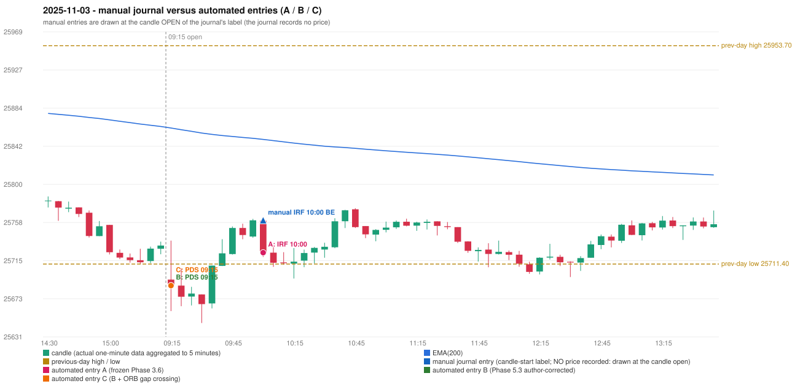

# 2025-11-03 (Monday) - manual journal versus the automated configurations

> SYNTHETIC index-point P&L; no real option P&L; costs illustrative (Rs 70 per trade + slippage scenarios). Configurations A / B / C are never combined.

## Session

* Open 25694.1; previous official close 25722.1; gap -28.00; previous-day high / low 25953.7 / 25711.4
* First 5-minute candle (09:15-09:20): O25694.1 H25737.45 L25659.2 C25687.85, RED, body 8.0%; EMA(200) at the first candle 25862.34; previous session's last close 25731.9 vs its EMA 25864.09

## Manual journal

row 33: IRF labelled 10:00, outcome BE

## Configuration A

Candidate signals (confirmed): 10:05 IRF/Method 1 SHORT [EXECUTED: trade 1: T1_THEN_BUFFER_STOP]; 10:50 IRF/Method 2B SHORT [IGNORED: DAY_FINISHED]; 11:40 IRF/Method 1 SHORT [IGNORED: DAY_FINISHED]; 12:15 PDS/Method 3 SHORT [IGNORED: DAY_FINISHED]; 13:50 IRF/Method 1 SHORT [IGNORED: DAY_FINISHED]; 14:10 IRF/Method 2B SHORT [IGNORED: DAY_FINISHED]

Strategies with no confirmed signal: ORB: Method 1 INVALIDATED CANDLE_QUALITY(not a strong body / wick too large); Method 2 INVALIDATED CANDLE_QUALITY | PDR: no setup record (the strategy's trigger event never occurred) | RF: no setup record (the strategy's trigger event never occurred)

| trade | strategy / method | dir | signal -> fill | entry | stop / T1 / T2 | leg 1 | leg 2 | outcome | gross Rs | net Rs (70, 0) | net Rs (70, 1.0) |
|---|---|---|---|---|---|---|---|---|---|---|---|
| 1 | IRF/Method 1 | SHORT | 10:05 -> 10:05 | 25724.0 | 25759.0 / 25697.0 / 25664.0 | 10:15 @ 25697.0 | 10:29 @ 25730.0 | T1_THEN_BUFFER_STOP | 4,095 | 4,025 | 3,245 |

Selection: This IRF Method 1 signal was the earliest executable signal of the day: 0 confirmed signal(s) earlier, 0 other in the same minute. 5 later confirmed signal(s) (IRF x4, PDS x1) are logged as ignored or rejected. State of the other four engines at that moment: [ORB: Method 1 invalidated at 09:15: CANDLE_QUALITY(not a strong body / wick too large); Method 2 invalidated at 09:15: CANDLE_QUALITY] [PDR: no setup record before this time (a base condition was not met, or nothing triggered)] [PDS: no setup record before this time (a base condition was not met, or nothing triggered)] [RF: no setup record before this time (a base condition was not met, or nothing triggered)]

* Journal row 33 (IRF 10:00): **STRICT** match with 20251103-1-IRF (delta +0 min); outcome BE vs automated T1_THEN_BUFFER_STOP (same class)

## Configuration B

Candidate signals (confirmed): 09:20 PDS/Method 2 SHORT [EXECUTED: trade 1: T1_THEN_BUFFER_STOP]; 10:05 IRF/Method 1 SHORT [IGNORED: DAY_FINISHED]; 10:10 IRF/Method 2A SHORT [IGNORED: DAY_FINISHED]; 10:10 PDS/Method 1 SHORT [IGNORED: DAY_FINISHED]; 10:15 PDS/Method 2 SHORT [IGNORED: DAY_FINISHED]; 10:55 IRF/Method 2A SHORT [IGNORED: DAY_FINISHED]; 11:35 IRF/Method 2A SHORT [IGNORED: DAY_FINISHED]; 11:40 IRF/Method 1 SHORT [IGNORED: DAY_FINISHED]; 12:15 PDS/Method 3 SHORT [IGNORED: DAY_FINISHED]; 12:30 PDS/Method 1 SHORT [IGNORED: DAY_FINISHED]; 13:25 IRF/Method 2B SHORT [IGNORED: DAY_FINISHED]; 13:50 IRF/Method 1 SHORT [IGNORED: DAY_FINISHED]; 13:50 IRF/Method 2B SHORT [IGNORED: DAY_FINISHED]; 15:05 IRF/Method 2B SHORT [IGNORED: DAY_FINISHED]

Strategies with no confirmed signal: ORB: Method 1 INVALIDATED CANDLE_QUALITY(not a strong body / wick too large); Method 2 INVALIDATED CANDLE_QUALITY | PDR: no setup record (the strategy's trigger event never occurred) | RF: no setup record (the strategy's trigger event never occurred)

| trade | strategy / method | dir | signal -> fill | entry | stop / T1 / T2 | leg 1 | leg 2 | outcome | gross Rs | net Rs (70, 0) | net Rs (70, 1.0) |
|---|---|---|---|---|---|---|---|---|---|---|---|
| 1 | PDS/Method 2 | SHORT | 09:20 -> 09:20 | 25687.45 | 25722.45 / 25660.45 / 25617.45 | 09:30 @ 25660.45 | 09:36 @ 25693.45 | T1_THEN_BUFFER_STOP | 4,095 | 4,025 | 3,245 |

Selection: This PDS Method 2 signal was the earliest executable signal of the day: 0 confirmed signal(s) earlier, 0 other in the same minute. 13 later confirmed signal(s) (IRF x9, PDS x4) are logged as ignored or rejected. State of the other four engines at that moment: [IRF: no setup record before this time (a base condition was not met, or nothing triggered)] [ORB: Method 1 invalidated at 09:15: CANDLE_QUALITY(not a strong body / wick too large); Method 2 invalidated at 09:15: CANDLE_QUALITY] [PDR: no setup record before this time (a base condition was not met, or nothing triggered)] [RF: no setup record before this time (a base condition was not met, or nothing triggered)]

* Journal row 33 (IRF 10:00): **UNMATCHED_MANUAL**; earliest cause DIFFERENT_STRATEGY_SELECTED (+ PORTFOLIO_CONTROLLER_CONSTRAINT): the controller took PDS Method 2 (signal 09:20) first; the IRF signal at 10:05 was IGNORED: DAY_FINISHED
* Automated PDS 09:15 has no strict / time-tolerant journal counterpart: DIFFERENT_STRATEGY_SELECTED - the journal traded IRF 10:00; the automated controller took PDS Method 2 (candle 09:15) as the first valid signal

## Configuration C

Candidate signals (confirmed): 09:20 PDS/Method 2 SHORT [EXECUTED: trade 1: T1_THEN_BUFFER_STOP]; 10:05 IRF/Method 1 SHORT [IGNORED: DAY_FINISHED]; 10:10 IRF/Method 2A SHORT [IGNORED: DAY_FINISHED]; 10:10 PDS/Method 1 SHORT [IGNORED: DAY_FINISHED]; 10:15 PDS/Method 2 SHORT [IGNORED: DAY_FINISHED]; 10:55 IRF/Method 2A SHORT [IGNORED: DAY_FINISHED]; 11:35 IRF/Method 2A SHORT [IGNORED: DAY_FINISHED]; 11:40 IRF/Method 1 SHORT [IGNORED: DAY_FINISHED]; 12:15 PDS/Method 3 SHORT [IGNORED: DAY_FINISHED]; 12:30 PDS/Method 1 SHORT [IGNORED: DAY_FINISHED]; 13:25 IRF/Method 2B SHORT [IGNORED: DAY_FINISHED]; 13:50 IRF/Method 1 SHORT [IGNORED: DAY_FINISHED]; 13:50 IRF/Method 2B SHORT [IGNORED: DAY_FINISHED]; 15:05 IRF/Method 2B SHORT [IGNORED: DAY_FINISHED]

Strategies with no confirmed signal: ORB: Method 1 INVALIDATED CANDLE_QUALITY(not a strong body / wick too large); Method 2 INVALIDATED CANDLE_QUALITY | PDR: no setup record (the strategy's trigger event never occurred) | RF: no setup record (the strategy's trigger event never occurred)

| trade | strategy / method | dir | signal -> fill | entry | stop / T1 / T2 | leg 1 | leg 2 | outcome | gross Rs | net Rs (70, 0) | net Rs (70, 1.0) |
|---|---|---|---|---|---|---|---|---|---|---|---|
| 1 | PDS/Method 2 | SHORT | 09:20 -> 09:20 | 25687.45 | 25722.45 / 25660.45 / 25617.45 | 09:30 @ 25660.45 | 09:36 @ 25693.45 | T1_THEN_BUFFER_STOP | 4,095 | 4,025 | 3,245 |

Selection: This PDS Method 2 signal was the earliest executable signal of the day: 0 confirmed signal(s) earlier, 0 other in the same minute. 13 later confirmed signal(s) (IRF x9, PDS x4) are logged as ignored or rejected. State of the other four engines at that moment: [IRF: no setup record before this time (a base condition was not met, or nothing triggered)] [ORB: Method 1 invalidated at 09:15: CANDLE_QUALITY(not a strong body / wick too large); Method 2 invalidated at 09:15: CANDLE_QUALITY] [PDR: no setup record before this time (a base condition was not met, or nothing triggered)] [RF: no setup record before this time (a base condition was not met, or nothing triggered)]

* Journal row 33 (IRF 10:00): **UNMATCHED_MANUAL**; earliest cause DIFFERENT_STRATEGY_SELECTED (+ PORTFOLIO_CONTROLLER_CONSTRAINT): the controller took PDS Method 2 (signal 09:20) first; the IRF signal at 10:05 was IGNORED: DAY_FINISHED
* Automated PDS 09:15 has no strict / time-tolerant journal counterpart: DIFFERENT_STRATEGY_SELECTED - the journal traded IRF 10:00; the automated controller took PDS Method 2 (candle 09:15) as the first valid signal

## Chart

