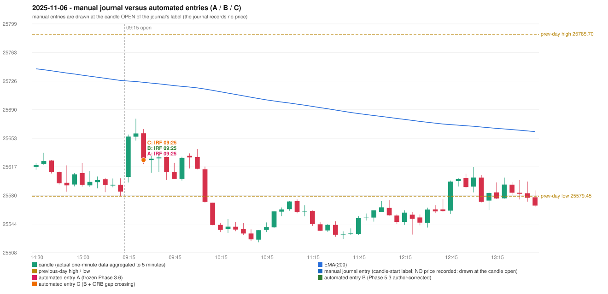

# 2025-11-06 (Thursday) - manual journal versus the automated configurations

> SYNTHETIC index-point P&L; no real option P&L; costs illustrative (Rs 70 per trade + slippage scenarios). Configurations A / B / C are never combined.

## Session

* Open 25604.05; previous official close 25597.65; gap +6.40; previous-day high / low 25785.7 / 25579.45
* First 5-minute candle (09:15-09:20): O25604.05 H25658.0 L25596.85 C25655.4, GREEN, body 84.0%; EMA(200) at the first candle 25726.15; previous session's last close 25585.35 vs its EMA 25726.86

## Manual journal

no manual trade recorded

## Configuration A

Candidate signals (confirmed): 09:30 IRF/Method 1 SHORT [EXECUTED: trade 1: TARGET]

Strategies with no confirmed signal: ORB: Method 2 INVALIDATED TREND:EMA_PREV_SESSION_CLOSE wrong side | PDR: PDR INVALIDATED OPEN_NOT_STRICTLY_ABOVE_ZONE | PDS: no setup record (the strategy's trigger event never occurred) | RF: RF INVALIDATED TREND:EMA_PREV_SESSION_CLOSE wrong side

| trade | strategy / method | dir | signal -> fill | entry | stop / T1 / T2 | leg 1 | leg 2 | outcome | gross Rs | net Rs (70, 0) | net Rs (70, 1.0) |
|---|---|---|---|---|---|---|---|---|---|---|---|
| 1 | IRF/Method 1 | SHORT | 09:30 -> 09:30 | 25625.55 | 25660.55 / 25598.55 / 25565.55 | 10:07 @ 25598.55 | 10:10 @ 25565.55 | TARGET | 16,965 | 16,895 | 16,115 |

Selection: This IRF Method 1 signal was the earliest executable signal of the day: 0 confirmed signal(s) earlier, 0 other in the same minute. No later signal was generated. State of the other four engines at that moment: [ORB: Method 2 invalidated at 09:15: TREND:EMA_PREV_SESSION_CLOSE wrong side] [PDR: PDR invalidated at 09:15: OPEN_NOT_STRICTLY_ABOVE_ZONE] [PDS: no setup record before this time (a base condition was not met, or nothing triggered)] [RF: no setup record before this time (a base condition was not met, or nothing triggered)]

* Automated IRF 09:25 has no strict / time-tolerant journal counterpart: UNRESOLVED_DISCRETIONARY_SELECTION - the journal records no trade this day; the automated system took IRF Method 1 SHORT (candle 09:25) mechanically

## Configuration B

Candidate signals (confirmed): 09:30 IRF/Method 1 SHORT [EXECUTED: trade 1: TARGET]

Strategies with no confirmed signal: ORB: Method 2 INVALIDATED TREND:EMA_PREV_SESSION_CLOSE wrong side | PDR: PDR INVALIDATED OPEN_NOT_STRICTLY_ABOVE_ZONE | PDS: no setup record (the strategy's trigger event never occurred) | RF: RF INVALIDATED TREND:EMA_PREV_SESSION_CLOSE wrong side

| trade | strategy / method | dir | signal -> fill | entry | stop / T1 / T2 | leg 1 | leg 2 | outcome | gross Rs | net Rs (70, 0) | net Rs (70, 1.0) |
|---|---|---|---|---|---|---|---|---|---|---|---|
| 1 | IRF/Method 1 | SHORT | 09:30 -> 09:30 | 25625.55 | 25660.55 / 25598.55 / 25565.55 | 10:07 @ 25598.55 | 10:10 @ 25565.55 | TARGET | 16,965 | 16,895 | 16,115 |

Selection: This IRF Method 1 signal was the earliest executable signal of the day: 0 confirmed signal(s) earlier, 0 other in the same minute. No later signal was generated. State of the other four engines at that moment: [ORB: Method 2 invalidated at 09:15: TREND:EMA_PREV_SESSION_CLOSE wrong side] [PDR: PDR invalidated at 09:15: OPEN_NOT_STRICTLY_ABOVE_ZONE] [PDS: no setup record before this time (a base condition was not met, or nothing triggered)] [RF: no setup record before this time (a base condition was not met, or nothing triggered)]

* Automated IRF 09:25 has no strict / time-tolerant journal counterpart: UNRESOLVED_DISCRETIONARY_SELECTION - the journal records no trade this day; the automated system took IRF Method 1 SHORT (candle 09:25) mechanically

## Configuration C

Candidate signals (confirmed): 09:30 IRF/Method 1 SHORT [EXECUTED: trade 1: TARGET]

Strategies with no confirmed signal: ORB: Gap/200DMA INVALIDATED CLOSE_NOT_BEYOND_MA; Method 2 INVALIDATED TREND:EMA_PREV_SESSION_CLOSE wrong side | PDR: PDR INVALIDATED OPEN_NOT_STRICTLY_ABOVE_ZONE | PDS: no setup record (the strategy's trigger event never occurred) | RF: RF INVALIDATED TREND:EMA_PREV_SESSION_CLOSE wrong side

| trade | strategy / method | dir | signal -> fill | entry | stop / T1 / T2 | leg 1 | leg 2 | outcome | gross Rs | net Rs (70, 0) | net Rs (70, 1.0) |
|---|---|---|---|---|---|---|---|---|---|---|---|
| 1 | IRF/Method 1 | SHORT | 09:30 -> 09:30 | 25625.55 | 25660.55 / 25598.55 / 25565.55 | 10:07 @ 25598.55 | 10:10 @ 25565.55 | TARGET | 16,965 | 16,895 | 16,115 |

Selection: This IRF Method 1 signal was the earliest executable signal of the day: 0 confirmed signal(s) earlier, 0 other in the same minute. No later signal was generated. State of the other four engines at that moment: [ORB: Method 2 invalidated at 09:15: TREND:EMA_PREV_SESSION_CLOSE wrong side; Gap/200DMA invalidated at 09:15: CLOSE_NOT_BEYOND_MA] [PDR: PDR invalidated at 09:15: OPEN_NOT_STRICTLY_ABOVE_ZONE] [PDS: no setup record before this time (a base condition was not met, or nothing triggered)] [RF: no setup record before this time (a base condition was not met, or nothing triggered)]

* Automated IRF 09:25 has no strict / time-tolerant journal counterpart: UNRESOLVED_DISCRETIONARY_SELECTION - the journal records no trade this day; the automated system took IRF Method 1 SHORT (candle 09:25) mechanically

## Chart

