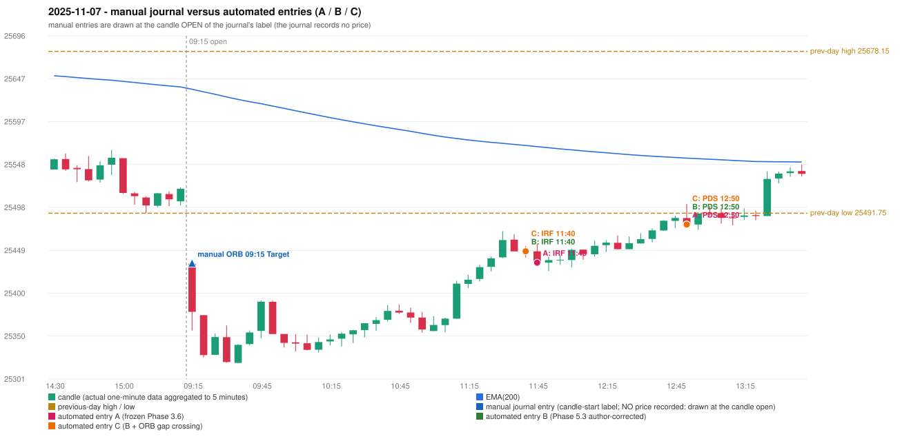

# 2025-11-07 (Friday) - manual journal versus the automated configurations

> SYNTHETIC index-point P&L; no real option P&L; costs illustrative (Rs 70 per trade + slippage scenarios). Configurations A / B / C are never combined.

## Session

* Open 25433.55; previous official close 25509.7; gap -76.15; previous-day high / low 25678.15 / 25491.75
* First 5-minute candle (09:15-09:20): O25433.55 H25438.5 L25356.5 C25378.15, RED, body 67.6%; EMA(200) at the first candle 25634.62; previous session's last close 25519.95 vs its EMA 25637.20

## Manual journal

row 34: ORB labelled 09:15, outcome Target

## Configuration A

Candidate signals (confirmed): 11:50 IRF/Method 1 SHORT [EXECUTED: trade 1: INITIAL_FULL_STOP]; 12:55 PDS/Method 2 SHORT [EXECUTED: trade 2: INITIAL_FULL_STOP]; 13:05 PDS/Method 2 SHORT [IGNORED: POSITION_ACTIVE (signal kept for diagnostics only; never reused)]; 14:05 IRF/Method 2A SHORT [IGNORED: DAY_FINISHED]; 14:05 IRF/Method 2B SHORT [IGNORED: DAY_FINISHED]; 14:05 PDS/Method 3 SHORT [IGNORED: DAY_FINISHED]

Strategies with no confirmed signal: ORB: Method 1 INVALIDATED CANDLE_QUALITY(not a strong body / wick too large); Method 2 INVALIDATED TRENDLINE_NOT_SUPPORTIVE | PDR: no setup record (the strategy's trigger event never occurred) | RF: RF INVALIDATED TREND:EMA_PREV_SESSION_CLOSE wrong side

| trade | strategy / method | dir | signal -> fill | entry | stop / T1 / T2 | leg 1 | leg 2 | outcome | gross Rs | net Rs (70, 0) | net Rs (70, 1.0) |
|---|---|---|---|---|---|---|---|---|---|---|---|
| 1 | IRF/Method 1 | SHORT | 11:50 -> 11:50 | 25434.7 | 25469.7 / 25407.7 / 25374.7 | 12:37 @ 25469.7 | 12:37 @ 25469.7 | INITIAL_FULL_STOP | -13,650 | -13,720 | -14,500 |
| 2 | PDS/Method 2 | SHORT | 12:55 -> 12:55 | 25478.7 | 25513.7 / 25451.7 / 25408.7 | 13:26 @ 25513.7 | 13:26 @ 25513.7 | INITIAL_FULL_STOP | -13,650 | -13,720 | -14,500 |

Selection: This IRF Method 1 signal was the earliest executable signal of the day: 0 confirmed signal(s) earlier, 0 other in the same minute. 5 later confirmed signal(s) (IRF x2, PDS x3) are logged as ignored or rejected. State of the other four engines at that moment: [ORB: Method 1 invalidated at 09:15: CANDLE_QUALITY(not a strong body / wick too large); Method 2 invalidated at 09:15: TRENDLINE_NOT_SUPPORTIVE] [PDR: no setup record before this time (a base condition was not met, or nothing triggered)] [PDS: no setup record before this time (a base condition was not met, or nothing triggered)] [RF: RF invalidated at 09:45: TREND:EMA_PREV_SESSION_CLOSE wrong side]

* Journal row 34 (ORB 09:15): **UNMATCHED_MANUAL**; earliest cause CANDLE_STRENGTH_MISMATCH: first candle RED O25433.55 H25438.5 L25356.5 C25378.15 (body 67.6%); direction ASSUMED from the colour (the journal has no direction); closest method Method 1 (1 failing predicate(s)): first failing 'candle_quality' - body 67.6% opposite wick 26.4% close location 26.4%; all methods: Method 1: 1 fail (candle_quality); Method 2: 2 fail (trendline); Gap/200DMA: 2 fail (gap_crosses_200_average)
* Automated IRF 11:45 has no strict / time-tolerant journal counterpart: DIFFERENT_STRATEGY_SELECTED - the journal traded ORB 09:15; the automated controller took IRF Method 1 (candle 11:45) as the first valid signal
* Automated PDS 12:50 has no strict / time-tolerant journal counterpart: PORTFOLIO_CONTROLLER_CONSTRAINT - second trade of the day: the controller allows a PDR / PDS re-entry after the original full stop of trade 1 (IRF Method 1, signal candle 11:45); the journal rows of the day not matched to another trade: ORB 09:15

## Configuration B

Candidate signals (confirmed): 11:45 IRF/Method 2A SHORT [EXECUTED: trade 1: INITIAL_FULL_STOP]; 11:50 IRF/Method 1 SHORT [IGNORED: POSITION_ACTIVE (signal kept for diagnostics only; never reused)]; 12:25 IRF/Method 2B SHORT [IGNORED: POSITION_ACTIVE (signal kept for diagnostics only; never reused)]; 12:55 PDS/Method 2 SHORT [EXECUTED: trade 2: INITIAL_FULL_STOP]; 13:05 PDS/Method 2 SHORT [IGNORED: POSITION_ACTIVE (signal kept for diagnostics only; never reused)]; 14:05 IRF/Method 2A SHORT [IGNORED: DAY_FINISHED]; 14:05 PDS/Method 3 SHORT [IGNORED: DAY_FINISHED]; 14:50 IRF/Method 2A SHORT [IGNORED: DAY_FINISHED]

Strategies with no confirmed signal: ORB: Method 1 INVALIDATED CANDLE_QUALITY(not a strong body / wick too large); Method 2 INVALIDATED TRENDLINE_NOT_SUPPORTIVE | PDR: no setup record (the strategy's trigger event never occurred) | RF: RF INVALIDATED TREND:EMA_PREV_SESSION_CLOSE wrong side

| trade | strategy / method | dir | signal -> fill | entry | stop / T1 / T2 | leg 1 | leg 2 | outcome | gross Rs | net Rs (70, 0) | net Rs (70, 1.0) |
|---|---|---|---|---|---|---|---|---|---|---|---|
| 1 | IRF/Method 2A | SHORT | 11:45 -> 11:45 | 25447.85 | 25482.85 / 25420.85 / 25387.85 | 12:41 @ 25482.85 | 12:41 @ 25482.85 | INITIAL_FULL_STOP | -13,650 | -13,720 | -14,500 |
| 2 | PDS/Method 2 | SHORT | 12:55 -> 12:55 | 25478.7 | 25513.7 / 25451.7 / 25408.7 | 13:26 @ 25513.7 | 13:26 @ 25513.7 | INITIAL_FULL_STOP | -13,650 | -13,720 | -14,500 |

Selection: This IRF Method 2A signal was the earliest executable signal of the day: 0 confirmed signal(s) earlier, 0 other in the same minute. 7 later confirmed signal(s) (IRF x4, PDS x3) are logged as ignored or rejected. State of the other four engines at that moment: [ORB: Method 1 invalidated at 09:15: CANDLE_QUALITY(not a strong body / wick too large); Method 2 invalidated at 09:15: TRENDLINE_NOT_SUPPORTIVE] [PDR: no setup record before this time (a base condition was not met, or nothing triggered)] [PDS: no setup record before this time (a base condition was not met, or nothing triggered)] [RF: RF invalidated at 09:45: TREND:EMA_PREV_SESSION_CLOSE wrong side]

* Journal row 34 (ORB 09:15): **UNMATCHED_MANUAL**; earliest cause CANDLE_STRENGTH_MISMATCH: first candle RED O25433.55 H25438.5 L25356.5 C25378.15 (body 67.6%); direction ASSUMED from the colour (the journal has no direction); closest method Method 1 (1 failing predicate(s)): first failing 'candle_quality' - body 67.6% opposite wick 26.4% close location 26.4%; all methods: Method 1: 1 fail (candle_quality); Method 2: 2 fail (trendline); Gap/200DMA: 2 fail (gap_crosses_200_average)
* Automated IRF 11:40 has no strict / time-tolerant journal counterpart: DIFFERENT_STRATEGY_SELECTED - the journal traded ORB 09:15; the automated controller took IRF Method 2A (candle 11:40) as the first valid signal
* Automated PDS 12:50 has no strict / time-tolerant journal counterpart: PORTFOLIO_CONTROLLER_CONSTRAINT - second trade of the day: the controller allows a PDR / PDS re-entry after the original full stop of trade 1 (IRF Method 2A, signal candle 11:40); the journal rows of the day not matched to another trade: ORB 09:15

## Configuration C

Candidate signals (confirmed): 11:45 IRF/Method 2A SHORT [EXECUTED: trade 1: INITIAL_FULL_STOP]; 11:50 IRF/Method 1 SHORT [IGNORED: POSITION_ACTIVE (signal kept for diagnostics only; never reused)]; 12:25 IRF/Method 2B SHORT [IGNORED: POSITION_ACTIVE (signal kept for diagnostics only; never reused)]; 12:55 PDS/Method 2 SHORT [EXECUTED: trade 2: INITIAL_FULL_STOP]; 13:05 PDS/Method 2 SHORT [IGNORED: POSITION_ACTIVE (signal kept for diagnostics only; never reused)]; 14:05 IRF/Method 2A SHORT [IGNORED: DAY_FINISHED]; 14:05 PDS/Method 3 SHORT [IGNORED: DAY_FINISHED]; 14:50 IRF/Method 2A SHORT [IGNORED: DAY_FINISHED]

Strategies with no confirmed signal: ORB: Method 1 INVALIDATED CANDLE_QUALITY(not a strong body / wick too large); Method 2 INVALIDATED TRENDLINE_NOT_SUPPORTIVE | PDR: no setup record (the strategy's trigger event never occurred) | RF: RF INVALIDATED TREND:EMA_PREV_SESSION_CLOSE wrong side

| trade | strategy / method | dir | signal -> fill | entry | stop / T1 / T2 | leg 1 | leg 2 | outcome | gross Rs | net Rs (70, 0) | net Rs (70, 1.0) |
|---|---|---|---|---|---|---|---|---|---|---|---|
| 1 | IRF/Method 2A | SHORT | 11:45 -> 11:45 | 25447.85 | 25482.85 / 25420.85 / 25387.85 | 12:41 @ 25482.85 | 12:41 @ 25482.85 | INITIAL_FULL_STOP | -13,650 | -13,720 | -14,500 |
| 2 | PDS/Method 2 | SHORT | 12:55 -> 12:55 | 25478.7 | 25513.7 / 25451.7 / 25408.7 | 13:26 @ 25513.7 | 13:26 @ 25513.7 | INITIAL_FULL_STOP | -13,650 | -13,720 | -14,500 |

Selection: This IRF Method 2A signal was the earliest executable signal of the day: 0 confirmed signal(s) earlier, 0 other in the same minute. 7 later confirmed signal(s) (IRF x4, PDS x3) are logged as ignored or rejected. State of the other four engines at that moment: [ORB: Method 1 invalidated at 09:15: CANDLE_QUALITY(not a strong body / wick too large); Method 2 invalidated at 09:15: TRENDLINE_NOT_SUPPORTIVE] [PDR: no setup record before this time (a base condition was not met, or nothing triggered)] [PDS: no setup record before this time (a base condition was not met, or nothing triggered)] [RF: RF invalidated at 09:45: TREND:EMA_PREV_SESSION_CLOSE wrong side]

* Journal row 34 (ORB 09:15): **UNMATCHED_MANUAL**; earliest cause CANDLE_STRENGTH_MISMATCH: first candle RED O25433.55 H25438.5 L25356.5 C25378.15 (body 67.6%); direction ASSUMED from the colour (the journal has no direction); closest method Method 1 (1 failing predicate(s)): first failing 'candle_quality' - body 67.6% opposite wick 26.4% close location 26.4%; all methods: Method 1: 1 fail (candle_quality); Method 2: 2 fail (trendline); Gap/200DMA: 2 fail (gap_crosses_200_average)
* Automated IRF 11:40 has no strict / time-tolerant journal counterpart: DIFFERENT_STRATEGY_SELECTED - the journal traded ORB 09:15; the automated controller took IRF Method 2A (candle 11:40) as the first valid signal
* Automated PDS 12:50 has no strict / time-tolerant journal counterpart: PORTFOLIO_CONTROLLER_CONSTRAINT - second trade of the day: the controller allows a PDR / PDS re-entry after the original full stop of trade 1 (IRF Method 2A, signal candle 11:40); the journal rows of the day not matched to another trade: ORB 09:15

## Handwritten author corrections for this date

* AC17 (page 3): "IRF should activate first which gives an SL. | 2nd trade should be PDS." - status A / B / C: NOT_ADDRESSED_BY_THE_CONFIGURATIONS / NOT_ADDRESSED_BY_THE_CONFIGURATIONS / NOT_ADDRESSED_BY_THE_CONFIGURATIONS

## Chart

