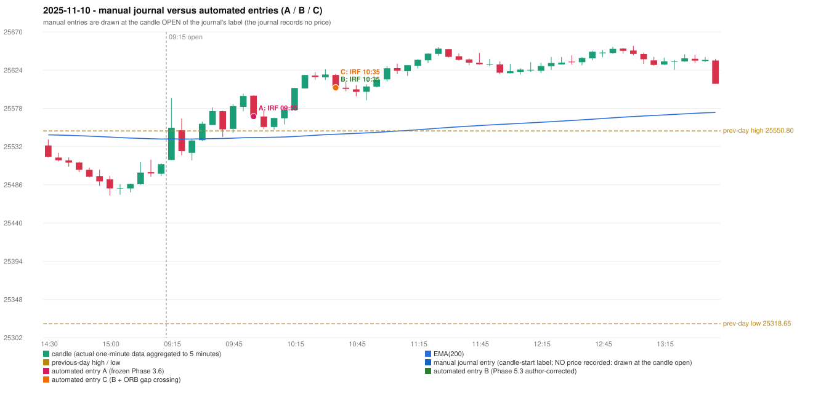

# 2025-11-10 (Monday) - manual journal versus the automated configurations

> SYNTHETIC index-point P&L; no real option P&L; costs illustrative (Rs 70 per trade + slippage scenarios). Configurations A / B / C are never combined.

## Session

* Open 25515.8; previous official close 25492.3; gap +23.50; previous-day high / low 25550.8 / 25318.65
* First 5-minute candle (09:15-09:20): O25515.8 H25590.35 L25515.8 C25554.6, GREEN, body 52.0%; EMA(200) at the first candle 25541.22; previous session's last close 25510.8 vs its EMA 25541.09

## Manual journal

no manual trade recorded

## Configuration A

Candidate signals (confirmed): 10:00 IRF/Method 1 SHORT [EXECUTED: trade 1: INITIAL_FULL_STOP]; 11:10 IRF/Method 2B SHORT [REJECTED: SECOND_TRADE_RESTRICTED_TO_PDR_PDS]; 11:50 IRF/Method 2B SHORT [REJECTED: SECOND_TRADE_RESTRICTED_TO_PDR_PDS]; 13:05 IRF/Method 2B SHORT [REJECTED: SECOND_TRADE_RESTRICTED_TO_PDR_PDS]

Strategies with no confirmed signal: ORB: Method 1 INVALIDATED TREND:EMA_PREV_SESSION_CLOSE wrong side; Method 2 INVALIDATED TREND:EMA_PREV_SESSION_CLOSE wrong side | PDR: PDR INVALIDATED OPEN_NOT_STRICTLY_ABOVE_ZONE | PDS: no setup record (the strategy's trigger event never occurred) | RF: no setup record (the strategy's trigger event never occurred)

| trade | strategy / method | dir | signal -> fill | entry | stop / T1 / T2 | leg 1 | leg 2 | outcome | gross Rs | net Rs (70, 0) | net Rs (70, 1.0) |
|---|---|---|---|---|---|---|---|---|---|---|---|
| 1 | IRF/Method 1 | SHORT | 10:00 -> 10:00 | 25568.2 | 25603.2 / 25541.2 / 25508.2 | 10:20 @ 25603.2 | 10:20 @ 25603.2 | INITIAL_FULL_STOP | -13,650 | -13,720 | -14,500 |

Selection: This IRF Method 1 signal was the earliest executable signal of the day: 0 confirmed signal(s) earlier, 0 other in the same minute. 3 later confirmed signal(s) (IRF x3) are logged as ignored or rejected. State of the other four engines at that moment: [ORB: Method 1 invalidated at 09:15: TREND:EMA_PREV_SESSION_CLOSE wrong side; Method 2 invalidated at 09:15: TREND:EMA_PREV_SESSION_CLOSE wrong side] [PDR: PDR invalidated at 09:15: OPEN_NOT_STRICTLY_ABOVE_ZONE] [PDS: no setup record before this time (a base condition was not met, or nothing triggered)] [RF: no setup record before this time (a base condition was not met, or nothing triggered)]

* Automated IRF 09:55 has no strict / time-tolerant journal counterpart: UNRESOLVED_DISCRETIONARY_SELECTION - the journal records no trade this day; the automated system took IRF Method 1 SHORT (candle 09:55) mechanically

## Configuration B

Candidate signals (confirmed): 10:40 IRF/Method 2A SHORT [EXECUTED: trade 1: INITIAL_FULL_STOP]; 11:50 IRF/Method 2B SHORT [REJECTED: SECOND_TRADE_RESTRICTED_TO_PDR_PDS]; 13:05 IRF/Method 2A SHORT [REJECTED: SECOND_TRADE_RESTRICTED_TO_PDR_PDS]; 13:05 IRF/Method 2B SHORT [REJECTED: SECOND_TRADE_RESTRICTED_TO_PDR_PDS]

Strategies with no confirmed signal: ORB: Method 1 INVALIDATED TREND:EMA_PREV_SESSION_CLOSE wrong side; Method 2 INVALIDATED TREND:EMA_PREV_SESSION_CLOSE wrong side | PDR: PDR INVALIDATED OPEN_NOT_STRICTLY_ABOVE_ZONE | PDS: no setup record (the strategy's trigger event never occurred) | RF: no setup record (the strategy's trigger event never occurred)

| trade | strategy / method | dir | signal -> fill | entry | stop / T1 / T2 | leg 1 | leg 2 | outcome | gross Rs | net Rs (70, 0) | net Rs (70, 1.0) |
|---|---|---|---|---|---|---|---|---|---|---|---|
| 1 | IRF/Method 2A | SHORT | 10:40 -> 10:40 | 25602.85 | 25637.85 / 25575.85 / 25542.85 | 11:21 @ 25637.85 | 11:21 @ 25637.85 | INITIAL_FULL_STOP | -13,650 | -13,720 | -14,500 |

Selection: This IRF Method 2A signal was the earliest executable signal of the day: 0 confirmed signal(s) earlier, 0 other in the same minute. 3 later confirmed signal(s) (IRF x3) are logged as ignored or rejected. State of the other four engines at that moment: [ORB: Method 1 invalidated at 09:15: TREND:EMA_PREV_SESSION_CLOSE wrong side; Method 2 invalidated at 09:15: TREND:EMA_PREV_SESSION_CLOSE wrong side] [PDR: PDR invalidated at 09:15: OPEN_NOT_STRICTLY_ABOVE_ZONE] [PDS: no setup record before this time (a base condition was not met, or nothing triggered)] [RF: no setup record before this time (a base condition was not met, or nothing triggered)]

* Automated IRF 10:35 has no strict / time-tolerant journal counterpart: UNRESOLVED_DISCRETIONARY_SELECTION - the journal records no trade this day; the automated system took IRF Method 2A SHORT (candle 10:35) mechanically

## Configuration C

Candidate signals (confirmed): 10:40 IRF/Method 2A SHORT [EXECUTED: trade 1: INITIAL_FULL_STOP]; 11:50 IRF/Method 2B SHORT [REJECTED: SECOND_TRADE_RESTRICTED_TO_PDR_PDS]; 13:05 IRF/Method 2A SHORT [REJECTED: SECOND_TRADE_RESTRICTED_TO_PDR_PDS]; 13:05 IRF/Method 2B SHORT [REJECTED: SECOND_TRADE_RESTRICTED_TO_PDR_PDS]

Strategies with no confirmed signal: ORB: Gap/200DMA INVALIDATED CANDLE_QUALITY_OR_REJECTION_WICK; Method 1 INVALIDATED TREND:EMA_PREV_SESSION_CLOSE wrong side; Method 2 INVALIDATED TREND:EMA_PREV_SESSI | PDR: PDR INVALIDATED OPEN_NOT_STRICTLY_ABOVE_ZONE | PDS: no setup record (the strategy's trigger event never occurred) | RF: no setup record (the strategy's trigger event never occurred)

| trade | strategy / method | dir | signal -> fill | entry | stop / T1 / T2 | leg 1 | leg 2 | outcome | gross Rs | net Rs (70, 0) | net Rs (70, 1.0) |
|---|---|---|---|---|---|---|---|---|---|---|---|
| 1 | IRF/Method 2A | SHORT | 10:40 -> 10:40 | 25602.85 | 25637.85 / 25575.85 / 25542.85 | 11:21 @ 25637.85 | 11:21 @ 25637.85 | INITIAL_FULL_STOP | -13,650 | -13,720 | -14,500 |

Selection: This IRF Method 2A signal was the earliest executable signal of the day: 0 confirmed signal(s) earlier, 0 other in the same minute. 3 later confirmed signal(s) (IRF x3) are logged as ignored or rejected. State of the other four engines at that moment: [ORB: Method 1 invalidated at 09:15: TREND:EMA_PREV_SESSION_CLOSE wrong side; Method 2 invalidated at 09:15: TREND:EMA_PREV_SESSION_CLOSE wrong side] [PDR: PDR invalidated at 09:15: OPEN_NOT_STRICTLY_ABOVE_ZONE] [PDS: no setup record before this time (a base condition was not met, or nothing triggered)] [RF: no setup record before this time (a base condition was not met, or nothing triggered)]

* Automated IRF 10:35 has no strict / time-tolerant journal counterpart: UNRESOLVED_DISCRETIONARY_SELECTION - the journal records no trade this day; the automated system took IRF Method 2A SHORT (candle 10:35) mechanically

## Handwritten author corrections for this date

* AC18 (page 4): "Should be ignored as Tgt 1 is not above EMA, tgt 1 is less than 27. | Should wait until EMA break." - status A / B / C: IRF_UNCHANGED / IRF_SIGNAL_REJECTED_OR_CHANGED / IRF_SIGNAL_REJECTED_OR_CHANGED

## Chart

