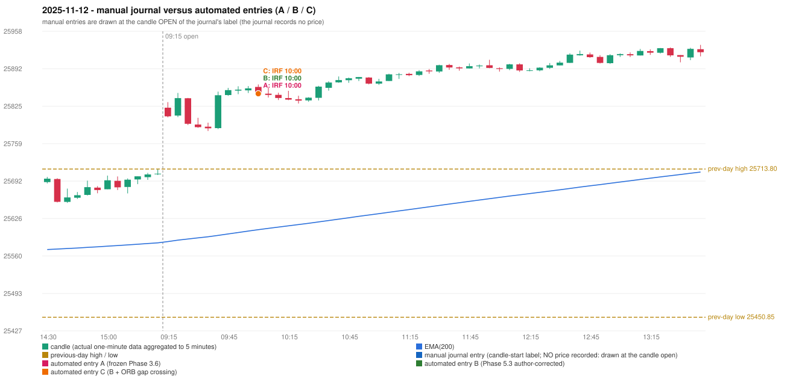

# 2025-11-12 (Wednesday) - manual journal versus the automated configurations

> SYNTHETIC index-point P&L; no real option P&L; costs illustrative (Rs 70 per trade + slippage scenarios). Configurations A / B / C are never combined.

## Session

* Open 25822.6; previous official close 25694.95; gap +127.65; previous-day high / low 25713.8 / 25450.85
* First 5-minute candle (09:15-09:20): O25822.6 H25832.5 L25805.4 C25807.2, RED, body 56.8%; EMA(200) at the first candle 25585.07; previous session's last close 25705.55 vs its EMA 25582.84

## Manual journal

no manual trade recorded

## Configuration A

Candidate signals (confirmed): 10:05 IRF/Method 2B SHORT [EXECUTED: trade 1: INITIAL_FULL_STOP]; 14:10 IRF/Method 2A SHORT [REJECTED: SECOND_TRADE_RESTRICTED_TO_PDR_PDS]

Strategies with no confirmed signal: ORB: Method 1 INVALIDATED CANDLE_QUALITY(not a strong body / wick too large); Method 2 INVALIDATED CANDLE_QUALITY | PDR: no setup record (the strategy's trigger event never occurred) | PDS: no setup record (the strategy's trigger event never occurred) | RF: RF INCOMPLETE_AT_EOD NO_RETURN_INSIDE_BEFORE_SESSION_END

| trade | strategy / method | dir | signal -> fill | entry | stop / T1 / T2 | leg 1 | leg 2 | outcome | gross Rs | net Rs (70, 0) | net Rs (70, 1.0) |
|---|---|---|---|---|---|---|---|---|---|---|---|
| 1 | IRF/Method 2B | SHORT | 10:05 -> 10:05 | 25847.5 | 25882.5 / 25820.5 / 25787.5 | 11:09 @ 25882.5 | 11:09 @ 25882.5 | INITIAL_FULL_STOP | -13,650 | -13,720 | -14,500 |

Selection: This IRF Method 2B signal was the earliest executable signal of the day: 0 confirmed signal(s) earlier, 0 other in the same minute. 1 later confirmed signal(s) (IRF x1) are logged as ignored or rejected. State of the other four engines at that moment: [ORB: Method 1 invalidated at 09:15: CANDLE_QUALITY(not a strong body / wick too large); Method 2 invalidated at 09:15: CANDLE_QUALITY] [PDR: no setup record before this time (a base condition was not met, or nothing triggered)] [PDS: no setup record before this time (a base condition was not met, or nothing triggered)] [RF: no setup record before this time (a base condition was not met, or nothing triggered)]

* Automated IRF 10:00 has no strict / time-tolerant journal counterpart: UNRESOLVED_DISCRETIONARY_SELECTION - the journal records no trade this day; the automated system took IRF Method 2B SHORT (candle 10:00) mechanically

## Configuration B

Candidate signals (confirmed): 10:05 IRF/Method 2B SHORT [EXECUTED: trade 1: INITIAL_FULL_STOP]; 15:25 IRF/Method 2A SHORT [REJECTED: SECOND_TRADE_RESTRICTED_TO_PDR_PDS]; 15:25 IRF/Method 2B SHORT [REJECTED: SECOND_TRADE_RESTRICTED_TO_PDR_PDS]

Strategies with no confirmed signal: ORB: Method 1 INVALIDATED CANDLE_QUALITY(not a strong body / wick too large); Method 2 INVALIDATED CANDLE_QUALITY | PDR: no setup record (the strategy's trigger event never occurred) | PDS: no setup record (the strategy's trigger event never occurred) | RF: RF INCOMPLETE_AT_EOD NO_RETURN_INSIDE_BEFORE_SESSION_END

| trade | strategy / method | dir | signal -> fill | entry | stop / T1 / T2 | leg 1 | leg 2 | outcome | gross Rs | net Rs (70, 0) | net Rs (70, 1.0) |
|---|---|---|---|---|---|---|---|---|---|---|---|
| 1 | IRF/Method 2B | SHORT | 10:05 -> 10:05 | 25847.5 | 25882.5 / 25820.5 / 25787.5 | 11:09 @ 25882.5 | 11:09 @ 25882.5 | INITIAL_FULL_STOP | -13,650 | -13,720 | -14,500 |

Selection: This IRF Method 2B signal was the earliest executable signal of the day: 0 confirmed signal(s) earlier, 0 other in the same minute. 2 later confirmed signal(s) (IRF x2) are logged as ignored or rejected. State of the other four engines at that moment: [ORB: Method 1 invalidated at 09:15: CANDLE_QUALITY(not a strong body / wick too large); Method 2 invalidated at 09:15: CANDLE_QUALITY] [PDR: no setup record before this time (a base condition was not met, or nothing triggered)] [PDS: no setup record before this time (a base condition was not met, or nothing triggered)] [RF: no setup record before this time (a base condition was not met, or nothing triggered)]

* Automated IRF 10:00 has no strict / time-tolerant journal counterpart: UNRESOLVED_DISCRETIONARY_SELECTION - the journal records no trade this day; the automated system took IRF Method 2B SHORT (candle 10:00) mechanically

## Configuration C

Candidate signals (confirmed): 10:05 IRF/Method 2B SHORT [EXECUTED: trade 1: INITIAL_FULL_STOP]; 15:25 IRF/Method 2A SHORT [REJECTED: SECOND_TRADE_RESTRICTED_TO_PDR_PDS]; 15:25 IRF/Method 2B SHORT [REJECTED: SECOND_TRADE_RESTRICTED_TO_PDR_PDS]

Strategies with no confirmed signal: ORB: Method 1 INVALIDATED CANDLE_QUALITY(not a strong body / wick too large); Method 2 INVALIDATED CANDLE_QUALITY | PDR: no setup record (the strategy's trigger event never occurred) | PDS: no setup record (the strategy's trigger event never occurred) | RF: RF INCOMPLETE_AT_EOD NO_RETURN_INSIDE_BEFORE_SESSION_END

| trade | strategy / method | dir | signal -> fill | entry | stop / T1 / T2 | leg 1 | leg 2 | outcome | gross Rs | net Rs (70, 0) | net Rs (70, 1.0) |
|---|---|---|---|---|---|---|---|---|---|---|---|
| 1 | IRF/Method 2B | SHORT | 10:05 -> 10:05 | 25847.5 | 25882.5 / 25820.5 / 25787.5 | 11:09 @ 25882.5 | 11:09 @ 25882.5 | INITIAL_FULL_STOP | -13,650 | -13,720 | -14,500 |

Selection: This IRF Method 2B signal was the earliest executable signal of the day: 0 confirmed signal(s) earlier, 0 other in the same minute. 2 later confirmed signal(s) (IRF x2) are logged as ignored or rejected. State of the other four engines at that moment: [ORB: Method 1 invalidated at 09:15: CANDLE_QUALITY(not a strong body / wick too large); Method 2 invalidated at 09:15: CANDLE_QUALITY] [PDR: no setup record before this time (a base condition was not met, or nothing triggered)] [PDS: no setup record before this time (a base condition was not met, or nothing triggered)] [RF: no setup record before this time (a base condition was not met, or nothing triggered)]

* Automated IRF 10:00 has no strict / time-tolerant journal counterpart: UNRESOLVED_DISCRETIONARY_SELECTION - the journal records no trade this day; the automated system took IRF Method 2B SHORT (candle 10:00) mechanically

## Handwritten author corrections for this date

* AC19 (page 4): "This day trading should be completely stopped as IRF is already activate[d] Ep entry is below days low." - status A / B / C: PENDING_OWNER_DEFINITION / PENDING_OWNER_DEFINITION / PENDING_OWNER_DEFINITION

## Chart

