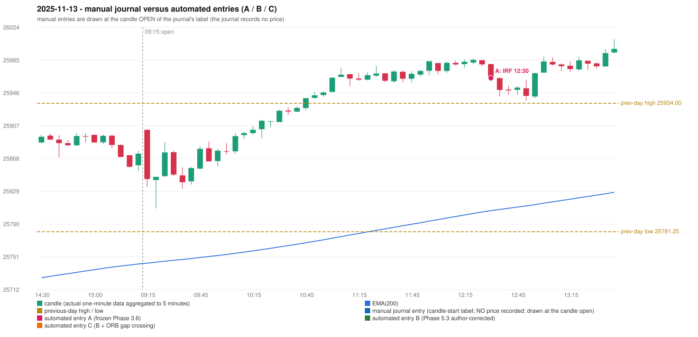

# 2025-11-13 (Thursday) - manual journal versus the automated configurations

> SYNTHETIC index-point P&L; no real option P&L; costs illustrative (Rs 70 per trade + slippage scenarios). Configurations A / B / C are never combined.

## Session

* Open 25902.45; previous official close 25875.8; gap +26.65; previous-day high / low 25934.0 / 25781.25
* First 5-minute candle (09:15-09:20): O25902.45 H25902.45 L25834.6 C25843.95, RED, body 86.2%; EMA(200) at the first candle 25743.97; previous session's last close 25874.0 vs its EMA 25742.96

## Manual journal

no manual trade recorded

## Configuration A

Candidate signals (confirmed): 12:35 IRF/Method 2A SHORT [EXECUTED: trade 1: T1_THEN_BUFFER_STOP]; 13:50 IRF/Method 2B SHORT [IGNORED: DAY_FINISHED]; 14:10 IRF/Method 1 SHORT [IGNORED: DAY_FINISHED]; 14:50 IRF/Method 2B SHORT [IGNORED: DAY_FINISHED]; 14:55 IRF/Method 1 SHORT [IGNORED: DAY_FINISHED]

Strategies with no confirmed signal: ORB: Method 2 INVALIDATED TREND:EMA_PREV_SESSION_CLOSE wrong side | PDR: PDR INVALIDATED OPEN_NOT_STRICTLY_ABOVE_ZONE | PDS: no setup record (the strategy's trigger event never occurred) | RF: no setup record (the strategy's trigger event never occurred)

| trade | strategy / method | dir | signal -> fill | entry | stop / T1 / T2 | leg 1 | leg 2 | outcome | gross Rs | net Rs (70, 0) | net Rs (70, 1.0) |
|---|---|---|---|---|---|---|---|---|---|---|---|
| 1 | IRF/Method 2A | SHORT | 12:35 -> 12:35 | 25963.85 | 25998.85 / 25936.85 / 25903.85 | 12:54 @ 25936.85 | 12:59 @ 25969.85 | T1_THEN_BUFFER_STOP | 4,095 | 4,025 | 3,245 |

Selection: This IRF Method 2A signal was the earliest executable signal of the day: 0 confirmed signal(s) earlier, 0 other in the same minute. 4 later confirmed signal(s) (IRF x4) are logged as ignored or rejected. State of the other four engines at that moment: [ORB: Method 2 invalidated at 09:15: TREND:EMA_PREV_SESSION_CLOSE wrong side] [PDR: PDR invalidated at 09:15: OPEN_NOT_STRICTLY_ABOVE_ZONE] [PDS: no setup record before this time (a base condition was not met, or nothing triggered)] [RF: no setup record before this time (a base condition was not met, or nothing triggered)]

* Automated IRF 12:30 has no strict / time-tolerant journal counterpart: UNRESOLVED_DISCRETIONARY_SELECTION - the journal records no trade this day; the automated system took IRF Method 2A SHORT (candle 12:30) mechanically

## Configuration B

Candidate signals (confirmed): 14:05 IRF/Method 2A SHORT [REJECTED: ENTRY_CUTOFF_EXCEEDED(fill 14:05 IST > 13:00)]; 14:05 IRF/Method 2B SHORT [REJECTED: ENTRY_CUTOFF_EXCEEDED(fill 14:05 IST > 13:00)]; 14:10 IRF/Method 1 SHORT [REJECTED: ENTRY_CUTOFF_EXCEEDED(fill 14:10 IST > 13:00)]; 14:40 IRF/Method 2A SHORT [REJECTED: ENTRY_CUTOFF_EXCEEDED(fill 14:40 IST > 13:00)]; 14:55 IRF/Method 1 SHORT [REJECTED: ENTRY_CUTOFF_EXCEEDED(fill 14:55 IST > 13:00)]; 14:55 IRF/Method 2A SHORT [REJECTED: ENTRY_CUTOFF_EXCEEDED(fill 14:55 IST > 13:00)]

Strategies with no confirmed signal: ORB: Method 2 INVALIDATED TREND:EMA_PREV_SESSION_CLOSE wrong side | PDR: PDR INVALIDATED OPEN_NOT_STRICTLY_ABOVE_ZONE | PDS: no setup record (the strategy's trigger event never occurred) | RF: no setup record (the strategy's trigger event never occurred)

No trade: final day state READY_FOR_FIRST_TRADE. Signals existed but none became a trade (see the dispositions above).

## Configuration C

Candidate signals (confirmed): 14:05 IRF/Method 2A SHORT [REJECTED: ENTRY_CUTOFF_EXCEEDED(fill 14:05 IST > 13:00)]; 14:05 IRF/Method 2B SHORT [REJECTED: ENTRY_CUTOFF_EXCEEDED(fill 14:05 IST > 13:00)]; 14:10 IRF/Method 1 SHORT [REJECTED: ENTRY_CUTOFF_EXCEEDED(fill 14:10 IST > 13:00)]; 14:40 IRF/Method 2A SHORT [REJECTED: ENTRY_CUTOFF_EXCEEDED(fill 14:40 IST > 13:00)]; 14:55 IRF/Method 1 SHORT [REJECTED: ENTRY_CUTOFF_EXCEEDED(fill 14:55 IST > 13:00)]; 14:55 IRF/Method 2A SHORT [REJECTED: ENTRY_CUTOFF_EXCEEDED(fill 14:55 IST > 13:00)]

Strategies with no confirmed signal: ORB: Method 2 INVALIDATED TREND:EMA_PREV_SESSION_CLOSE wrong side | PDR: PDR INVALIDATED OPEN_NOT_STRICTLY_ABOVE_ZONE | PDS: no setup record (the strategy's trigger event never occurred) | RF: no setup record (the strategy's trigger event never occurred)

No trade: final day state READY_FOR_FIRST_TRADE. Signals existed but none became a trade (see the dispositions above).

## Handwritten author corrections for this date

* AC20 (page 4): "First red candle only should be considered." - status A / B / C: IRF_TRADE_UNCHANGED / IRF_TRADE_CHANGED / IRF_TRADE_CHANGED

## Chart

