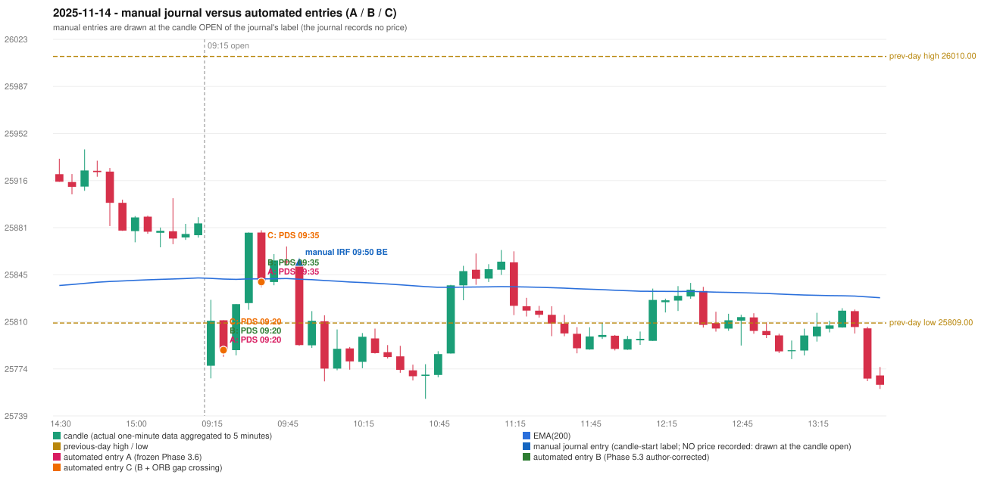

# 2025-11-14 (Friday) - manual journal versus the automated configurations

> SYNTHETIC index-point P&L; no real option P&L; costs illustrative (Rs 70 per trade + slippage scenarios). Configurations A / B / C are never combined.

## Session

* Open 25776.85; previous official close 25879.15; gap -102.30; previous-day high / low 26010.0 / 25809.0
* First 5-minute candle (09:15-09:20): O25776.85 H25826.45 L25767.3 C25810.7, GREEN, body 57.2%; EMA(200) at the first candle 25842.66; previous session's last close 25884.1 vs its EMA 25842.98

## Manual journal

row 36: IRF labelled 09:50, outcome BE

## Configuration A

Candidate signals (confirmed): 09:25 PDS/Method 1 SHORT [EXECUTED: trade 1: INITIAL_FULL_STOP]; 09:40 PDS/Method 1 SHORT [EXECUTED: trade 2: TARGET]; 09:55 IRF/Method 1 SHORT [IGNORED: POSITION_ACTIVE (signal kept for diagnostics only; never reused)]; 09:55 PDS/Method 1 SHORT [IGNORED: POSITION_ACTIVE (signal kept for diagnostics only; never reused)]; 10:05 PDS/Method 1 SHORT [IGNORED: DAY_FINISHED]; 11:20 IRF/Method 1 SHORT [IGNORED: DAY_FINISHED]; 12:35 IRF/Method 1 SHORT [IGNORED: DAY_FINISHED]; 13:05 IRF/Method 2A SHORT [IGNORED: DAY_FINISHED]; 13:05 PDS/Method 3 SHORT [IGNORED: DAY_FINISHED]

Strategies with no confirmed signal: ORB: Gap/200DMA INVALIDATED CANDLE_QUALITY_OR_REJECTION_WICK; Method 2 INVALIDATED TREND:EMA_PREV_SESSION_CLOSE wrong side | PDR: no setup record (the strategy's trigger event never occurred) | RF: RF INVALIDATED GAP_NOT_UP(DOWN)

| trade | strategy / method | dir | signal -> fill | entry | stop / T1 / T2 | leg 1 | leg 2 | outcome | gross Rs | net Rs (70, 0) | net Rs (70, 1.0) |
|---|---|---|---|---|---|---|---|---|---|---|---|
| 1 | PDS/Method 1 | SHORT | 09:25 -> 09:25 | 25788.55 | 25823.55 / 25761.55 / 25718.55 | 09:30 @ 25824.0 | 09:30 @ 25824.0 | INITIAL_FULL_STOP | -13,826 | -13,896 | -14,676 |
| 2 | PDS/Method 1 | SHORT | 09:40 -> 09:40 | 25839.95 | 25874.95 / 25812.95 / 25769.95 | 09:52 @ 25812.95 | 10:03 @ 25769.95 | TARGET | 18,915 | 18,845 | 18,065 |

Selection: This PDS Method 1 signal was the earliest executable signal of the day: 0 confirmed signal(s) earlier, 0 other in the same minute. 8 later confirmed signal(s) (IRF x4, PDS x4) are logged as ignored or rejected. State of the other four engines at that moment: [IRF: no setup record before this time (a base condition was not met, or nothing triggered)] [ORB: Method 2 invalidated at 09:15: TREND:EMA_PREV_SESSION_CLOSE wrong side; Gap/200DMA invalidated at 09:15: CANDLE_QUALITY_OR_REJECTION_WICK] [PDR: no setup record before this time (a base condition was not met, or nothing triggered)] [RF: no setup record before this time (a base condition was not met, or nothing triggered)]

* Journal row 36 (IRF 09:50): **UNMATCHED_MANUAL**; earliest cause DIFFERENT_STRATEGY_SELECTED (+ PORTFOLIO_CONTROLLER_CONSTRAINT): the controller took PDS Method 1 (signal 09:25) first; the IRF signal at 09:55 was IGNORED: POSITION_ACTIVE (signal kept for diagnostics only; never reused)
* Automated PDS 09:20 has no strict / time-tolerant journal counterpart: DIFFERENT_STRATEGY_SELECTED - the journal traded IRF 09:50; the automated controller took PDS Method 1 (candle 09:20) as the first valid signal
* Automated PDS 09:35 has no strict / time-tolerant journal counterpart: PORTFOLIO_CONTROLLER_CONSTRAINT - second trade of the day: the controller allows a PDR / PDS re-entry after the original full stop of trade 1 (PDS Method 1, signal candle 09:20); the journal rows of the day not matched to another trade: IRF 09:50

## Configuration B

Candidate signals (confirmed): 09:25 PDS/Method 1 SHORT [EXECUTED: trade 1: INITIAL_FULL_STOP]; 09:40 PDS/Method 1 SHORT [EXECUTED: trade 2: TARGET]; 09:55 PDS/Method 1 SHORT [IGNORED: POSITION_ACTIVE (signal kept for diagnostics only; never reused)]; 10:05 PDS/Method 1 SHORT [IGNORED: DAY_FINISHED]; 10:10 IRF/Method 2A SHORT [IGNORED: DAY_FINISHED]; 11:05 PDS/Method 2 SHORT [IGNORED: DAY_FINISHED]; 11:20 PDS/Method 1 SHORT [IGNORED: DAY_FINISHED]; 11:25 PDS/Method 2 SHORT [IGNORED: DAY_FINISHED]; 11:30 PDS/Method 2 SHORT [IGNORED: DAY_FINISHED]; 11:45 IRF/Method 2A SHORT [IGNORED: DAY_FINISHED]; 11:45 IRF/Method 2B SHORT [IGNORED: DAY_FINISHED]; 13:05 IRF/Method 2A SHORT [IGNORED: DAY_FINISHED]; 13:05 PDS/Method 3 SHORT [IGNORED: DAY_FINISHED]; 13:35 PDS/Method 1 SHORT [IGNORED: DAY_FINISHED]

Strategies with no confirmed signal: ORB: Gap/200DMA INVALIDATED CANDLE_QUALITY_OR_REJECTION_WICK; Method 2 INVALIDATED TREND:EMA_PREV_SESSION_CLOSE wrong side | PDR: no setup record (the strategy's trigger event never occurred) | RF: RF INVALIDATED GAP_NOT_UP(DOWN)

| trade | strategy / method | dir | signal -> fill | entry | stop / T1 / T2 | leg 1 | leg 2 | outcome | gross Rs | net Rs (70, 0) | net Rs (70, 1.0) |
|---|---|---|---|---|---|---|---|---|---|---|---|
| 1 | PDS/Method 1 | SHORT | 09:25 -> 09:25 | 25788.55 | 25823.55 / 25761.55 / 25718.55 | 09:30 @ 25824.0 | 09:30 @ 25824.0 | INITIAL_FULL_STOP | -13,826 | -13,896 | -14,676 |
| 2 | PDS/Method 1 | SHORT | 09:40 -> 09:40 | 25839.95 | 25874.95 / 25812.95 / 25769.95 | 09:52 @ 25812.95 | 10:03 @ 25769.95 | TARGET | 18,915 | 18,845 | 18,065 |

Selection: This PDS Method 1 signal was the earliest executable signal of the day: 0 confirmed signal(s) earlier, 0 other in the same minute. 13 later confirmed signal(s) (IRF x4, PDS x9) are logged as ignored or rejected. State of the other four engines at that moment: [IRF: no setup record before this time (a base condition was not met, or nothing triggered)] [ORB: Method 2 invalidated at 09:15: TREND:EMA_PREV_SESSION_CLOSE wrong side; Gap/200DMA invalidated at 09:15: CANDLE_QUALITY_OR_REJECTION_WICK] [PDR: no setup record before this time (a base condition was not met, or nothing triggered)] [RF: no setup record before this time (a base condition was not met, or nothing triggered)]

* Journal row 36 (IRF 09:50): **UNMATCHED_MANUAL**; earliest cause DIFFERENT_STRATEGY_SELECTED (+ PORTFOLIO_CONTROLLER_CONSTRAINT): the controller took PDS Method 1 (signal 09:25) first; the IRF signal at 10:10 was IGNORED: DAY_FINISHED
* Automated PDS 09:20 has no strict / time-tolerant journal counterpart: DIFFERENT_STRATEGY_SELECTED - the journal traded IRF 09:50; the automated controller took PDS Method 1 (candle 09:20) as the first valid signal
* Automated PDS 09:35 has no strict / time-tolerant journal counterpart: PORTFOLIO_CONTROLLER_CONSTRAINT - second trade of the day: the controller allows a PDR / PDS re-entry after the original full stop of trade 1 (PDS Method 1, signal candle 09:20); the journal rows of the day not matched to another trade: IRF 09:50

## Configuration C

Candidate signals (confirmed): 09:25 PDS/Method 1 SHORT [EXECUTED: trade 1: INITIAL_FULL_STOP]; 09:40 PDS/Method 1 SHORT [EXECUTED: trade 2: TARGET]; 09:55 PDS/Method 1 SHORT [IGNORED: POSITION_ACTIVE (signal kept for diagnostics only; never reused)]; 10:05 PDS/Method 1 SHORT [IGNORED: DAY_FINISHED]; 10:10 IRF/Method 2A SHORT [IGNORED: DAY_FINISHED]; 11:05 PDS/Method 2 SHORT [IGNORED: DAY_FINISHED]; 11:20 PDS/Method 1 SHORT [IGNORED: DAY_FINISHED]; 11:25 PDS/Method 2 SHORT [IGNORED: DAY_FINISHED]; 11:30 PDS/Method 2 SHORT [IGNORED: DAY_FINISHED]; 11:45 IRF/Method 2A SHORT [IGNORED: DAY_FINISHED]; 11:45 IRF/Method 2B SHORT [IGNORED: DAY_FINISHED]; 13:05 IRF/Method 2A SHORT [IGNORED: DAY_FINISHED]; 13:05 PDS/Method 3 SHORT [IGNORED: DAY_FINISHED]; 13:35 PDS/Method 1 SHORT [IGNORED: DAY_FINISHED]

Strategies with no confirmed signal: ORB: Gap/200DMA INVALIDATED CANDLE_QUALITY_OR_REJECTION_WICK; Method 2 INVALIDATED TREND:EMA_PREV_SESSION_CLOSE wrong side | PDR: no setup record (the strategy's trigger event never occurred) | RF: RF INVALIDATED GAP_NOT_UP(DOWN)

| trade | strategy / method | dir | signal -> fill | entry | stop / T1 / T2 | leg 1 | leg 2 | outcome | gross Rs | net Rs (70, 0) | net Rs (70, 1.0) |
|---|---|---|---|---|---|---|---|---|---|---|---|
| 1 | PDS/Method 1 | SHORT | 09:25 -> 09:25 | 25788.55 | 25823.55 / 25761.55 / 25718.55 | 09:30 @ 25824.0 | 09:30 @ 25824.0 | INITIAL_FULL_STOP | -13,826 | -13,896 | -14,676 |
| 2 | PDS/Method 1 | SHORT | 09:40 -> 09:40 | 25839.95 | 25874.95 / 25812.95 / 25769.95 | 09:52 @ 25812.95 | 10:03 @ 25769.95 | TARGET | 18,915 | 18,845 | 18,065 |

Selection: This PDS Method 1 signal was the earliest executable signal of the day: 0 confirmed signal(s) earlier, 0 other in the same minute. 13 later confirmed signal(s) (IRF x4, PDS x9) are logged as ignored or rejected. State of the other four engines at that moment: [IRF: no setup record before this time (a base condition was not met, or nothing triggered)] [ORB: Method 2 invalidated at 09:15: TREND:EMA_PREV_SESSION_CLOSE wrong side; Gap/200DMA invalidated at 09:15: CANDLE_QUALITY_OR_REJECTION_WICK] [PDR: no setup record before this time (a base condition was not met, or nothing triggered)] [RF: no setup record before this time (a base condition was not met, or nothing triggered)]

* Journal row 36 (IRF 09:50): **UNMATCHED_MANUAL**; earliest cause DIFFERENT_STRATEGY_SELECTED (+ PORTFOLIO_CONTROLLER_CONSTRAINT): the controller took PDS Method 1 (signal 09:25) first; the IRF signal at 10:10 was IGNORED: DAY_FINISHED
* Automated PDS 09:20 has no strict / time-tolerant journal counterpart: DIFFERENT_STRATEGY_SELECTED - the journal traded IRF 09:50; the automated controller took PDS Method 1 (candle 09:20) as the first valid signal
* Automated PDS 09:35 has no strict / time-tolerant journal counterpart: PORTFOLIO_CONTROLLER_CONSTRAINT - second trade of the day: the controller allows a PDR / PDS re-entry after the original full stop of trade 1 (PDS Method 1, signal candle 09:20); the journal rows of the day not matched to another trade: IRF 09:50

## Handwritten author corrections for this date

* AC21 (page 4): "The IRF should be activated instead of PDS. | PDS criteria is not satisfying." - status A / B / C: NOT_ADDRESSED_BY_THE_CONFIGURATIONS / NOT_ADDRESSED_BY_THE_CONFIGURATIONS / NOT_ADDRESSED_BY_THE_CONFIGURATIONS
* AC22 (page 4): "IRF should activate. | Same day 2nd trade, ig it's glitch." - status A / B / C: NOT_ADDRESSED_BY_THE_CONFIGURATIONS / NOT_ADDRESSED_BY_THE_CONFIGURATIONS / NOT_ADDRESSED_BY_THE_CONFIGURATIONS

## Chart

